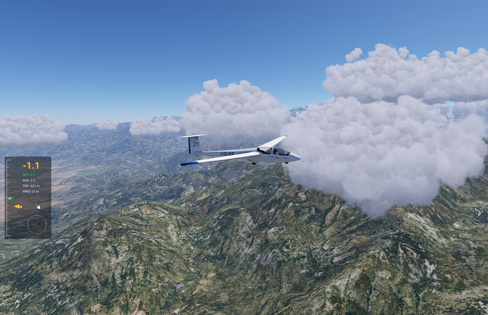

# xp-gliding

A thermal soaring plugin for X-Plane 12: thermals you can find by reading the clouds and climb in by hand.

It is an independent take on thermals, offered as another option for soaring in X-Plane 12. The weather, the wind, the ridge lift and the flight model stay X-Plane's, and the plugin brings thermals tied to clouds of their own.

> **Version 0.1, an alpha.** It flies, and its limits are stated. Download it from the [releases page](https://github.com/jlgabriel/xp-gliding/releases) and follow the [pilot guide](docs/pilot-guide.md) to install it: it needs only X-Plane 12 and [XPPython3](https://xppython3.readthedocs.io/).

## What it does today

- **Thermals** with a life cycle: they grow, peak and fade, and never vanish abruptly. The same seed, date and place give the same sky.
- **Cumulus** drawn by the plugin over the thermals that carry one. Each forms and fades with its thermal, so a cloud means something. Clouds keep to a level for the area, and stand higher where the ground under them and along their drift would reach them.
- **Lift that ends with its cloud,** over any ground, rather than following the ground under the glider. No thermal is born over water.
- **Lift with no per-aircraft calibration.** It is applied as the energy rising air would give the glider, and measured within 0.01 m/s of the intended climb at different speeds, banks and frame rates. The reference glider is the Laminar ASK 21. Other gliders get the lift, and no netto on the HUD.
- **Thermals and clouds that follow the wind.** The wind is X-Plane's, real or set by hand: the plugin reads it and has no wind of its own.
- **A soaring HUD:** total energy, netto, average climb, height up to the clouds, the wind and a centring aid.
- **A menu** in *Plugins → xp-gliding* to choose the sky and the day, saved between sessions.
- **Optional training markers** showing where the thermals are.

## Where it is going

The work is in three stages. The first is this public alpha of what flies today. The second brings strength and cloud base from X-Plane's weather with a daily cycle, a sky tuned with what pilots report, and a better HUD and clouds. The third holds pieces that are not promised, such as XCSoar, other gliders, and thermals born where global land data says they would be. The details are in the [stages](notes/SPEC.md#stages).

## Documentation

- **[Documentation](docs/README.md):** start here, including [measurements of X-Plane's native soaring](docs/findings/native-soaring.md).
- **[Pilot guide](docs/pilot-guide.md):** installing, a first flight, reading the sky, and the known limits.
- **[Working notes](notes/README.md):** the full records of the work, with the current design and [stages](notes/SPEC.md#stages).

## What it is not

It is not a simulation of the atmosphere. The thermals start from a published model ([Allen, 2006](https://ntrs.nasa.gov/citations/20060004052)) and are tuned by flying, with each departure from the paper documented. It is not a soaring simulator either: no tasks, no traffic, no wave. Condor's soaring is the inspiration, not the target, and a glider still flies as well as its own flight model allows.

## Principles

1. **The sky must be readable.** What you see tells you where the lift is.
2. **Native first, apart from the thermals.** The thermals are this project's own proposal. Beyond them, what X-Plane does well is left alone, and that is decided with measurements.
3. **The flight decides.** Papers give the first numbers, and a number stays only if it flies well by hand.

## How it is built

- **Atmospheric engine:** pure Python, deterministic, independent of X-Plane, tested and plotted outside the simulator.
- **X-Plane adapter:** an [XPPython3](https://xppython3.readthedocs.io/) plugin that applies the lift as forces and draws the clouds, markers and HUD.

## Acknowledgements

Inspired by Alex Ferrer's [xplane_thermals](https://github.com/alexferrer/xplane_thermals), which proved that thermal soaring in X-Plane 12 through a plugin is possible.

## License

[GPL-3.0-or-later](LICENSE).
