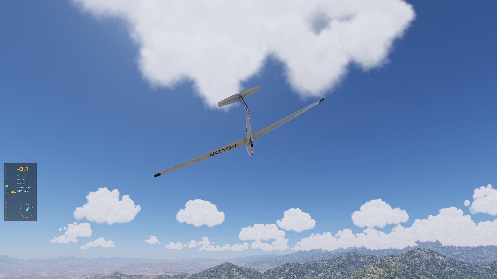

# XP-Gliding

A thermal soaring plugin for X-Plane 12: thermals you can find by reading the clouds and climb in by hand.

It is an independent take on thermals, offered as another option for soaring in X-Plane 12. The weather, the wind, the ridge lift and the flight model stay X-Plane's, and the plugin brings thermals tied to clouds of their own.

> **Version 2.0.** Its limits are stated in the guide. Download it from the [releases page](https://github.com/jlgabriel/xp-gliding/releases) and follow the [pilot guide](docs/pilot-guide.md) to install it: it needs only X-Plane 12 and [XPPython3](https://xppython3.readthedocs.io/).

## What it does today

- **Thermals** with a life cycle: they grow, peak and fade, and never vanish abruptly. In calm air, the same seed, date, place and time give the same sky.
- **A daily cycle.** The thermals follow the sun: weak and low in the morning, strongest in the early afternoon, gone around sunset. The early morning is blue, and the first cumulus come late in the morning, low, under a base that rises through the day.
- **Cumulus** drawn by the plugin over the thermals that carry one. Each forms with its thermal, thins as it weakens and lingers a few minutes after it dies, so a cloud means something and an old one can deceive. Clouds keep to a level for the area, and stand higher where the ground under them and along their drift would reach them.
- **Good and bad areas.** Over tens of kilometres the thermals are more numerous and stronger in some areas, under more and bigger clouds, and fewer and weaker in others, so choosing where to fly by the look of the sky pays. Each date has its own map. Off by default, for an easier start.
- **Less lift under X-Plane's clouds,** by how much of the sky its layers cover and how thick they are, and none in rain.
- **Lift that ends with its cloud,** over any ground, rather than following the ground under the glider. No thermal is born over water.
- **Lift with no per-aircraft calibration.** It is applied as the energy rising air would give the glider, and measured within 0.01 m/s of the intended climb at different speeds, banks and frame rates. The reference glider is the Laminar ASK 21. Other gliders get the lift, and no netto on the HUD. A motor glider gets it once treated as a glider from the menu.
- **Thermals and clouds that follow the wind.** The wind is X-Plane's, real or set by hand: the plugin reads it and has no wind of its own.
- **A soaring HUD:** total energy, netto, average climb, height up to the clouds, the wind and a centring aid.
- **A Flight Computer,** in place of the HUD if you prefer: a window with a topographic map of the track flown coloured by height, the HUD's readings larger, and SeeYou CUP tasks to fly, with the point you are flying to, its bearing and distance. It needs X-Plane 12.4.4 and XPPython3 4.8.0 or later.
- **A menu** in *Plugins → XP-Gliding* to choose the day, by name (easy, typical, demanding, weak and low, or blue, with no clouds to read) or one setting at a time, saved between sessions. As an experiment, the cloud base can come from X-Plane's weather instead.
- **A hotspot flight:** a file of hotspots from [thermal.kk7.ch](https://thermal.kk7.ch/) in place of the plugin's own sky, so the thermals are where pilots find them at that site, and nowhere else.
- **Put me near a cloud:** from the menu, the glider starts flying towards a cloud, with no tow.
- **Optional training markers** showing where the thermals are.

## Where it is going

Next, a sky tuned further by flying it: how much sink belongs between clouds, where a climb ends under its cloud, the clouds' width on deep and shallow days, the strength of the day from X-Plane's weather, and a better HUD. Later, and not promised: thermals lined up in streets along the wind, thermals born where the ground favours them, measured polars so other gliders get netto, and the same sky for two pilots at the same place and time. Tools around soaring beyond the Flight Computer, such as a link to XCSoar, task scoring or other gliders in the sky, are outside this project. What changed in each version is in the [changelog](CHANGELOG.md).

## Documentation

- **[Documentation](docs/README.md):** start here, including [measurements of X-Plane's native soaring](docs/findings/native-soaring.md).
- **[Pilot guide](docs/pilot-guide.md):** installing, a first flight, reading the sky, and the known limits.
- **[How it works](docs/how-it-works.md):** the thermal model, the day, the clouds, the wind and how the lift is applied.

## What it is not

It is not a simulation of the atmosphere. The thermals start from a published model ([Allen, 2006](https://ntrs.nasa.gov/citations/20060004052)) and are tuned by flying, with each departure from the paper [documented](docs/how-it-works.md#the-shape-of-a-thermal). It is not a soaring simulator either: tasks are shown and followed but not scored, and there is no traffic and no wave. A glider still flies as well as its own flight model allows.

## Principles

1. **The sky must be readable.** What you see tells you where the lift is.
2. **Native first, apart from the thermals.** The thermals are this project's own proposal. Beyond them, what X-Plane does well is left alone, and that is decided with measurements.
3. **The flight decides.** Papers give the first numbers, and a number stays only if it flies well by hand.

## How it is built

- **Atmospheric engine:** pure Python, deterministic, independent of X-Plane, tested and plotted outside the simulator.
- **X-Plane adapter:** an [XPPython3](https://xppython3.readthedocs.io/) plugin that applies the lift as forces and draws the clouds, markers and HUD.

## Dedication

To the Vitacura aerodrome (SCLC), in Santiago, Chile, and its glider pilots.

## Acknowledgements

Inspired by Alex Ferrer's [xplane_thermals](https://github.com/alexferrer/xplane_thermals), which proved that thermal soaring in X-Plane 12 through a plugin is possible.

The Flight Computer's map is drawn with [Leaflet](https://leafletjs.com/) (BSD-2-Clause, included with its licence in `xp_gliding/web/vendor/leaflet/`). Its tiles are not part of the plugin: by default they come from [OpenTopoMap](https://opentopomap.org/) (map style CC-BY-SA), drawn from [OpenStreetMap](https://www.openstreetmap.org/copyright) data (© OpenStreetMap contributors, ODbL) and SRTM elevation data.

## License

[GPL-3.0-or-later](LICENSE).
