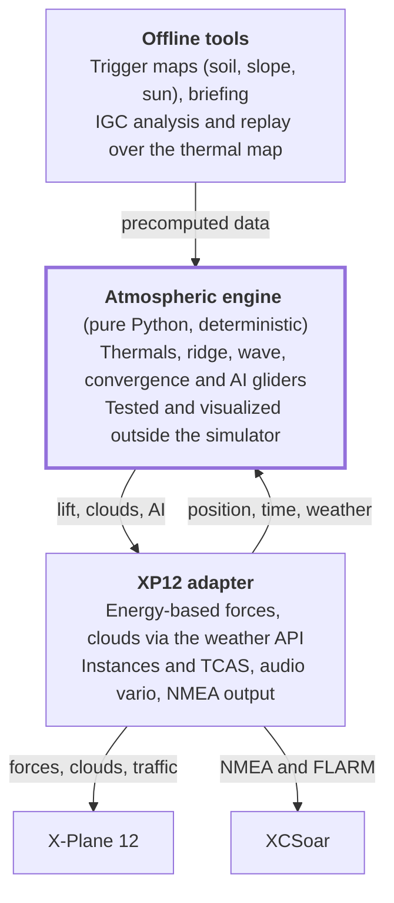
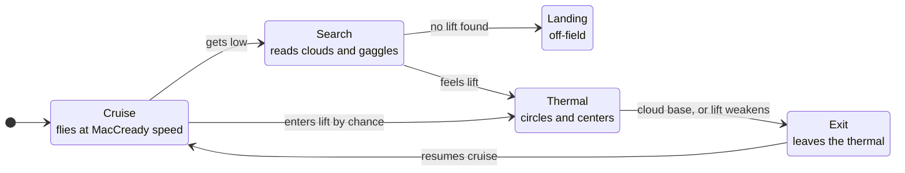

# xp-gliding — Soaring in X-Plane 12: Specification

Started 2026-11-02 · Juan Luis Gabriel

## How to use this document

This is the reference specification for building, with Claude Code, a soaring layer for X-Plane 12 that brings it closer to the Condor 3 experience. It gathers everything discussed so far: the diagnosis of the existing plugin, new ideas, architecture decisions and open questions.

- **Source of truth:** this file (`docs/SPEC.md`) is the single source of truth and is referenced from `CLAUDE.md`. For any design question, this document rules; if something contradicts what is observed in the simulator, the observation wins and this document is updated.
- **Keep it current:** after each phase, come back here and record what was resolved or changed, so the document never falls behind the code.
- **Certainty level:** items marked *verify* are reasonable assumptions that have not been confirmed by tests or documentation. Do not treat them as facts.
- **Scope:** racing and competition are excluded for now. They are still recorded in the out-of-scope section so the ideas are not lost.
- **Language:** everything in the repository is written in English. The original Spanish draft of this document is no longer maintained.

## Vision and guiding principle

The goal is to turn X-Plane 12 into a Condor 3–style soaring simulator, leaving racing aside for now. The starting point is Alex Ferrer's [xplane_thermals](https://github.com/alexferrer/xplane_thermals) plugin.

**Guiding principle: the air must be coherent.** What makes Condor feel like Condor is not the graphics or the flight model, but that clouds, terrain, sun, wind and time of day all tell the same story, and the glider flies inside that air mass. If we achieve that in XP12, everything else is an add-on.

Practical consequences of this principle:

- There is a single atmosphere, and it is XP12's. Our model refines it and never contradicts it: wind, temperature, cloud base and clouds come from XP12, and every source of lift we add (thermal, wave, convergence) is derived from that air, never from isolated effects.
- What you see (cumulus, circling gliders, dust) must be a consequence of the model, not independent decoration.
- AI gliders and the player feel exactly the same air at the same point.

**Second principle: native first (complement, do not compete).** XP12's weather is good, and it already models some soaring lift. The project adds to it instead of replacing it (decided 2026-11-02):

- Whatever XP12 does well natively, we use as it is. The plugin only adds what is missing.
- Native effects are better physics than ours: XP12 moves the air itself, so the flight model, and the aircraft's vario, TE and netto, see a real vertical air current. Ours can only be a force on the aircraft (see injection physics). A force is the fallback for what XP12 cannot do, not the default.
- No effect is ever applied twice: each lift source is either native or ours, decided per phenomenon and recorded in [Native soaring in XP12](#native-soaring-in-xp12).
- Decisions about what to keep native are made with measurements (phase 0), not with forum reports.

**Differentiator versus Condor:** Condor only has the regions someone built; XP12 has the whole world. The long-term goal is "Condor anywhere in the world", with thermals that are born where they should be according to the real terrain.

**Use cases:** full-size gliders, starting with the Laminar ASK 21 that ships with XP12 (decided 2026-11-03). RC gliders in X-Plane (RC thermal soaring, with a thermal indicator on an RC HUD) were considered and are out of scope for now.

## Starting point: xplane_thermals

The plugin works in XP12: Juan Luis tested it and it produces usable thermals. Manual per-glider calibration compensates for a good part of the physics problems described in the next section.

**General facts**

| Attribute | Value |
| --- | --- |
| Author | Alex Ferrer, real pilot with ~25 years in gliders, paragliders and ultralights (Texas and Peru) |
| License | `LICENSE` file is GPL-2.0; source headers say only "License: GPL" (no version) |
| Platform | XPPython3 v4 (embedded Python 3), X-Plane 12+ only |
| Activity | Last major update November 2024; last commit July 2025 (`082dd7d`); ~205 commits, 36 stars, 7 forks, 14 open issues |
| Essential files | `PI_ThermalSim.py`, `thermal_model.py`, `world.py` (the rest are helpers or tests) |

**What it already does well**

- Samples several points of the aircraft (left wing, right wing, center, tail) to generate roll torque: a thermal "lifts a wing". The concept is right.
- Strong core with weaker outer layers; drifts with the wind; thermals rise up to cloud base or the top of lift.
- Reduces the roll effect when the aircraft is already banked.
- Solar factor: strength depends on sun elevation, including seasons.
- Random generator with configurable count, size and strength, which avoids placing thermals over water.
- Real clouds at the top of thermals (v0.4).
- Optional visual rings for beginners, with a bindable command (`alexferrer/xplane_thermals/show_thermal_rings`).
- Loading of CSV hotspots from [thermal.kk7.ch](https://thermal.kk7.ch/).
- imgui UI: generate thermals, load KK7, configure glider, statistics window, about.
- Enable or disable the plugin (so it does not affect aircraft that are not gliders).
- Persistent configuration in an .ini file; debug levels 1 to 6 to `XPPython3Log.txt`.
- Calibration mode at 1 m/s to tune the glider.

**The author's own TODOs**

- Thermal cycles: start (small bubble that gets stronger), middle (wider and stronger), end (stops rising when it reaches the base and dies). Duration depends on temperature, humidity and altitude; pilots learn to read the cycle to know when to leave.
- Thermal streets.

**Relevant open issues**

| # | Topic | Relevance |
| --- | --- | --- |
| 34 | Error on load (May 2025) | No details in the issue. Likely cause: `world.py` crashes at import when `init_values.json` is not at `Resources/plugins/PythonPlugins/` (e.g. installed into a subfolder); *verify* in the baseline |
| 32 | Terrain and environment considerations | Terrain triggers |
| 31 | Thermal visibility ON/OFF does not work | UI bug |
| 30 | Menu to enable only the effect, not the plugin | UX |
| 28 | Thermal generation range | Generation |
| 24 | lat/lon to meters swaps x/y (since 2016) | Confirmed geometry bug |
| 16 | Control to adjust refresh rate | Performance |
| 15 | Cloud base marker | Visual |
| 14 | Change the thermal climb-rate constant | Drift |
| 13 | Multiplayer capability | Deterministic seed |
| 11 | Thermal cycles | Life cycle |
| 9 | Test ground-based origin point | Triggers |
| 8 | Thermal trigger point | Triggers |
| 7 | Information screen | Instrumentation |

## Technical diagnosis of the current plugin

The plugin is slow and depends on calibration by design, not because it is written in Python. These are the problems found when reading `PI_ThermalSim.py` and `thermal_model.py`; all of them must be fixed or redesigned in the new project.

**1. Injection physics**

- Converts m/s to force with a fixed constant `METERS_PER_SECOND_TO_NEWTON = 10`, multiplied by a `lift_factor` that has to be hand-calibrated for each glider.
- Adds the same amount as thrust (`faxil_plug_acf`) "so the aircraft does not float without moving forward". This is a symptom that the model is not physical.
- Datarefs used: `sim/flightmodel/forces/fnrml_plug_acf` (lift), `faxil_plug_acf` (thrust), `L_plug_acf` (roll), `M_plug_acf` (pitch). Each value is added to the value read from the same dataref.

**2. Framerate dependence**

- The flight loop runs every fixed 0.01 s (`CALLBACKTIME = .01`), not every frame. The author's comment says it works fine on his fast machine.
- If the `_plug_acf` datarefs are applied per flight-model cycle, the effective force changes with FPS. *Verify* whether X-Plane resets them every frame.

**3. Geometry errors**

- Wing tips are placed at `heading` and `heading + 180`, i.e. along the flight axis instead of perpendicular to it. The tail is at `heading + 90`. Everything looks rotated by 90°, consistent with issue #24 (x/y swap).
  - *Verify* (second reading, 2026-11-02): with X-Plane's local frame (x east, z **south**) and the offsets `(cos h, sin h)` applied to (x, z), the "left" point lands on the aircraft's right side and the "right" point on its left, and the tail lands behind. That would mean the wing labels are swapped (and the roll sign swaps them back), not rotated. Test F in [baseline.md](baseline.md) decides.
- `roll_factor` and `pitch_factor` are each applied twice (in `calc_thermalx` and again in the flight loop), so the moments scale with their square.
- Pitch uses `(_lift_r - _lift_l)`: the difference between wings, not between wings and tail. The tail is computed but not used for pitch.
- Total lift averages 4 samples by dividing by 3: a hidden 33% gain.
- Wing tips use `wing_size * 3`, an empirical tweak to "feel the wing bump".
- `xp.worldToLocal` returns (x, y, z) with y up and z pointing south; mixing sin/cos with those conventions is confusing and must be redone with an explicit coordinate system.

**4. Simplistic thermal model**

- Linear cone profile: `strength × (R − d) / R`. No sink ring.
- Height attenuation (`calc_thermal_band`) is disabled (`tband_factor = 1`).
- Linear solar factor: `(sun_pitch + 10) / 100`, zero below the horizon.
- Only the nearest thermal to each sample point is considered.

**5. Wind drift**

- Uses only the surface wind (`sim/weather/wind_speed_kt[0]`, `wind_direction_degt[0]`).
- Assumes a constant climb of 2.54 m/s (~500 ft/min) to compute rise time.
- Uses MSL altitude instead of AGL: over high terrain the drift error is large.
- Applies drift by shifting the aircraft position the opposite way instead of shifting the thermals.

**6. Thermal generation**

- 200 × 200 grid with random positions; offset of `0.00001°` per meter in both latitude and longitude, without the cos(lat) factor. At 33° latitude the grid is distorted by ~16%.
- Random strength weighted toward high values (30% to 100% of the configured strength) and random radius between 1/5 and the average.
- Avoids water with a terrain probe (`is_wet`).
- KK7 loading uses lat/lon but ignores each hotspot's probability.

**7. Abrupt refresh**

- Every `thermal_refresh_time` minutes the whole map is regenerated: the thermal you are circling in can vanish suddenly.
- No life cycle.

**8. Performance**

- For each of the 4 sample points, every 10 ms, it loops over all thermals calling `xp.worldToLocal` from Python. With 200 thermals that is ~80,000 SDK calls per second.
- Fix: precompute local coordinates (recompute only when the local origin changes) and use a spatial grid.

**9. Code quality**

- Global state in `world.py`.
- Prints `"P "` to the log every cycle while the simulator is paused.
- Many debug prints mixed with the logic.

## Gap between Condor and XP12

Almost everything that defines Condor can be built in XP12 with a plugin; the exception is glider polars, which depend on each aircraft. The second column is what XP12 does natively; see the next section for details and the phase 0 audit that measures it.

| Condor pillar | State in XP12 today | Possible with a plugin? |
| --- | --- | --- |
| Coherent thermals (life cycle, cumulus, drift) | Native setting adds a uniform sink; no thermal found in ~75 km under cumulus (measured 2026-11-03) | Yes, it is the core of the project |
| Ridge | Native: wind × slope under the aircraft, fading with height (measured 2026-11-03) | Use native; add only measured gaps |
| Wave | Not modeled (measured 2026-11-03) | Yes, from XP12's wind and stability over the terrain |
| Convergence | No | Yes |
| Triggers by ground type | No | Yes, with data preprocessed offline |
| Aerotow and winch | Exist natively | *Verify* how well they work |
| TE/netto vario and flight computer | Depends on each aircraft | Yes: own soaring HUD ([hud.md](hud.md)) + XCSoar via NMEA |
| Other gliders in the sky | No | Yes (AI gliders) |
| Weather briefing, IGC, replay | No | Yes |
| Accurate polars | Depends on each aircraft | Partial: can be measured and validated, not corrected |
| Multiplayer | Weak for soaring | Yes, with a shared seed (later) |

## Native soaring in XP12

XP12 already models some soaring lift. Following the native-first principle, this section records what it does, who owns each phenomenon, and what is still unknown. The phase 0 native audit (tests H–J in [baseline.md](baseline.md), flown by the test pilot on 2026-11-03) measured it; the reports it started from are kept below for reference.

**What was measured (2026-11-03, Laminar ASK 21, details in [baseline.md](baseline.md))**

- **Ridge (test H, a Pennsylvania ridge, 12 and 25 kt).** XP12 moves the air with a *local slope model*: the vertical air speed is close to wind × slope of the ground directly under the aircraft, scaled by height above that ground (about 1 near the surface, 0.5 at 500 m AGL, roughly 0 by 1000–1100 m AGL), linear in wind speed, smooth (r ≈ 0.9 between measured lift and wind × slope). Ridge running works: at crest level 600 m out from the face, 25 kt gave +1.4 m/s on average and the ASK 21 climbed. Gaps: no lift band upwind of the foot of the slope or above and ahead of the crest; lee sink is the exact mirror of windward lift (−3.7 m/s at 25 kt behind the crest) with no rotor or turbulence; every bump of the terrain makes its own lift and sink.
- **Thermals (test I, KHOB, cumulus 40%, 500 fpm setting).** No thermal was found in ~75 km of straight flight from 400 m AGL up to just below cloud base, with custom and preset cumulus, although the clouds were drawn. The only measurable effect of the setting is a uniform sink everywhere, about 14% of the setting (−0.35 m/s at 500 fpm, constant to ±0.05 m/s; absent with the setting at 0). `sim/weather/aircraft/thermal_rate_ms` is not a sensor: it repeats the regional setting everywhere. With real weather X-Plane does set a nonzero regional rate (0.62 m/s at KHOB), so the "slider stuck at 0" report did not hold. Still open: one hand-flown check aiming at cloud centers, in case native thermals exist but are too narrow or rare to meet in straight flight.
- **Wave (test J, Sierra Nevada at Bishop, wind from 250° rising from 26 kt at 11000 ft to 50 kt at 25000 ft).** Not modeled: over the Owens Valley, 5–28 km downwind of the crest, the air is still to ±0.02 m/s at crest +600 m and +2000 m; only the local slope effect appears near the crest and lee slopes.

**What was reported before measuring (checked 2026-11-02)**

- **Thermals.** Laminar's [flight model report](https://developer.x-plane.com/article/x-plane-12-flight-model-report/) says thermals are tied to cumulus clouds so gliders can find them, rise to the cloud tops, and fade out below ~100 m AGL. They are switched on in *Customize Weather*. Forum users report that not every cumulus has lift, that thermals are unreliable, and (disputed) that with real weather the thermal slider stays at 0. Nothing is reported about a sink ring, a life cycle, a daily cycle or blue thermals.
- **Ridge.** Laminar calls the ridge model good, and the [manual](https://www.x-plane.com/manuals/desktop/) describes riding a windward slope to 10,000 ft with a 25 kt wind. Juan Luis flew it and it works. Forum reports are mixed: one user measured more than 1300 ft/min in 25 kt, another found only sink on slopes, and one notes that lift depends only on the local slope angle, with no venturi or chimney effect.
- **Wave.** No source confirms that XP12 models lee waves or rotor; an older forum post says it does not.

**Who owns what**

| Phenomenon | Owner | Reason |
| --- | --- | --- |
| Wind, temperature, dew point, clouds, cloud base | XP12 | It is the atmosphere; we read it |
| Ridge lift | **XP12** | Native air motion, measured good close to the face (test H). Gaps the plugin may add, without stacking on native lift: the lift band ahead of the face and above the crest, rotor and turbulence in the lee |
| Thermals | **To be decided in phase 1** (the audit points to A) | Native thermals were not found, and the setting adds a uniform sink; keep it at 0 under our thermals |
| Wave | **Plugin** | Not modeled natively (test J) |
| Convergence, streets | Plugin | Not modeled natively |

**Thermal strategy (decided 2026-11-03: A)**

Thermals are where the project adds the most. There are three ways to combine ours with XP12's:

- **A. Replace.** Set native thermals to zero and apply our own, with the strength of the day and cloud base taken from XP12. Full control: bell profile, sink ring, life cycle, blue thermals, terrain triggers, and AI gliders that share the same air. Cost: the link to XP12's own cumulus is lost unless we draw our own.
- **B. Anchor to XP12's clouds.** Keep XP12's cumulus as the truth and place our thermals under them. The most coherent option, but only possible if a plugin can learn where XP12 draws each cumulus, which the SDK probably does not expose (*verify*).
- **C. Modulate native thermals.** Only drive the regional `sim/weather/region/thermal_rate_ms` (for example with a daily cycle). Minimal work, but it adds no structure (profile, sink ring, life cycle).

Consequence for AI gliders: our AI cannot know where native lift is, because the SDK reports it only per region (`sim/weather/aircraft/thermal_rate_ms` turned out to repeat the regional setting, not the lift at the aircraft). With native thermals (B or C) the AI could not circle in them and the gaggle would stop being a reliable indicator. The same applies to native ridge: AI gliders that ridge-soar need an approximate ridge model of ours that matches what native ridge gives the player. This argues for A for thermals, but the decision is made with the audit's data. **Audit result (test I, 2026-11-03):** native thermals were not found at all, and turning them on only adds a uniform sink of ~14% of the setting, so C has nothing to modulate and B has nothing to anchor to; the data point to A, with the native setting at 0.

## XP12 SDK capabilities and limits

The most important technical limit: XP12 does not allow injecting vertical air motion at specific points, so local lift will still be applied as a force on the aircraft.

**Weather API (XPLMWeather)**

- Reading available since X-Plane 12.04; writing since 12.3.0. ([XPPython3](https://xppython3.readthedocs.io/en/beta/development/modules/weather.html))
- `getWeatherAtLocation` only works within the nearby region (~50 nm of good accuracy) and is not meant to be called every frame. ([Laminar](https://developer.x-plane.com/sdk/XPLMWeather))
- Returns 13 wind layers by height, temperature and dew point per layer, up to 3 cloud layers (type, coverage, base, top) and a `thermal_climb` field (climb rate due to thermals, m/s).
- What a plugin writes with `setWeatherAtLocation` is added as one more sample to the simulated weather; `setWeatherAtAirport` replaces that airport's records. `eraseWeatherAtLocation` erases what the plugin itself injected. ([Laminar](https://developer.x-plane.com/sdk/XPLMSetWeatherAtAirport))
- When writing clouds there is no way to say "keep the clouds as they are": the layers must be re-sent.
- Uses in the project: **read** layered wind, temperature and dew point (cloud base, drift, strength of the day); **write** as little as possible (native first), for example cumulus coverage if our thermals need it; **neutralize** native thermals (`thermal_climb` set to zero) only if the thermal strategy is A. *Verify* how XP12's native thermals behave today (test I).
- Native thermal datarefs in XP 12.4.3 (`DataRefs.txt`): `sim/weather/region/thermal_rate_ms` (writable, regional climb rate) and `sim/weather/aircraft/thermal_rate_ms` (read-only, what the aircraft experiences). The old `sim/weather/thermal_rate_ms` is marked as replaced.

**Relationship with XP12's native weather**

The plugin works *on top of* the native weather, never instead of it. Whether the user flies real weather or sets it manually, XP12 stays in charge of the large scale.

| Element | Who owns it | What the plugin does |
| --- | --- | --- |
| Wind by layer, temperature, dew point, pressure, visibility | XP12 (real or manual weather) | Reads it as input: cloud base, thermal top, drift, strength of the day |
| Frontal and layered clouds, rain | XP12 | Reads coverage for cloud shadow; does not touch them |
| Native thermals | XP12 | Depends on the thermal strategy: with A, sets them to zero while active and restores them when disabled; with B or C, keeps or modulates them |
| Ridge lift | XP12 | Uses it as is; adds only measured gaps |
| Local lift we add (thermal, wave, convergence) | Plugin | Applied as forces on the aircraft |
| Cumulus marking each thermal | Plugin | Drawn by the plugin (method to be decided in phase 2) |

- Everything the plugin writes must be undone when it is disabled or X-Plane closes (`eraseWeatherAtLocation`, restore the native thermal rate). Never use `endWeatherUpdate(isIncremental=0)`, which wipes everyone's injected weather.
- The weather API works per region (tens of nautical miles), so it can tint the day (cumulus coverage, temperature profile), but it cannot place one specific cloud on top of one specific thermal. That is why per-thermal cumulus will probably be drawn objects, not weather.
- *Verify* coexistence with third-party weather injectors, which may overwrite what the plugin writes.

**Forces on the aircraft**

- `sim/flightmodel/forces/*_plug_acf` datarefs for additional forces and moments. This is the path for local lift.

**Traffic and AI aircraft**

- `XPLMAcquirePlanes` gives exclusive access to AI aircraft; only one plugin can hold them at a time (typical conflict with LiveTraffic, xPilot or other injectors). Design to release control gracefully and retry with the availability callback. ([Laminar](https://developer.x-plane.com/sdk/XPLMAcquirePlanes/))
- Disabling AI on an aircraft keeps it drawn and a real aircraft in X-Plane, but it no longer moves by itself. ([XPPython3](https://xppython3.readthedocs.io/en/latest/development/modules/planes.html))
- TCAS override (`sim/operation/override/override_TCAS`): the official way to report traffic to X-Plane and other plugins, up to 63 targets, works even if the user has 0 AI aircraft. With Vulkan/Metal the old "TCAS hack" no longer works. ([Laminar](https://developer.x-plane.com/article/overriding-tcas-and-providing-traffic-information/))
- Since X-Plane 12.4.1, traffic injected by plugins also generates TCAS advisories and resolutions. ([Laminar](https://developer.x-plane.com/?p=41277))
- Instance API (XPLMInstance) to draw custom .obj models efficiently.

**Three ways to "control" other aircraft**

| Approach | How it works | Difficulty | Use in the project |
| --- | --- | --- | --- |
| Kinematic puppets | The plugin computes the trajectory and sets the position every frame | Low to medium; the hard part is making it look believable | **Chosen** for AI gliders |
| Native X-Plane AI | Real physics, interacts with ATC, but decides its own routes | Low to use as is, high to steer | Discarded: does not accept orders like "circle here" |
| Real physics + virtual pilot | Full flight model and PID controllers moving the controls | High: per-aircraft tuning | Discarded for now |

**Other**

- Aerotow and winch exist natively in X-Plane. *Verify* their quality in XP12.

**XPPython3 (platform facts, from its documentation, checked 2026-11-02)**

- Stable version 4.7.1 (July 2026), beta 4.8.0b2; requires X-Plane 12.00+. It is actively maintained, but there is no public source repository; the [documentation](https://xppython3.readthedocs.io/en/latest/) is the reference.
- Ships its own private **Python 3.12** (system Python is irrelevant). Bundles imgui, OpenGL and requests, and since v4.4 it auto-installs **numpy**, Pillow and freetype. Other packages install through its "Pip Package Installer" menu or `xp_pip`. ([pip](https://xppython3.readthedocs.io/en/latest/usage/pip.html), [xp_pip](https://xppython3.readthedocs.io/en/latest/development/modules/xp_pip.html))
- Plugin layout: one `PI_xp_gliding.py` in `Resources/plugins/PythonPlugins/` plus a same-named package folder `xp_gliding/`, imported relatively; avoid generic top-level module names because all Python plugins share one interpreter. ([import](https://xppython3.readthedocs.io/en/latest/development/import.html), [deployment](https://xppython3.readthedocs.io/en/latest/development/deployment.html))
- "Reload scripts" exists but the docs call it unreliable: submodules are not reloaded automatically, modules with native libraries (numpy) may crash on reload, and reloading after using imgui crashes the simulator. Fast iteration must therefore happen in the engine **outside** the simulator; in-sim reload is a convenience, not the workflow. ([runtime menus](https://xppython3.readthedocs.io/en/latest/usage/runtime_menus.html))
- Flight loops: `xp.createFlightLoop(callback, phase)` + `xp.scheduleFlightLoop`; phase `BeforeFlightModel` is the normal case; returning `-1` runs every frame. All SDK calls must happen on the main thread. ([processing](https://xppython3.readthedocs.io/en/latest/development/modules/processing.html))
- Datarefs: look them up once and cache the handle; reads and writes are cheap; a wrong type silently returns 0. ([data access](https://xppython3.readthedocs.io/en/latest/development/modules/dataaccess.html))
- Objects: `xp.loadObject` blocks the frame (measured: ~5 ms per small object), so use `xp.loadObjectAsync` from the flight loop. Instancing calls cost a few µs each. ([instance](https://xppython3.readthedocs.io/en/latest/development/modules/instance.html), [phase2.md](phase2.md))
- A Performance window shows microseconds per frame per plugin; it is the tool for the per-frame budget. ([performance](https://xppython3.readthedocs.io/en/latest/usage/performance.html))
- Weather writes must be batched inside `beginWeatherUpdate()` / `endWeatherUpdate()`; `isIncremental=0` wipes everyone's injected weather; `radius_nm` and `max_altitude_msl_ft` come back as 0 from a read and must be set explicitly. ([weather](https://xppython3.readthedocs.io/en/latest/development/modules/weather.html))
- Testing: the official `xp` stubs are type hints only, not executable. No official mock exists, which reinforces the rule that the engine never imports `xp`. ([stubs](https://xppython3.readthedocs.io/en/latest/development/stubs.html))
- Third-party projects worth a look later: [xppython3-headless-dev](https://github.com/stu-speed/xppython3-headless-dev) (sim-less runner, new and unproven) and [xppython3-atmos](https://github.com/stu-speed/xppython3-atmos) (see below).
- **xppython3-atmos (reviewed 2026-11-02):** a design-only repository, with Markdown specs and no code. It was created on 2026-07-01 and last pushed on 2026-07-02, has 0 stars, and is licensed AGPL-3.0. It plans a whole-weather engine (visibility, haze, fog, precipitation, synoptic, terrain and orographic wind, cloud dynamics, turbulence) fed by GFS/HRRR/METAR. It acts by *writing wind* into X-Plane, not forces.
  - **Overlap:** its Terrain Wind (ridge, lee, rotor), Orographic Wind (mountain wave, rotor) and Cloud Dynamics (cumulus lift, thermal modulation by sun and shading) cover ground similar to our phases 2 and 4.
  - **Nothing reusable as code:** there is none. Ideas worth keeping are the fixed 10-ray terrain-sampling box (up, down, 8 compass directions, ray length ∝ TAS) and the standard wavelength λ = 2πU/N for waves.
  - **Its write path does not exist in XP 12.4.3:** it relies on `sim/weather/region/wind_vertical_mps[]` and writable `sim/weather/wind_now_*`, but `DataRefs.txt` has no vertical-wind dataref, and `wind_now_*` are read-only and marked replaced. This supports our force-based approach.
  - **Coexistence:** if it is ever implemented and a user runs both, its wind and turbulence writes would stack with our lift. Check then, not now.

## System architecture

The system is split into three parts, and the key decision is that the atmospheric engine does not depend on X-Plane.



The adapter passes position, time and weather to the engine; the engine returns lift, cloud state and AI glider state.

**1. Independent atmospheric engine**

- Pure Python, never imports `xp`. Deterministic: given a seed, a date and an area, it always produces the same sky.
- Contains the thermal, ridge, wave, convergence and daily-cycle models, and the AI gliders.
- Clear interface, for example: `lift_at(lat, lon, alt_msl, t) -> m/s`, `clouds(t) -> list`, `step(dt, player_state)`.
- Can be tested and visualized outside the simulator: thermal maps, vertical cross-sections, evolution through the day. This speeds up fine-tuning enormously.
- It is the part that would be ported to C++ if needed (see the language section).

**2. XP12 adapter**

- Reads datarefs and weather, calls the engine and applies the result: forces, clouds, AI glider instances, TCAS, audio vario, NMEA output.
- Minimizes SDK calls per frame.

**3. Offline tools**

- Trigger-map generator from global soil and terrain data.
- Weather briefing for the day.
- IGC flight analysis and replay.

**Repository decisions**

- **New repository**, not a fork: the scope changes the architecture too much. Ideas are taken from Alex Ferrer's plugin.
- **License: GPL-3.0-or-later.** The repository is public.
- **No code is copied from xplane_thermals**; it is used only as a reference for ideas and behavior (cloned locally into `reference/`, git-ignored). Its `LICENSE` file is GPL-2.0 while its source headers say only "GPL" without a version, so copying would need a licensing check first. A clean rewrite also avoids inheriting the problems listed in the diagnosis.
- **Contacting Alex Ferrer:** only once there is something that works (at least phase 1). He is a real pilot with 25 years of thermal experience; as a collaborator or tester he would be very valuable. Alternative on record: small PRs upstream for the clear bugs.

## Language, performance and distribution

Decision: **start in Python (XPPython3) and keep the door open to C++**. Python to discover what works, C++ to distribute what works, and an architecture that makes that step a translation, not a rewrite.

**Per-frame budget (estimate)**

At 60 FPS each frame lasts ~16.7 ms; the plugin should use less than 0.5 ms.

| Task | Frequency | Expected cost in Python |
| --- | --- | --- |
| Player thermals: 4–5 points against a spatial grid | Every frame | Microseconds |
| 20 AI gliders: state, position, bank | Every frame | Microseconds |
| Ridge: a few probes, or a grid around the aircraft | Grid every few seconds | Low |
| Wave: linear theory over the terrain (FFT with numpy) | Every few minutes | Moderate, outside the frame |
| Ground triggers: global rasters | Offline | Outside the simulator |

**Performance rules**

- The real cost in XPPython3 is crossing into the SDK: minimize `xp.*` calls per frame.
- Spatial grid for thermal lookup; precomputed local coordinates.
- Do not create objects in the per-frame loop, to avoid garbage-collector pauses (micro-stutters).
- Measure with the profiler before optimizing or porting.

**Why start in Python**

- Most of the work will be tuning (thermal profiles, AI behavior, stick feel): many iterations of changing a number, flying and comparing.
- Python allows reloading without restarting X-Plane and testing the engine outside the simulator with plots.

**Real arguments for native code (not raw speed)**

1. **Distribution:** with Python every user must install XPPython3; a native plugin is copied into a folder and works. This weighs heavily on community adoption.
2. **Micro-stutters:** Python's garbage collector can cause irregular pauses; in native code it does not exist.

**Migration strategy**

1. Develop and tune in Python.
2. Measure with the profiler; if something is slow, port only that piece.
3. Once the design is stable, decide whether a full native plugin is worth it for distribution.

**If going native: C++ before Rust**

- The official SDK and all of Laminar's examples are in C/C++.
- **XPMP2** (LiveTraffic's library for drawing traffic and handling TCAS) is C++; it would save a lot of work on AI gliders.
- Rust is safer, but the SDK bindings are community-maintained (*verify* their state). Mixing two languages adds complexity without much benefit.

**Build and distribution**

- Builds for Windows, Mac and Linux with GitHub Actions (prior experience with Electron apps).
- The only annoyance: signing and notarization on Mac.

## Injection physics

Lift is injected as the power delivered by the rising air mass, so that any glider climbs ~w m/s above its sink rate without per-aircraft calibration.

**Base formula**

An air mass rising at w m/s delivers to the glider a power P = m·g·w. Expressed as a force along the flight path:

```math
F = \frac{m \, g \, w}{V_{TAS}}
```

- m = actual total aircraft mass (`sim/flightmodel/weight/m_total`).
- V_TAS = true airspeed.
- w = model lift at that point (m/s).
- Removes the `METERS_PER_SECOND_TO_NEWTON` constant and the need for a per-glider `lift_factor`. A global multiplier may remain only as a fine-tuning of feel.
- *Verify* in the simulator whether it is better applied as a force along the flight path, as a vertical component, or split; compare against the expected climb rate.

**Per-frame execution**

- Flight loop every frame (`return -1`), ideally synchronized with the flight model, so the force does not depend on FPS.
- The `_plug_acf` datarefs are effectively reset every frame (test B, 2026-11-03): a force written before the flight model acts once and is cleared. DataRefs.txt says to *add* to them, so the adapter adds its force once per frame, from a before-flight-model flight loop, to the value read in that same frame. Because X-Plane clears them, that can never accumulate across frames, and it keeps any force another plugin wrote earlier in the frame. A plugin reading them after the flight model sees 0, so the adapter publishes the force and lift it applied in datarefs of its own, for logging and the test pilot.
- Frame-rate independence measured (phase 1, 2026-11-03, [phase1.md](phase1.md)): with 1 m/s of uniform lift the climb gain is w within 0.002 m/s at 60, 30 and 20 fps (X-Plane's `--lock_fr=N` command-line option fixes a rate below the 60 fps cap). X-Plane integrates the per-frame force over each frame's time step.
- Respect pause and replay; do not write to the log on every paused cycle.

**Sampling geometry**

- Explicit, documented coordinate system (for example east-north-up in meters relative to a local origin), with correct lat/lon conversion including cos(lat).
- Sample points: center, left and right wing tips (perpendicular to heading, at the real or configured span) and tail (behind, on the longitudinal axis).
- **Roll:** proportional to the lift difference between wing tips, attenuated by the current bank angle (shorter lever arm). *Verify* whether it should depend inversely on airspeed.
  - Resolved by analysis (2026-11-02, `xp_gliding/engine/injection.py`): a vertical air velocity that varies linearly along the span, w(y) = g·y, changes each wing station's angle of attack exactly as a roll rate p = g does. The rolling moment is therefore the aircraft's own roll damping applied to that rate, L = ¼ ρ V S b² C_lp g, with C_lp from the wing's aspect ratio (Helmbold lift slope) and a generic taper correction. It grows with airspeed, not inversely, and needs only span and wing area, which the adapter reads from the aircraft. Bank attenuation comes out of the geometry: the tips are sampled at their real 3D positions, so a banked wing spans less horizontal distance. *Verify* the feel in test F terms once the adapter exists.
  - The energy uses the span average of the three wing samples (Simpson's rule). Pitch from the tail sample and the transient load factor when entering lift ("the seat kick") are not modeled yet: the energy force gives the right climb but a softer entry. Both are to be measured in phase 1.
  - Roll sign checked in flight (2026-11-03): more lift under the right wing rolls the glider left. The adapter reads span, wing area, taper and tail arm from the aircraft's `.acf` (Plane Maker's wing parts), because the SDK does not expose the parts' positions.
  - **Climbing-turn overbanking (found in flight, 2026-11-03).** A force makes the glider climb *relative to the air*, while in real rising air it still descends relative to it. In a turn each wing station has a different airspeed V(y), so the climb lowers each station's angle of attack by a different w / V(y), equivalent to a spanwise gradient of −w·r / V (r yaw rate). That makes the outer wing lift more, and the glider overbanks: a 35° circle in 2 m/s ran away to 46°. The adapter adds +w·r / V to the roll moment's gradient (`helix_gradient`), which removes ~63% of the extra stick the artifact asks for. Revisit the size with test F (feel).
- **Pitch:** proportional to the difference between lift at the wings/center and at the tail.
- **Total lift:** correct average of the samples (without the hidden 4/3 factor).

**Neutralize double effects**

- Never stack our lift on top of a native effect of the same kind. With thermal strategy A, set X-Plane's native thermals to zero (`thermal_climb` in the weather API) while the plugin is active. Native ridge is left alone, so any ridge correction of ours must be designed as a difference from it, not a second ridge.
- Option to enable or disable only the thermal effect without disabling the plugin (issue #30).

**Known limitation**

Because lift is a force and not moving air, the aircraft's own instruments that compute netto from the polar may show wrong values. Mitigation: the plugin's own vario (see instrumentation). Measured 2026-11-03 ([hud.md](hud.md)): X-Plane's total-energy gauge reads our lift correctly, within 0.03 m/s over 20 s, so this concerns netto only.

## Thermal model

Thermals move from static cones to objects with a realistic profile, a life cycle and a height that depends on XP12's atmosphere.

**Horizontal profile**

- Bell-shaped core, not a linear cone.
- **Sink ring** around the core (Allen / Lenschow model). This is what teaches centering.
  - Finding (2026-11-02, from the paper): in Allen's model the ring exists only above z/zi = 0.5 and is weak, about −0.1 m/s on a mean day; lower down the only sink is the uniform environment sink (about −0.13 m/s). That is probably too gentle to teach centering. Whether to strengthen it is decided by flying, as a documented deviation from the paper.
- Turbulence and gusts at the edge: the physical cue a pilot uses to know they entered or left.

**Engine implementation (phase 1, started 2026-11-02)**

The engine's thermal model lives in `xp_gliding/engine/` and is tested outside the simulator (`tests/`, run with the Python 3.12 venv made from XPPython3's own interpreter) and plotted with `tools/engine_plots/plot_engine.py`. It does not depend on the thermal strategy as long as it is A or B; under C it would not be needed.

- **Profile: Allen (2006)**, "Updraft Model for Development of Autonomous Soaring Uninhabited Air Vehicles" (AIAA 2006-1510, NASA NTRS 20060004052), in `updraft.py`. It gives the outer radius r2 and mean updraft from w*, zi and z (Lenschow and Stephens 1980), a bell shape fitted to Konovalov's measured profiles, the toroidal downdraft and the environment sink from conservation of mass. The transcription reproduces the paper's check case (its Fig. 12) and Fig. 10 within reading accuracy; tests pin both.
  - The paper's Table 3 prints a k4 column that its own code does not use; the code's column is the one that makes the bell reach zero near r2, and it is the one implemented.
  - The mean updraft peaks at 0.45 w* at z/zi = 1/4.4 and turns negative above z/zi = 1/1.1, so thermals stop about 10% below zi. Mapping zi to XP12's cloud base must take that into account (phase 2).
  - With mean-day numbers the outer radius is ~80–110 m at mid heights, about an ASK 21's turn radius at 35–45° of bank. Real-world experience says that is narrow but flyable; to check by flying.
- **Two deviations from the paper,** both to avoid lift jumps the pilot would feel, each switchable to reproduce the paper exactly: the shape table is blended between rows instead of picking the nearest row (the paper's rule jumps ~0.2 m/s at about 60 m AGL on a mean day as r2 grows with height), and the stretch toward the environment sink is applied at every radius instead of only outside the core.
- **Sky profiles, offline, not flown** (2026-11-04, [phase2.md](phase2.md#a-wider-sky-under-the-clouds)): `SkyProfile` shapes the sky the draw gives, moving nothing, and `"sky"` in `config.json` chooses one by name. The default changes nothing. The candidate `wide_carriers` adds two deviations from the paper: thermals that carry a cloud are stretched x2, shape and all, rather than following Eq. 13 (which flattens the top and lowers the peak), and only 15% of the others remain, at 0.6 of the strength and 0.75 of the width, far below the density of Eq. 20. The environment sink stays what conservation of mass gives.
- **Field** (`field.py`): thermals are generated per tile of a global 0.02° lat/lon grid and per time slot, each with its own random stream keyed by (seed, day, tile, slot), using a portable splitmix64 generator (`rng.py`). The same inputs give the same sky whatever the player's path or the local origin. Births are a Poisson process with Allen's density (Eq. 20 at z/zi = 0.4: 4.5 thermals/km² for zi = 1400 m) and lifetimes of 5–30 min (Allen). A life-cycle envelope grows each thermal from narrow and weak to full size and fades it out, so nothing appears or vanishes abruptly. Lift is the environment sink plus the sum of nearby thermals' perturbations (Allen uses only the nearest updraft, which jumps where two overlap).
- **Cost in XPPython3's Python 3.12:** 5–10 µs per sample point, so ~40 µs per frame for 4 points; first load of a 10 km radius (~9000 thermals over two slots) 42 ms; crossing into a new row of tiles ~3 ms.

**Vertical profile**

- Strength varies with height relative to the convective layer (z / zi): it weakens near the top and dies at cloud base.
- Cloud base computed from XP12 temperature and dew point (rule of thumb: ~125 m per °C of surface temperature–dew point spread).
- Top of blue thermals (no cloud) derived from the same atmosphere.
- Re-enable and redesign the height attenuation that is disabled today.

**Drift**

- Integrated through layers using XP12's 13 wind layers, not only the surface wind.
- Based on AGL height from the trigger point, not MSL.
- Rise time from each thermal's actual strength, not a 2.54 m/s constant (issue #14).
- Thermals leaning with wind shear.
- The thermals move, not the aircraft.

**Life cycle of each thermal (author's original TODO)**

1. **Start:** the sun heats the ground and a large bubble of warm air starts rising; it is narrow and getting stronger.
2. **Middle:** the bubble rises, widens and delivers the strongest lift.
3. **End:** on reaching the base, the air inside and outside equalizes; it stops rising, residual lift remains and it dies.

- Duration depends on temperature, humidity and altitude. Pilots learn to read the cycle to know when to leave.
- Evaluate the **bubble** model versus continuous **columns**.
- Never remove a thermal in use abruptly: new ones are born and old ones die gradually.

**Daily cycle**

- Thermals start mid-morning, peak mid-afternoon and fade at sunset.
- Cloud base rises during the day.
- Replaces the current linear solar factor with one tied to radiation and season.

**Cloud shadow**

- Under cloudy areas (XP12 weather coverage), less thermal activity. Forces the pilot to read the sky.

**Variety**

- Blue thermals (no marking cumulus) and thermals with cumulus.
- Narrow and strong versus wide and gentle.
- Thermal streets and sink streets aligned with the wind.

**Generation**

- Deterministic with a seed (date + area) for reproducibility and multiplayer.
- Distance conversion with cos(lat).
- No thermals over water (keep the terrain-probe check).
- KK7 hotspots: also use the probability column.
- Configurable generation range around the player (issue #28) and zone-by-zone regeneration as the player moves.
- Later, terrain triggers (own section).

## Ridge, wave and convergence

Wave opens a type of flying that, as far as we know, does not exist in X-Plane today; together with the XCSoar output and cumulus with a life cycle, it is one of the three highest-impact ideas. Ridge is already native (see [Native soaring in XP12](#native-soaring-in-xp12)).

**Ridge lift**

- Native first: the player flies XP12's own ridge lift. Test H measures it (strength against wind and slope, lee-side sink).
- Only if the audit shows gaps (for example no lee sink, no rotor, no venturi), add them as a correction on top of native ridge, never as a second ridge.
- AI gliders still need an approximate ridge model of ours to ridge-soar, tuned so that it matches what native ridge gives the player (from test H). Same method as before: XP12's layered wind against terrain sampled with probes, or a precomputed terrain grid refreshed every few seconds.

**Mountain waves**

- Standing waves downwind of mountain ranges: smooth, huge lift above, turbulent rotor below.
- Almost no simulator models them well outside Condor; in areas with large ranges it is spectacular. Test J checks that XP12 does not model them already.
- Inputs come from XP12: wind by layer and stability (temperature profile).
- Implementation: linear mountain-wave theory over the terrain grid (FFT with numpy), recomputed every few minutes, never per frame.

**Convergence lines**

- For example, the sea-breeze front that advances inland during the afternoon and can be flown in a straight line for kilometers.

**Streets**

- Cloud streets (thermals aligned with the wind) and sink streets between them. See also the thermal model.

## Terrain triggers

Thermals should be born where they would be in reality, computing their probability from global data preprocessed outside the simulator (issues #32, #8 and #9).

- **Factors:** ground type (dry crops, rock, urban, forest, water), slope and orientation to the sun by time of day.
- **Data:** global land cover and elevation model. *Verify* concrete sources (for example, freely licensed global land-cover datasets) and their licenses.
- **Process:** offline tool that generates trigger-probability maps per area, in a lightweight format the engine loads at startup.
- **Relation to scenery work:** the flow is similar to scenery pipelines already built for other simulators.
- **Complement:** thermal.kk7.ch hotspots remain useful as real data where they exist.
- **Desired result:** "Condor anywhere in the world": ranges, valleys and plains with thermals consistent with the real terrain.

## Visual cues

What you see in the sky must be a consequence of the model, so the pilot learns to read the sky instead of looking for rings.

- **Cumulus with a life cycle:** they form, mature and dissolve in sync with their thermal. A cumulus that frays warns that the thermal died, just like in real life. Done (2026-11-04, [phase2.md](phase2.md#cumulus)): an instanced object with a particle emitter of our own, the technique of Alex's plugin v0.4, driven per instance. *Verify* next to XP12's volumetric clouds: they have not been flown together yet.
- **Cloud base marker** (issue #15).
- **Optional thermal rings** for beginners, off by default in realistic mode; fix the toggle (issue #31). Done as the training markers (2026-11-03, [phase2.md](phase2.md)): a ring at the glider's height sized to the core, a thin column up to the top of the lift, colour by core lift, for up to 20 thermals within 3 km. Menu, command, setting and dataref.
- **Birds or AI gliders circling** in thermals: a gaggle is the best indicator there is.
- **Dust devils** over dry terrain, useful for paragliders and low gliders.
- **Visibility of other gliders:** from far away they should look like circling dots, which is how they are spotted in reality.

## AI gliders

Other gliders flying at the same time are one of the highest-impact improvements: flying alone in an empty sky is what most takes the life out of soaring in X-Plane.



A glider enters a thermal by chance or because of what it sees; it leaves on reaching cloud base or if the thermal weakens.

**Architecture**

- Inside the same plugin, not a separate plugin: the AI shares the thermal list and climbs at exactly the rate the player would climb at that point. That makes the gaggle a reliable indicator. This only holds for lift our model knows about; native lift is invisible to the AI (see the thermal strategy).
- Kinematic puppets drawn with the instance API, with simplified glide physics: polar (sink rate vs. speed) plus the model's lift where they are.
- Between 10 and 20 gliders; minimum version with 5. The per-frame computation in Python is trivial.
- Visible on TCAS via TCAS override; release control if another traffic plugin needs it.

**State machine**

1. **Cruise:** flies toward a target (next point or downwind) at MacCready speed: faster in sinking air, slower in rising air.
2. **Search:** when low, deviates toward what a pilot would see: a cumulus, other gliders circling, a sunlit slope.
3. **Thermal:** on feeling lift it starts circling and corrects the circle toward the core, with errors according to its skill.
4. **Exit:** when approaching cloud base or if the thermal weakens, it resumes cruise.
5. **Landing** off-field or at an airfield if it finds nothing (optional, but adds a lot of realism).

**Key rule: they are not omniscient**

If they know where the invisible thermals are, they go straight to them and it looks fake. They must discover them like a pilot: entering by chance, reading clouds or seeing others circle. This creates emergent behavior: one finds the thermal, the others see it and join, and the gaggle forms by itself.

**Sharing a thermal**

- **Same turn direction:** whoever enters later circles in the direction the first one already uses.
- **Separation:** they spread around the circle and at different heights, without crossing.
- **Respect for the player:** if the player enters their thermal, they adapt their circle to avoid collision.
- **Social attraction:** circling gliders attract those that are searching.

**Personality and presentation**

- Skill levels: some center quickly and climb well; others circle poorly centered and climb less.
- Bank consistent with turn radius and speed; smooth accelerations.
- Models: *verify* whether the .obj files of the gliders shipped with XP12 can be reused.

**Open design question: how they appear**

- **Option A:** they take off from an airfield (aerotow or winch) and the day starts gradually. Much more immersive, quite a bit more work.
- **Option B:** they appear already airborne around the player. Simple, ideal for the minimum version.

**Phases**

1. Minimum version: ~5 gliders that glide, find thermals by passing through them, circle and climb.
2. Social behavior: attraction, shared turn direction, separation.
3. Cruise intelligence: MacCready, reading cumulus, skill, landings.
4. Extras: FLARM traffic to XCSoar.

The most laborious part is not programming it but tuning the behavior so it looks natural, by flying a lot alongside them.

## Instrumentation and integrations

The NMEA output to XCSoar is the integration with the best effort-to-value ratio: it reuses an existing, excellent real flight computer.

- **Soaring HUD** (decided by Juan Luis, 2026-11-03: permanent, alongside XCSoar; it replaces that day's earlier decision that made an own vario optional). A small panel with TE, netto, the average climb, the height to the day's thermal top and a centring aid, in the plugin (`xp_gliding/adapter/hud.py`). It works without a tablet, and gives what is needed for test F now. Drawing method and measurements in [hud.md](hud.md). Netto needs each glider's polar; only the Laminar ASK 21 has one.
- **Own audio vario** with TE and netto modes. Juan Luis wants it. Not done: X-Plane's native switch (`sim/cockpit2/switches/total_energy_audio`) is the first thing to try, since its TE is right.
- **NMEA output to XCSoar** on a tablet or PC: position and vario, so XCSoar works as a flight computer with thermal assistant and planning.
- **FLARM traffic to XCSoar:** emit the AI gliders with the FLARM protocol (traffic sentences) so XCSoar shows them as real traffic, even marking which ones are circling and how fast they climb.
- **IGC recorder** for XP12, to analyze flights in SeeYou or WeGlide. There is prior experience with an IGC recorder for Aerofly FS4.
- **Force feedback:** the bump of a wing entering a thermal felt in the stick (for example with a Moza AB9 base). Tied to the turbulence at the thermal's edge.
- **Information / statistics screen** (issue #7): current thermal strength, distance to center, applied forces; also useful for debugging.
- **RC HUD:** thermal indicator for RC glider thermal soaring. Juan Luis's [RCHud](https://github.com/jlgabriel/RCHud) (SASL, Lua) was evaluated for the soaring instruments and not chosen; its ideas were ([hud.md](hud.md)).

## Learning, briefing and analysis

These features turn the plugin into a tool for learning to soar, not just a thermal generator.

- **Centering instructor:** indicates which side the core is on and gives statistics at the end, such as percentage of time climbing and average climb rate while circling. The direction is in the soaring HUD since 2026-11-04, from netto against heading only, never from the engine: reliable from about 60 m off centre ([hud.md](hud.md)). The statistics are still to do.
- **Post-flight replay:** the flight track drawn over the map of thermals that existed, to see which core was missed.
- **Pre-flight briefing:** RASP-style forecast of the day computed from XP12's atmosphere: cloud base, expected strength, useful time window, wind by layer.
- **Engine visualization tool** outside the simulator (maps, vertical cross-sections, evolution through the day), useful for both the pilot and development.

## Multiplayer and out of scope

Multiplayer is left for later, but deterministic generation is designed from the start to make it possible.

**Multiplayer (later)**

- Deterministic generation with a seed per date and place: all pilots see the same thermals without needing a server (issue #13).
- Sharing positions between pilots: *verify* existing options before building something of our own.

**Out of scope for now (recorded ideas)**

- Racing and competition: tasks with turnpoints, start gate, scoring by average speed and results table.
- AI gliders competing against the player in a task.
- Improvements to the native aerotow and winch, unless the evaluation shows they are needed.

## Phased roadmap

Phases 1 to 3 alone would deliver something clearly better than what exists today for soaring in X-Plane. Each phase ends with a criterion verifiable by flying.

0. **Baseline**
   - Install XPPython3 and Alex's plugin, and fly a known glider. (Juan Luis already flew the plugin informally.)
     - [x] XPPython3 4.7.1 installed and verified (2026-11-02).
     - [x] Alex's plugin (`082dd7d`) installed flat in `PythonPlugins/` (2026-11-02).
     - [x] Per-frame flight logger and offline analyzer in `tools/flightlog/`; protocol and code-reading predictions in [baseline.md](baseline.md).
     - [ ] Fly the protocol and fill in the results. Test A (still-air polar) done at KHOB on 2026-11-02, by hand and then by the automatic test pilot (`tools/testpilot/`, flies through X-Plane's local web API), which agree within ~0.02 m/s: Laminar's ASK 21 sinks ~0.86 m/s at sea level from 77 to 90 km/h and has a best glide of ~31 at 100 km/h, worse than the real glider at low speed (details in [baseline.md](baseline.md)).
     - [x] Native audit (tests H–J), flown by the test pilot on 2026-11-03: native ridge is a local slope model (wind × slope under the aircraft, fading with height), soarable close to the face; native thermals were not found and the setting only adds a uniform sink; no wave. See [Native soaring in XP12](#native-soaring-in-xp12).
     - [x] Tests B and C (Alex's calibration mode), 2026-11-03: exact at 90 km/h, 1.35× at 120 km/h; all the energy comes from the forward force (predictions 1 and 2 held).
     - [ ] Still open: D (frame rate; X-Plane's `--lock_fr=N` command-line option now makes it possible, and our plugin already passed it in phase 1), E (Alex's thermals: his random map was generated far from the glider), F (feel, by hand), G (performance), and one hand-flown look for native thermals under cloud centers.
   - Measure climb rates, roll feel and FPS; review issue #34.
   - *Done when:* there are written measurements to compare against later ([baseline.md](baseline.md)), including what XP12 does natively.
1. **Thermal engine and correct physics**
   - [x] Decide the thermal strategy: **A, replace** (2026-11-03, from test I and the AI-glider consequence).
   - New repository with the engine / adapter split.
   - Energy-based physics, per-frame flight loop, correct wing/tail geometry, spatial grid.
   - Profile with sink ring, variation with height, life cycle without abrupt disappearances, deterministic generation with cos(lat).
     - [x] Engine, offline only (2026-11-02): ENU frame with WGS84 radii, Allen profile reproducing the paper's check case, deterministic tiled field with life cycle and spatial grid, energy-force and gust-roll math. 41 tests. Valid for thermal strategies A and B. See [Engine implementation](#thermal-model).
     - [x] XP12 adapter (`PI_xp_gliding.py` + `xp_gliding/adapter/`, 2026-11-03): datarefs looked up once, before-flight-model loop every frame, energy force and gust roll moment with the climbing-turn correction, pause and replay respected, native thermals held at 0 and restored, menu and commands for the plugin and for the thermals alone (issue #30), its own datarefs for logging and the test pilot, settings in `Output/xp-gliding/config.json`. Installed with `tools/install_plugin.py`. See [phase1.md](phase1.md).
     - [x] Uniform lift with the test pilot (test B with our physics, 2026-11-03): Δvs = w within 0.01 m/s at 90 and 120 km/h, from 1 to 3 m/s, straight and in a 35° circle, and at 60, 30 and 20 fps (Alex's plugin: 1.35 w at 120 km/h).
     - [x] Climb in the engine's thermals against the engine's lift at the glider (2026-11-03): the test pilot's rule-of-thumb hunt found no climbable core (see below), so an oracle mission (`fly_phase1.py orbit`) rebuilds the plugin's deterministic field, flies to the best thermal and orbits its centre. Over 23 thermals in four flights, the measured netto matched the engine's lift within 0.02 m/s where the orbit was flown at the reference circle's bank and speed, and read up to 0.38 m/s high where it was not (the sink then comes from the turn model; the test pilot's pitch-attitude cap let the speed run 10–12 km/h fast in strong cores, and the ASK 21 cannot hold 80 km/h at 45° at all). See [phase1.md](phase1.md#thermals-of-the-engine).
     - [x] Cost per frame with the field sampled (2026-11-03): median 118–132 µs, p99 150–190 µs at 60 fps (42 µs without sampling); about twice the offline estimate, well inside the 500 µs budget.
     - [ ] Test F (feel), by hand: roll on entry, centring, the climbing-turn correction (it removes ~63% of the artifact).
     - [ ] ~~A second glider, with no changes.~~ **Deferred** (Juan Luis, 2026-11-03): everything is made complete with the Laminar ASK 21 first; other gliders much later. The physics has no per-aircraft constant, so nothing is expected to depend on the aircraft.
   - *Done when:* the Laminar ASK 21 climbs ~w m/s above its sink rate without calibration, at different FPS, and climbs in the engine's thermals as the engine says it should. (A second glider with no changes: deferred, see above.)
2. **XP12 atmosphere and coherent cumulus**
   - Reading of layered wind, temperature and dew point; cloud base and layered drift.
   - Native thermals neutralized or kept, per the thermal strategy; cumulus with a life cycle synchronized with their thermal; daily cycle and cloud shadow.
   - Priority (Juan Luis, 2026-11-03): being able to *place* a cloud where each thermal is, coherent with it over its life, matters more than how the cloud looks; looks can improve later.
   - [x] Step zero, training markers (2026-11-03, [phase2.md](phase2.md)): instanced objects at thermal positions, created and destroyed with each thermal's life. Within 0.2 m of X-Plane's own coordinates, and no cost that can be told from the noise at 20 markers (40 instances). Feel from the seat still to judge in test F.
   - [x] Cumulus with a life cycle (2026-11-04, [phase2.md](phase2.md#cumulus)): our own particle object over about 3% of the thermals, chosen from the thermal's own numbers, ~200 clouds within 20 km. Forms and fades with its thermal. No cost that can be told from the noise. Flown by the test pilot: the lift is within ~150 m of a cloud's centre. Climbing under them with the test pilot is still unproven: three clouds of six, up to +0.7 m/s, with an orbit that swings 12–145 m from the centre.
   - [x] Juan Luis under a full sky (2026-11-04, Santiago): he enjoyed it, and saw that the thermals did not seem to be right under the clouds. Offline he was right ([why](phase2.md#why)), so he decided to tune the sky before publishing on the forum.
   - [x] A candidate sky, offline (2026-11-04, [phase2.md](phase2.md#a-wider-sky-under-the-clouds)): thermals with a cloud twice as wide, few blue ones. Nearly all the air at +2 m/s or more is then under a cloud, and an ASK 21 climbs under every cloud offline, but the climb still tops out about 400 m below the base. Its numbers are a first guess. `wide_carriers` in `SKIES`; the default sky has not changed.
   - [ ] Fly `wide_carriers`, and decide whether it becomes the default.
   - [ ] Still to fly: wind, dusk, XP12's own clouds in the same sky, a shift of the local origin ([list](phase2.md#still-open)).
   - [ ] Cloud shadow on the ground, cloud base from XP12's atmosphere, drift with the wind, daily cycle.
   - *Done when:* a thermal can be found just by looking at the clouds.
3. **Instrumentation**
   - NMEA output to XCSoar, as flight computer.
   - [x] Soaring HUD in the plugin, flown by the test pilot (2026-11-04, [hud.md](hud.md)). It came forward from this phase because Juan Luis wants it for thermalling now, permanently, alongside XCSoar (2026-11-03).
   - [x] Juan Luis flew with it (2026-11-04): it looks good. It stays as it is until the air works well; then it gets refined ([hud.md](hud.md#still-open)).
   - [ ] Audio vario.
   - *Done when:* XCSoar on a tablet shows position and vario in real time.
4. **Wave, and ridge gaps**
   - Wave with rotor. Ridge stays native; add only the gaps measured in test H (for example lee-side sink), plus the AI glider's approximate ridge model.
   - *Done when:* wave can be climbed downwind of a range, and native ridge flying is unchanged or better with the plugin on.
5. **Terrain triggers**
   - Offline tool for probability maps and loading them in the engine.
   - *Done when:* thermals appear preferentially over dry ground and sunlit slopes.
6. **AI gliders** (moved to the very end, after phases 7 and 8; decided 2026-11-03)
   - Minimum version, then social behavior, cruise intelligence and FLARM traffic.
   - *Done when:* a gaggle forms by itself in a thermal discovered by an AI glider.
7. **Briefing, IGC and replay**
   - Forecast of the day, IGC recording, replay over the thermal map, centering instructor.
   - Findings for the community (asked for by Juan Luis, 2026-11-04): a section that shares the analyses and tests done (`docs/baseline.md`, `phase1.md`, `phase2.md`, `hud.md`: X-Plane's native soaring, plugin forces, particle emitters, drawing costs), readable by people outside the project, with each method and its limits. He rates this work almost as interesting as the plugin itself, so it need not wait for this phase. Its form is still to agree.
8. **Later**
   - Multiplayer with a shared seed.
   - Decision on a native C++ plugin for distribution.

Relation to the first three-phase proposal: "fix the base" corresponds to phase 1; "atmospheric model using XP12" to phases 1 and 2; "realism and community" to phases 5, 6 and 8.

## Open questions and verifications

These questions do not have an answer yet; they are resolved in the phase indicated.

**Decisions for Juan Luis**

- [x] What is missed most from Condor when flying gliders in XP12? **Finding thermals by looking at the clouds** (2026-11-03). That makes coherent cumulus (phase 2) the priority right after the phase 1 physics. The vario was not a priority of its own then, because it would come from XCSoar (phase 3). **Changed the same day:** he wants an own HUD permanently, alongside XCSoar, with netto, a centring aid, the thermal average, the height to the top and audio ([hud.md](hud.md)).
- [ ] AI gliders: do they take off from an airfield or appear airborne? **Deferred** (2026-11-03): AI gliders go to the very end of the roadmap, after everything else.
- [x] Main use: **full-size gliders only, and only the Laminar ASK 21 that ships with XP12 for now** (2026-11-03). RC is out of scope until further notice.
- [x] Thermal strategy: **A, replace** (2026-11-03, after test I). Native thermals were not found and their setting only adds a uniform sink, so the plugin owns thermals and keeps the native setting at 0 while it is active. Until phase 2 draws its own cumulus, XP12's clouds will not match our thermals (fly it as a blue day).
- [x] Relationship with XP12's weather: **native first, complement instead of compete** (2026-11-02). See the second principle in the vision.
- [x] Reference glider: **the Laminar Schleicher ASK 21 that ships with XP12**. All tuning and measurements are done with it. A second aircraft (for example the NHAdrian ASK 21) was planned as a check that nothing depends on per-aircraft calibration; **deferred** on 2026-11-03 until the project is complete with the ASK 21.
- [x] Repository and project name: **xp-gliding**.
- [x] License and visibility: **GPL-3.0-or-later, public repository**.
- [x] When to contact Alex Ferrer: **once something works**, not before.

**Technical verifications**

- [x] How to draw an on-screen instrument from XPPython3 under Vulkan, and at what cost? **A plain XPLM window, raw OpenGL, a display list, X-Plane's font for small text:** 75 µs per frame for the test scene, against ~500 µs with xpgl or imgui; the HUD as built costs 265 µs, mostly one TrueType number. Avionics popups draw every frame even on demand. Measured 2026-11-03/04 ([hud.md](hud.md)).
- [x] Does X-Plane reset the `_plug_acf` datarefs every flight-model cycle? **Effectively yes** (test B, 2026-11-03): Alex's add-to-current-value force gives exactly one application per frame; it would run away otherwise. A plugin reading them after the flight model sees 0, so they cannot be used to observe another plugin's force.
- [x] Best way to apply the energy-based force: along the flight path, vertical, or split? **Along the air-relative velocity, split into body axes with α and β** (2026-11-03): it gives Δvs = w at every speed and bank tried ([phase1.md](phase1.md)). Signs, from DataRefs.txt and checked in flight: `faxil_plug_acf` positive pushes backward, `fside_plug_acf` right, `fnrml_plug_acf` up, `L_plug_acf` positive rolls right; X-Plane's β is positive with the nose right of the flight path.
- [ ] Do results change with X-Plane's number of flight-model runs per frame? (raised by Juan Luis, 2026-11-02) Partly answered (2026-11-03): with `--lock_fr` the frame rate itself does not matter (20–60 fps give the same still-air sink and the same lift gain). `--fm_per_frame=4`, another command-line option found in `X-Plane.exe`, changed nothing at 20 fps, but no dataref confirms that it took effect.
- [ ] Is Allen's sink ring (about −0.1 m/s, only above 0.5 zi) enough to teach centering, or does it need strengthening? (phase 1, by flying)
- [ ] How does zi relate to XP12's cloud base, given that Allen's thermals stop about 10% below zi? (phase 2)
- [ ] How should lift behave near the cloud's base? Allen's dies there, so a glider tops out about 400 m below the clouds, with narrow thermals or wide ones ([phase2.md](phase2.md#the-numbers)). Nothing measured yet says how it should be.
- [ ] How much sink should there be between clouds? Conservation of mass gives about −0.12 m/s in the candidate sky, half of today's, so glides get easier. A stronger sink would take more flux in the clouds' thermals: about four times as much for −0.6 m/s. (by flying)
- [ ] Are the cues for centring enough in a wide, flat core? In the candidate sky the lift's swing around a circle 60 m off centre is about a quarter of today's, and the roll on entry about half. (test F, and the HUD's centring aid)
- [x] Are Allen's mean-day thermal radii wide enough to circle an ASK 21 in? **Barely, and only circling tight** (2026-11-03, [phase1.md](phase1.md#thermals-of-the-engine)). With w* 3 m/s and zi 2000 m, r2 is ~135 m at mid height but the strong core only ~40 m. Perfectly centred, at 35° and 90 km/h only ~10% of the thermals can be climbed; at 45° and 80 km/h ~40% (best 10% ~+1.3 m/s), and almost none above 0.7 zi. Laminar's ASK 21 adds to it: it sinks ~2.1 m/s circling at 45° and cannot hold 80 km/h there. Tuning the sky (widths, strengths, density, the environment sink of −0.26 m/s) is a decision still to make, against real climb rates rather than to make up for this glider's flight model. **Candidate, offline** (2026-11-04, [phase2.md](phase2.md#a-wider-sky-under-the-clouds)): a cloud carrier stretched x2 gives, in this glider, +2.3 to +2.7 m/s at 31° and 83 km/h, perfectly centred. Not flown yet.
- [x] Which Python version does XPPython3 use, and can numpy be installed in it? **Python 3.12; numpy is auto-installed since v4.4.** Confirmed on 2026-11-02: XPPython3 4.7.1 bundles Python 3.12.2 and installed numpy 2.5.4 on first launch.
- [x] Does stu-speed/xppython3-atmos overlap with this project or offer something reusable? **Partly overlaps in scope (ridge, wave, cumulus lift), but it is design docs only, AGPL-3.0, and plans to write vertical wind datarefs that XP 12.4.3 does not have.** Nothing to reuse beyond ideas; details in the XPPython3 section.
- [x] How do XP12's native thermals behave and how can they be neutralized reliably? **None were found; the setting adds a uniform sink of ~14% of its value; setting it to 0 removes it** (sink back to the test A polar within 0.01 m/s). Test I, 2026-11-03.
- [x] How good is XP12's native ridge lift: strength against wind and slope, lee-side sink, rotor? **Wind × local slope, fading to ~0 by ~1100 m AGL, mirror-image lee sink, no rotor.** Test H, 2026-11-03.
- [x] Does XP12 model mountain waves at all? **No.** Test J, 2026-11-03.
- [ ] Can a plugin learn where XP12 draws each cumulus (needed for thermal strategy B)? (phase 1)
- [ ] Which method suits per-thermal cumulus? Alex's plugin draws an instanced 3D object at cloud base; the weather API is regional. (phase 2) What matters first is placing one where each thermal is (decided 2026-11-03), so instancing is enough to start with. Alex's cloud (read 2026-11-03) is an almost empty `.obj` holding one XP12 particle-system emitter (`.pss`, a few hundred blended billboards with a cloud texture), instanced at cloud base over each thermal; Juan Luis remembers it looking good. That is the candidate method: same technique with our own `.obj`, `.pss` and texture (his assets' license and origin are unclear), limited to mature thermals near the glider, and its GPU cost measured. The training markers (2026-11-03, [phase2.md](phase2.md#what-x-plane-taught-for-the-cumulus)) settled the placing: instancing from Python is cheap and exact, objects must load with `loadObjectAsync`, textures must not be tiny, and `instanceSetAutoShift` should spare clouds their position updates. **Settled 2026-11-04** ([phase2.md](phase2.md#what-x-plane-does-with-an-emitter)): an object with an emitter works, each can be driven on its own through datarefs of the instance, and 200 of them show no measurable cost.
- [ ] Do training-marker rings read well from the cockpit, at eye level and stepping once a second, or do they need an offset, a second ring or smoother motion? (test F, by Juan Luis)
- [ ] How well do XP12's native aerotow and winch work?
- [ ] Global land-cover and elevation data sources, and their licenses. (phase 5)
- [ ] Can the .obj models of the gliders included with XP12 be reused? (phase 6)
- [ ] State of the Rust bindings for the SDK, only if the native language is reconsidered.

## References

- [alexferrer/xplane_thermals — repository and README](https://github.com/alexferrer/xplane_thermals)
- [PI_ThermalSim.py](https://github.com/alexferrer/xplane_thermals/blob/master/PI_ThermalSim.py)
- [thermal_model.py](https://github.com/alexferrer/xplane_thermals/blob/master/thermal_model.py)
- [Plugin open issues](https://github.com/alexferrer/xplane_thermals/issues)
- [thermal.kk7.ch — thermal hotspots](https://thermal.kk7.ch/)
- [Allen, M. J., "Updraft Model for Development of Autonomous Soaring Uninhabited Air Vehicles", AIAA 2006-1510 (NASA NTRS 20060004052)](https://ntrs.nasa.gov/citations/20060004052)
- Lenschow, D. H. and Stephens, P. L., "The Role of Thermals in the Convective Boundary Layer", Boundary-Layer Meteorology 19, 1980, pp. 509–532 (source of Allen's radius, strength and spacing laws)
- [XPPython3 — XPLMWeather](https://xppython3.readthedocs.io/en/beta/development/modules/weather.html)
- [XPPython3 — weather data structure](https://xppython3.readthedocs.io/en/latest/development/modules/weather.html)
- [XPPython3 — XPLMPlanes](https://xppython3.readthedocs.io/en/latest/development/modules/planes.html)
- [Laminar — XPLMWeather API](https://developer.x-plane.com/sdk/XPLMWeather)
- [Laminar — XPLMSetWeatherAtAirport](https://developer.x-plane.com/sdk/XPLMSetWeatherAtAirport)
- [Laminar — XPLMAcquirePlanes](https://developer.x-plane.com/sdk/XPLMAcquirePlanes/)
- [Laminar — Overriding TCAS and providing traffic information](https://developer.x-plane.com/article/overriding-tcas-and-providing-traffic-information/)
- [Laminar — TCAS resolution advisories and plugin traffic (12.4.1)](https://developer.x-plane.com/?p=41277)
- [TwinFan/XPPlanes (XPMP2)](https://github.com/TwinFan/XPPlanes)
- [Laminar — X-Plane 12 flight model report](https://developer.x-plane.com/article/x-plane-12-flight-model-report/)
- [X-Plane 12 desktop manual](https://www.x-plane.com/manuals/desktop/)
- [XPPython3 — XPLMPanelGraphics (X-Plane 12.4.4+)](https://xppython3.readthedocs.io/en/beta/development/modules/panelgraphics.html)
- [XPPython3 — Avionics API](https://xppython3.readthedocs.io/en/beta/development/modules/display_avionics.html)
- [Laminar — Plugin compatibility guide, Vulkan and Metal](https://developer.x-plane.com/article/plugin-compatibility-guide-for-x-plane-11-50/)
- X-Plane.org forum, XP12 Gliding: [Gliding in X-Plane 12](https://forums.x-plane.org/forums/topic/271830-gliding-in-x-plane-12/), [Automatic thermals?](https://forums.x-plane.org/forums/topic/276240-automatic-thermals/), [Personal thoughts and FAQ suggestions for gliding in XP12](https://forums.x-plane.org/forums/topic/306594-personal-thoughts-and-faq-suggestions-for-gliding-in-xp12/), [Gliding is broken in 12.0.9](https://forums.x-plane.org/forums/topic/302753-gliding-is-broken-doesnt-work-in-1209/)
