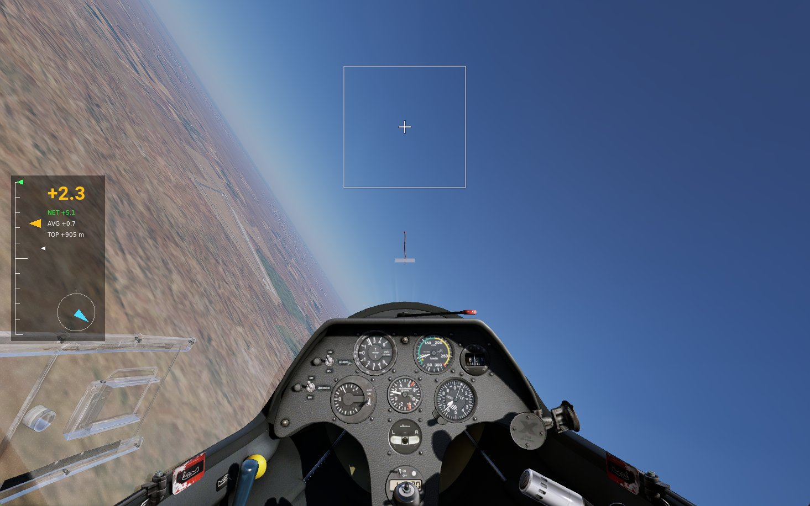

# Soaring HUD: how it is drawn, and what it shows

A small panel on screen with total energy (TE), netto, the average climb, the height to the day's thermal top and a centring aid. See the roadmap in [SPEC.md](SPEC.md). Measured on 2026-11-03 and 04 in X-Plane 12.4.3 under Vulkan, XPPython3 4.7.1, Laminar ASK 21, at 60 fps. Code: `xp_gliding/adapter/hud.py` (drawing, SDK) and `vario.py` (instruments, no SDK).

**Status:** working in the plugin and flown by the test pilot. Juan Luis flew with it on 2026-11-04 and it looks good. **Paused as it is** (his decision, that day): the instrument gets refined once the air itself works well. The audio vario is not done.

## Recommendation

**A plain XPLM window drawn from Python: raw OpenGL for shapes, a display list for the static part, X-Plane's own font for small text, and TrueType only for the big TE number.** It fits the SPEC's 500 µs budget together with the force injection, needs nothing but XPPython3, and lives in the plugin that already has the data.

When X-Plane 12.4.4 and XPPython3 4.8 are stable, move to native Panel Graphics: see [Newer tools](#newer-tools).

## Measurements

Each method draws the same scene: a scrim, 11 ticks, a needle, a marker and three strings (`tools/hudlab/`). The sim was paused, so the scenery stayed still. "Own draw" is the time in the draw callback, which is precise. "Main thread" is the difference in CPU time of X-Plane's main thread, off against on, median of six pairs of 8 s with half the interquartile range; it is coarse, and it is the only way to see anything outside our callback. GPU differences were within noise for all of them (under 0.1 ms per frame). The frame rate cap hides all of this in the frame time.

| Method | Own draw p50 (µs) | Own draw p99 (µs) | Draws/s | Main thread, per frame (µs) |
| --- | --- | --- | --- | --- |
| Window: XPLM dark box and strings, no tape | 48 | 78 | 60 | +5 ± 220 |
| Window: raw GL, XPLM strings | 83 | 125 | 60 | +150 ± 130 |
| Window: display list for the static part, XPLM strings | 75 | 113 | 60 | +140 ± 150 |
| Window: display list, three TrueType strings through xpgl | 424 | 591 | 60 | +730 ± 320 |
| Window: xpgl for everything | 563 | 701 | 60 | +820 ± 170 |
| Avionics popup: xpgl, every frame | 562 | 709 | 60 | +70 ± 320 |
| Avionics popup: xpgl, on demand at 10 Hz | 565 | 811 | 70 | +190 ± 250 |
| Window: imgui | 518 | 698 | 120 (not explained) | +240 ± 180 |
| RCHud v0.3.0 (SASL, Lua), whole strip | not measurable | | | +800 ± 230 and +470 ± 70, two runs |

Reading:

- **Python's cost here is PyOpenGL and per-glyph text.** xpgl's TrueType text draws each glyph with its own texture bind, buffer upload and draw call, about 18 µs per glyph plus about 100 µs per string, all through PyOpenGL. Its polygons are triangulated in Python each time. The cost is not the drawing itself: the GPU column does not move.
- **The HUD as built costs 265 µs per frame** in flight (from `xp_gliding/hud/draw_us`), plus about 3 µs per frame for its samples (30 µs, ten times a second). With the force injection's 125 µs that is about 390 µs of the SPEC's 500 µs budget. The TrueType TE number is the largest part: replacing it is the first thing to do if the budget gets tight.
- RCHud draws far more than this scene (eight instruments), so its number is not a comparison of frameworks. What it says is that a strip of that size costs the same order as the rest of our plugin.

## The options compared

**(a) Soaring instruments in RCHud, as its own plugin.** It works under Vulkan and is a good HUD, with a mature design, but it would be a second plugin reading `xp_gliding/*`, in another language, carrying a 42 MB SASL package per install for one panel, against the project's single-plugin layout. Its data would cross the SDK twice. RC is out of scope, and a glider's panel shares no instruments with its strip other than the idea of a vario. Not recommended; its ideas are, below.

**(b) XPLM avionics device.** It works: `createAvionicsEx` opens a popup, transparent and with no frame when bezel and screen match. But on-demand drawing saved nothing as a popup: asked for 10 Hz it was drawn 70 times a second, every frame plus the ten requests. It only makes sense on a 3D cockpit screen, which needs a polygon with `ATTR_cockpit_device`, so a change to Laminar's cockpit object, or `setObjectAvionics` from 12.4.4. That is worth a look later for a real instrument in the panel; a HUD gains nothing from it.

**(c) imgui.** It works, and is the only one with a hazard: the SPEC's warning that reloading scripts after using imgui crashes the simulator. Its default window has a title bar with a close button and an opaque background, so it reads as a tool window, not a HUD. Good for a settings or statistics window (issue #7), wrong for this. The lab counted 120 window callbacks per second against 60 draws of the scene, which I did not explain; take its per-draw figure with care.

**(c) Plain XPLM window.** Recommended, above. It is the path Laminar lists as compatible under Vulkan.

## What was found about drawing from XPPython3

- **An exception ends a draw callback for good.** XPPython3 logged the first one and never called that callback again, silently. In the lab one bad colour in one mode stopped every mode sharing that window, and the first measurement run was thrown away for it: its costs were noise, off against off. `hud.py` catches everything inside the callback.
- **X-Plane's screenshot command leaves 2D windows out.** To see a HUD from outside, capture the screen (`tools/hudlab/thread_cpu.py`).
- **X-Plane leaves its own GL state.** Blending was additive and faces were culled, so a black translucent quad, wound counterclockwise, did not appear at all. `hud.py` sets both every frame.
- **xpgl's polygons force alpha to 1** on 4.7.1 (`glColor(*color, 1)`), so a translucent colour raises an exception. 4.8.0b2 also fixes polygons that could come out black.
- **The before and after callbacks of `Phase_Window` do not bracket drawing:** the time between them was a whole frame (~16.6 ms).

## What RCHud contributes

Read in the repository `jlgabriel/RCHud`. Taken: a read-only panel, no mouse; metric first; a scrim for legibility; a menu item and a bindable command. To take when he asks: its opacity and background levels, and saving the preferences from the menu (here the config file is the only persistence); the rule that sizes are multiples of one unit, so that the panel can scale; the "every instrument must earn its place" test. Not applicable: the speed source (GPS against IAS), power, gear, flaps, and its full-width strip, which would cover the ASK 21's panel. Its code is GPLv3, compatible with this project, but none was copied.

## The instruments

All of them read only what a real glider could sense. The engine's lift and thermals appear only in tests and tools, as the oracle.

- **TE:** the rate of h + V²/2g, first-order filter of 1 s, sampled at 10 Hz. X-Plane's own gauge (`total_energy_fpm`) agrees within 0.03 m/s over 20 s under force injection, so the SPEC's known limitation does not apply to TE, and it lags the lift about as much (1.1–1.3 s against ours at 1.0–1.25 s). We compute our own so that TE and netto share a filter.
- **Netto:** TE plus the still-air sink at this IAS, TAS, bank and mass. Level flight comes from test A. Turning adds k (90 / IAS) (n² − 1), with k = 0.85 m/s fitted to logged circles (`tools/flightlog/replay_vario.py`). Over 67 steady stretches of 20 s it is within 0.05 m/s of the lift on average at every bank, 0–60°. The fit used those flights. **There is no netto for other aircraft:** the polar is per glider, and `polar_for` knows only the Laminar ASK 21. This is a display, so it does not break the rule against per-glider constants, which is about lift.
- **Average:** the energy difference over the last 30 s, so without lag or drift. It is a time window, not a thermal's average since entry.
- **Height to top:** the sky's cloud base (0.91 zi above ground by default), minus AGL. It is the day's forecast, the same for every thermal, as a pilot knows it from the cloud base. It follows the fixed `zi_m` until phase 2 reads the atmosphere.
- **Centring aid:** the lift around the last turn, per 10° of heading, with the filter's lag taken out; the first harmonic says where the lift peaks, and so where the core lies from the circle's centre. The arrow points that way, relative to the nose, and hides below 1.2 m/s of half-swing. Checked against the real field on three logged orbit flights (`tools/hudlab/check_aid.py`):

| Circle off centre (m) | Samples | Median direction error (deg) | Within 45° | Median half-swing (m/s) |
| --- | --- | --- | --- | --- |
| 0–15 | 1448 | 110 | 18% | 0.82 |
| 15–30 | 3667 | 82 | 15% | 0.94 |
| 30–60 | 9429 | 46 | 48% | 1.75 |
| 60–100 | 5996 | 24 | 89% | 2.39 |
| 100–200 | 1266 | 12 | 96% | 2.18 |

So it is reliable from about 60 m off centre, half right from 30 to 60 m, and says nothing closer, where the threshold should hide it. The threshold is absolute, and these are the test pilot's steady orbits in strong cores: a hand-flown circle will swing more for other reasons. **To decide by flying.**

## In flight

Two flights of `fly_phase1.py orbit` over KHOB on 2026-11-04, seed 1, w* 3 m/s, zi 2000 m, about 14 minutes in all, with `tools/hudlab/watch_hud.py` reading the instruments from outside. The panel drew throughout, with no error in the log, and the scrim and the arrow were checked in captures of the window.

| Bank (deg) | Stretches of 20 s | Netto - engine's lift (m/s) | Spread |
| --- | --- | --- | --- |
| 0-15 | 6 + 4 | -0.10, -0.06 | 0.09, 0.07 |
| 15-35 | 2 | -0.11 | 0.01 |
| 35-60 | 11 + 6 | +0.02, +0.01 | 0.15, 0.10 |

This is the netto as the HUD computes it, in new flights not used for the fit. Cost in those flights: draw 261-265 µs per frame, sample 29-30 µs ten times a second, force injection 117-125 µs per frame.

X-Plane crashed three times at its main menu during this work (2026-11-03 21:00 and 21:30, 2026-11-04 00:38), each time at the same place, `X-Plane.exe+0x15e8daa`, a breakpoint. The first was before any of this code existed, so it is not the HUD; the cause is unknown. Other starts on the same days were fine. A start after a crash stops at the Safe Mode dialog, and a flight requested through the web API while it is on the way to the main menu can leave that menu on screen over a paused flight, which `sim/operation/toggle_main_menu` closes.

## Newer tools

From the documentation, not tried:

- **X-Plane 12.4.4 with XPPython3 4.8 (beta, 4.8.0b4 on 2026-11-02)** bring native 2D drawing, [XPLMPanelGraphics](https://xppython3.readthedocs.io/en/beta/development/modules/panelgraphics.html): lines, polygons, TrueType [fonts](https://xppython3.readthedocs.io/en/beta/development/modules/panelgraphics_fonts.html) and retained drawing, on all backends. [XPPython3's changelog](https://xppython3.readthedocs.io/en/beta/changelog.html) calls it faster and says to migrate from raw OpenGL. Its fonts and its "record once, replay" drawing would remove our largest costs. On 12.4.3 the calls raise an error. The installed 4.7.1 has none of it, although its `samples/` folder holds examples for it. Laminar's [SDK page](https://developer.x-plane.com/sdk/plugin-sdk-downloads/) still lists 4.3.0 as current, so SDK 4.4 is known here only through XPPython3.
- The same release adds browser windows, avionics content types and [`setObjectAvionics`](https://xppython3.readthedocs.io/en/beta/development/modules/display_avionics.html) (an avionics screen on a 3D object), and `xp.isReloading()`.
- Laminar's [compatibility guide](https://developer.x-plane.com/article/plugin-compatibility-guide-for-x-plane-11-50/) lists window drawing and custom OpenGL in 2D callbacks as compatible under Vulkan: plugins get their own OpenGL context. The [xpgl page](https://xppython3.readthedocs.io/en/beta/development/modules/xpgl.html) calls xpgl a work in progress and makes no statement on cost.

## The wind

Added on 2026-11-05, as Juan Luis asked: `WIND 19 kt` under the text, and an arrow above the centring aid, from `sim/weather/aircraft/wind_now_*`. Up is the nose and it points where the wind goes, as in the centring aid, so it turns as the glider circles. Knots, as X-Plane's weather settings have it. Checked in flight: heading 40° in a wind from 90° draws it down and to the left, 230° from the nose. Drawing costs 281 µs against 265 µs, one reading.

## Still open

For when the air works well (Juan Luis, 2026-11-04):

- Readability, position and size in detail, and whether the arrow helps a hand-flown circle. His first flight only said that it looks good.
- **Audio vario.** X-Plane has a native switch, `sim/cockpit2/switches/total_energy_audio`, and its TE is right, so the first thing to try is switching it on and listening. Only a netto tone would need a sound of our own (FMOD through XPPython3).
- Settings from the menu, and a position to move the panel to. VR is untested.
- A thermal's average since entry, instead of the fixed window, if he misses it.
