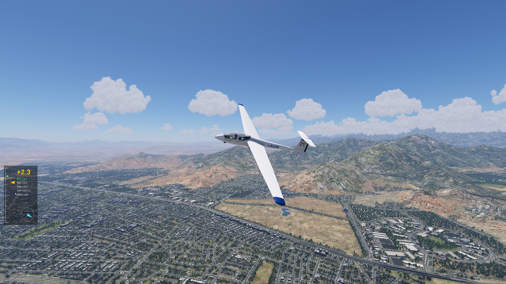
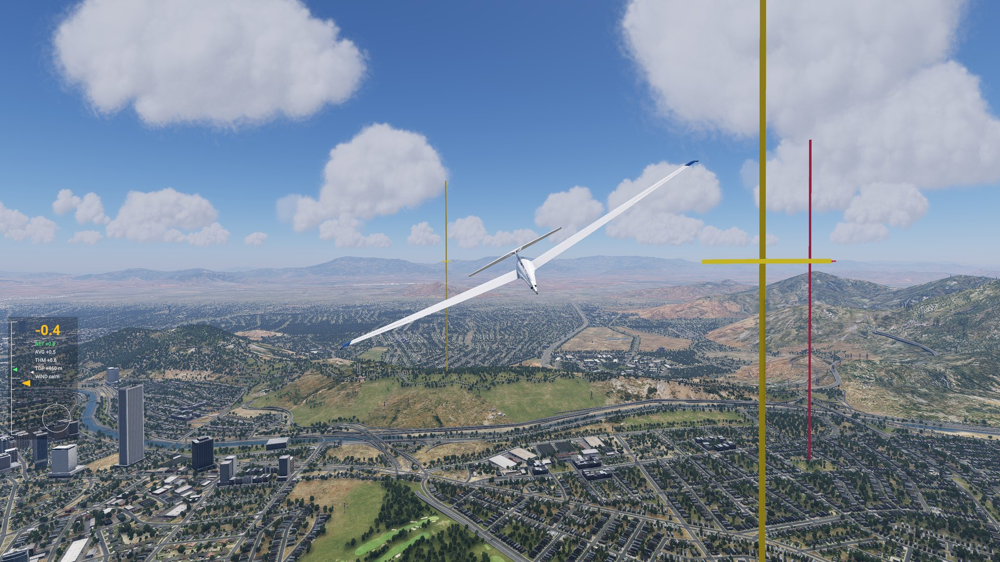
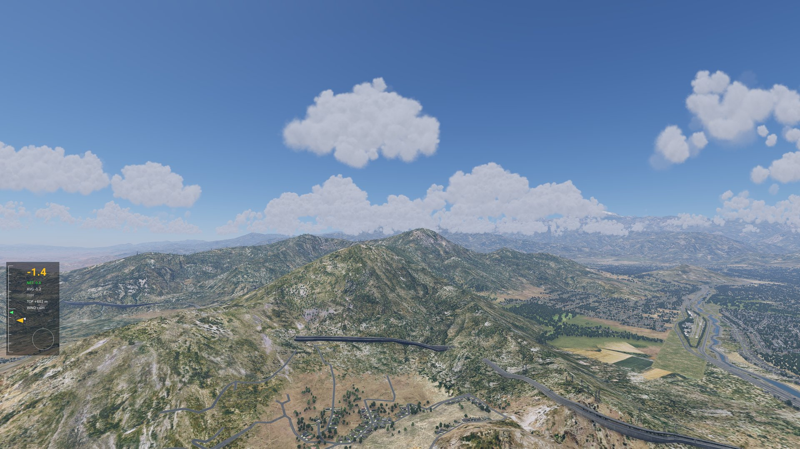
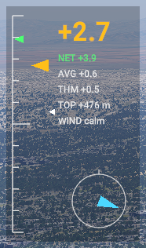
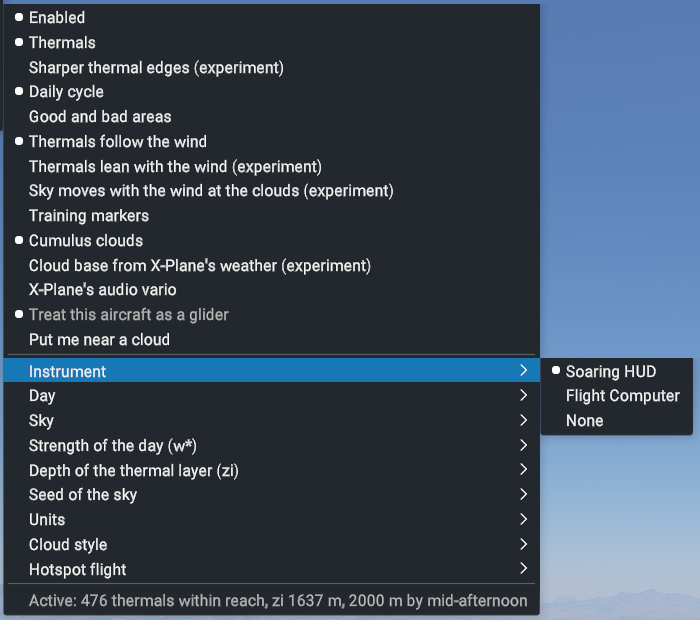

# Pilot guide

How to install XP-Gliding, make a first flight and read its sky. This guide is for version 2.0. Its known limits are listed at the end.

## What you need

- **X-Plane 12.** The plugin has been flown in versions 12.4.3 and 12.4.4 under Vulkan, on Windows 11. Other versions and systems have not been tried.
- **[XPPython3](https://xppython3.readthedocs.io/),** the plugin that runs Python plugins in X-Plane. Install it as its page explains, and start X-Plane once, so that it creates the folder `Resources/plugins/PythonPlugins/`. Versions 4.7.1 and 4.8.0 have been tried. With 4.8.0 or later on X-Plane 12.4.4, the HUD draws with X-Plane's newer Panel Graphics and costs much less, and the Flight Computer is there. With an earlier version the HUD draws as before and the Flight Computer is greyed out in the menu. Nothing else is needed.
- **A glider.** The reference is the Laminar ASK 21 that comes with X-Plane. The HpH 304S Shark has been tried too, by script: it gets the lift and its HUD shows no netto. A motor glider gets in through the menu (see [The menu](#the-menu)).

## Installing

1. Download `xp-gliding-2.0.zip` from the [releases page](https://github.com/jlgabriel/xp-gliding/releases) and unzip it.
2. Close X-Plane.
3. From the unzipped folder, copy `PI_xp_gliding.py`, the whole `xp_gliding` folder and the `xp-gliding-cloud-styles` folder into `X-Plane 12/Resources/plugins/PythonPlugins/`. They must sit side by side there. The last one is for cloud styles of your own, and the plugin makes it if it is missing. `README.txt` and `LICENSE` do not need to be copied.
4. Start X-Plane. *Plugins → XP-Gliding* appears in the menu.

The plugin comes ready to fly: no file to edit, and nothing to set in X-Plane's thermal settings. It holds X-Plane's own thermal rate at 0 while it is active and puts it back afterwards.

**Updating:** delete the old `xp_gliding` folder first, then copy the new one, so that no old file is left behind. Your settings are kept, and so are your cloud styles in the `xp-gliding-cloud-styles` folder beside it: leave that one as it is, or copy the new one over it.

**Removing:** delete `PI_xp_gliding.py` and the `xp_gliding` folder. Your cloud styles are in `xp-gliding-cloud-styles`, beside them, and your settings in `X-Plane 12/Output/xp-gliding/config.json`; both can be deleted too.

## A first flight

1. **Set the weather.** Fly by day, best from late morning to mid-afternoon: the thermals follow the day (see *Daily cycle* in [The menu](#the-menu)), weak and low in the morning, strongest around 1 pm solar time, gone soon after the sun drops under 10°. Leave out X-Plane's own cumulus clouds: the plugin draws its own over its thermals, and X-Plane's clouds mark none of them, so flying towards one finds nothing. Wind is fine, steady or not.
2. **Choose the glider.** The Laminar ASK 21. The plugin acts only on gliders, and does nothing on the rest. A motor glider counts once you choose *Treat this aircraft as a glider* in the menu (see [The menu](#the-menu)).
3. **Turn on the markers for the first climb.** *Plugins → XP-Gliding → Training markers* puts a ring at your height over each nearby thermal, and a thin column up to its cloud. It helps while learning how a climb feels. Turn them off later and fly by the clouds.
4. **Get airborne,** by tow, winch or an air start, and fly towards a cloud. Or choose *Plugins → XP-Gliding → Put me near a cloud*: the glider is set flying 1.5 km from a cloud, heading for it, a little over halfway from the ground to the cloud's base.
5. **Check that the airbrakes are closed.** The ASK 21 can start with them open, which feels like a heavy glider and reads as strong sink.
6. **Circle where the lift is.** When the vario goes up, turn. A bank of 28–35° at 90–95 km/h has worked in the ASK 21, flown by hand in X-Plane 12.4.3. Steeper turns cost a lot of climb in this glider.
7. **Listen, if you like.** The AUDIO switch on the ASK 21's panel turns on X-Plane's own audio vario, which hears the plugin's thermals. In a glider with no such switch, choose *Plugins → XP-Gliding → X-Plane's audio vario*.

In calm air the sky is the same every time for the same place, date, time and seed, so a good thermal can be found again. With wind the sky drifts from where it stood when the flight began, so the same thermal turns up over different ground.

## Reading the sky

- **A cloud means a thermal.** Each of the plugin's clouds sits over a thermal. A few thermals have no cloud, and they are weaker.
- **Clouds are born with their thermal and outlive it.** A thermal lives between 5 and 30 minutes, growing and then fading, and never vanishes at once. A full cloud has a thermal at its best. A cloud that thins has a thermal that is weakening, and it stays a few minutes after its thermal has died, fading. A thin cloud may have nothing left under it.
- **A bigger cloud usually means a stronger thermal.** This holds on average when the two are compared offline, and in the three thermals flown by hand to check it, which is too few to rely on.
- **Some areas are better than others,** with *Good and bad areas* ticked (off by default). Over tens of kilometres the air varies: where it is good there are more thermals, stronger, under more and bigger clouds; where it is poor there are few, weaker, under few small clouds, though never with none at all. Choosing where to fly by the look of the sky pays. Each date has its own map, and with wind the areas drift with it.
- **Everything moves with the wind.** Thermals and clouds drift with X-Plane's wind, as the glider does, so a circle needs no correction for it, even while the ground passes underneath. In strong wind a thermal can carry you towards high ground.
- **A climb ends near its cloud.** The lift fades towards the cloud's base, and usually stops some way under it.
- **Clouds keep to a level for the area,** and stand higher where the ground under them, or along their drift, would reach them.
- **A deeper day spaces the thermals out.** With the cloud base from X-Plane's weather, a high base gives wider thermals and clouds farther apart, and a low base narrower thermals and clouds closer together. The sink between them stays the same.
- **X-Plane's own clouds take the sun away.** Under a layer set in X-Plane's weather the thermals weaken, more the more it covers and the thicker it is: about half as strong under a closed overcast, a little weaker under scattered cloud, hardly at all under thin cirrus. In rain there are none. Fewer of our cumulus form there, and smaller, by as much, and none in rain. The change comes over a few minutes, as the weather changes from place to place. A clear sky changes nothing.
- **No thermal starts over water.** One born over land can drift out over the sea.
- **X-Plane's ridge lift stays on,** and adds to the thermals where the wind meets a slope.

## The HUD

A small panel on the left of the screen. The vario readings and the centring arrow use only what a real glider could sense, not the plugin's knowledge of where the thermals are.

| Item | What it shows |
| --- | --- |
| Large amber number, and the tape | Total energy rate, m/s, or knots with aviation units (the tape then spans ±10 kt) |
| `NET` | Netto: the air's own motion, from total energy and the glider's sink. Only the Laminar ASK 21 has a measured polar, and any other glider shows `NET --` |
| `AVG` | The average climb over the last 30 s, m/s or knots |
| `THM` | The average climb since you began circling in this thermal, after 10 s of circling. A few straight seconds to move the circle stay in the same thermal. After 20 s straight it turns grey and keeps the last thermal's figure until the next |
| `TOP` | Height up to the nearest thermal's cloud, m, or feet to the nearest 10 with aviation units. It can jump when the nearest cloud changes |
| `WIND` | The wind at the glider, in knots with either units, with an arrow pointing where it goes, relative to the nose |
| Centring arrow | Which way the core lies, when the lift changes enough around the circle to tell. It is most useful 60–100 m off centre, and says little closer in |

## The Flight Computer

The other instrument, in place of the HUD: a window of its own that you can move and resize, with the same readings as the HUD, larger, and room for more to come. Choose it in *Plugins → XP-Gliding → Instrument*. It needs X-Plane 12.4.4 and XPPython3 4.8.0 or later, since its window is X-Plane's built-in browser; with anything earlier the menu greys it out and the HUD stays.

A strip across the top always shows the total energy rate, with a bar whose half height is 5 m/s or 10 kt, the 30 s average and the altitude above sea level. With a task loaded, a row under it names the point you are flying to, with an arrow showing which way to turn to it, its bearing and its distance (see [TASK](#task)). Below, three tabs choose the view, MAP, FLIGHT or TASK; the one you leave it on is the one it opens with. Beside the tabs is the simulator's local time, which stands still while X-Plane is paused.

### MAP

A topographic map, north up, with the glider on it, turned to its heading, and the track you have flown, coloured by height: blue at the lowest of the flight, red at the highest. The legend under the zoom buttons gives the two heights; it widens by itself in steps of 100 m (300 m at least) as the flight goes higher or lower, and then the whole line takes its new colours. The map follows the glider: it moves at most once a second, in a small step, rather than gliding along all the time, which would cost X-Plane frames. Drag the map and it stops following; the round button at the top right brings it back. Under it, an arrow shows where the wind at the glider is blowing to, with its speed in knots. The + and − buttons, or the mouse wheel, zoom; the zoom you leave is kept. The scale at the bottom left is in km, or in nautical miles with *Units* set to aviation (feet below one mile).

The track keeps one point a second for the last six hours. It is recorded while the Flight Computer is the chosen instrument, whether its window is open or not, and starts again when the glider jumps: a new flight, a move on X-Plane's map, *Put me near a cloud*, a change of time.

The map's tiles come from the internet, from [OpenTopoMap](https://opentopomap.org/) by default: map data © OpenStreetMap contributors and SRTM, map style © OpenTopoMap (CC-BY-SA), as the text in the map's corner says. X-Plane's browser keeps the tiles it has shown on disk, so an area you have flown over shows again without a download. Only the tiles you look at are fetched, never an area in advance. Without a network the map is a dark background with a grid of latitude and longitude, and the glider and the track draw on it as usual; the line under the window then says the tiles are not loading.

With a task loaded, the map draws its legs in magenta, each point with its name and its observation zone: a cylinder, a sector or a line. The zone of the point you are flying to is drawn stronger, and a dashed yellow line joins the glider to its point. When you choose a task, the map shows it whole and stops following until you press the follow button.

Another tile server can be set in `Output/xp-gliding/config.json` with X-Plane closed: `map_tiles` is the tiles' address with `{z}`, `{x}` and `{y}` in it (and `{s}` for servers named a, b and c), and `map_attribution` the text the provider asks to be shown with them. Use a provider whose terms allow it.

### FLIGHT

The readings the strip does not show:

| Item | What it shows |
| --- | --- |
| `NETTO` | The air's own motion, as the HUD's `NET`; `--` for a glider without a measured polar |
| `THM` | The climb since you began circling in this thermal, grey once you have left it, as on the HUD |
| `AGL` | Height above the ground, m, or feet to the nearest 10 |
| `IAS`, `GS` | Indicated airspeed and ground speed, km/h, or knots |
| `TOP` | Height up to the nearest thermal's cloud, as on the HUD; `--` with *Thermals* off |
| `WIND` | Where the wind comes from and its speed in knots, with an arrow pointing where it goes, relative to the nose |

The numbers grow and shrink with the window, so a small window in a corner still reads well.

The readings are the HUD's own: the two instruments never disagree. Like the HUD, they use only what a glider could sense. *Units* in the menu sets both.

### TASK

A task from a SeeYou CUP file, to fly without leaving X-Plane. Put CUP files in `Output/xp-gliding/tasks/` in your X-Plane folder (the plugin makes the folder on its first start). Open the TASK tab: it lists each file and the tasks in it, with their length; press one to load it. ↻ reads the folder again, so a file you add while flying shows at once. The task you load is kept and loaded again at the next start, from its beginning. If you edit the file in the meantime, the same task is found wherever it now is in the file; if it was changed or removed, nothing is loaded and you choose again.

A CUP file can hold waypoints only, with no task: turn point files for a site or a competition are often like that. Such a file is listed with "no tasks in this file". Make the task in SeeYou (or another program that writes CUP files with tasks) from those waypoints and save it, then put that file in the folder.

The TASK tab shows the task's points, each with the length of the leg to it; the point you are flying to is in yellow and those behind you are dimmed, and once started, the distance left and the share done. Each point is taken by itself as you fly:

- **the start** when you leave its zone, or cross its line going the way of the first leg; crossing it again before the first turn point starts the task again;
- **each turn point and the finish** when you enter their zones.

*Prev* and *Next* step back and forward by hand, for a point you want to skip or one taken by mistake; *Clear* unloads the task. A point you step back to stays the one you fly to until you leave its zone and enter it again. A move on X-Plane's map, *Put me near a cloud* or a new flight does not take any point or cross any line, even when it puts you inside a zone: fly out and back in.

The zones are those the file gives (`ObsZone` lines). A point the file gives no zone gets the plugin's: a start line 2 km long across the first leg, and a 500 m cylinder at each turn point and at the finish. The task is shown and followed, not scored: start opening times, task times and assigned areas in the file are not used, and with several starts (`STARTS=`) only the task's own one is.

Distances are in km, or nautical miles with *Units* set to aviation. Bearings and distances are worked out on a sphere, as soaring instruments show them, within about 0.5 % of the true distance.

Where you leave the window, and its size, are kept for the next session. Its close box closes the Flight Computer (choose it again in the menu to bring it back). It stays inside X-Plane's window: its pop-out button puts it back at once, because X-Plane 12.4.4 draws a popped-out browser window wrong (a corner of the page, enlarged). A click in the window leaves the keyboard with X-Plane, so your keys and their commands work as before.

## The menu

Everything is in *Plugins → XP-Gliding*. What you choose is saved for the next session, and each switch is also a command you can bind to a key or a joystick button in X-Plane's keyboard or joystick settings.

| Item | What it does | Command |
| --- | --- | --- |
| Enabled | The plugin's whole effect, the HUD included | `xp_gliding/toggle` |
| Thermals | The lift, keeping the clouds and the rest | `xp_gliding/thermals/toggle` |
| Sharper thermal edges (experiment) | A jolt when you fly into lift and out of it, bumps at a thermal's edge (more low down), a ring of sink around each thermal, and twice the sink between thermals. Gliding between clouds costs more, and the edge tells you where the lift is. The climb in the thermal is the same. Off by default, so you can learn the thermals first; tick it when you want rougher air, and untick it in flight to compare | `xp_gliding/edge/toggle` |
| Daily cycle | The thermals follow the sun. None is born with the sun under 10°. They start weak and low a little after sunrise and grow stronger and deeper through the morning; the strength of the day below is reached around 1 pm solar time, and they weaken through the afternoon. Each thermal keeps the depth of the hour it was born: around 10 am solar time they end at less than half the afternoon's height, and they reach it by mid-afternoon. The early morning is blue: the first cumulus come between about 10 and 10:40 am solar time, at about half the afternoon's base, and the base rises to it by mid-afternoon. Solar time is not your clock: at Santiago in November, solar noon is at 13:26 local time, so the first clouds come around 11:30. Off: the same strength and depth all day and night, as in 0.1. On by default | `xp_gliding/day/cycle/toggle` |
| Good and bad areas | The thermals' number and strength vary over tens of kilometres: in the best areas about 1.6 times as many as on average and a fifth stronger, in the worst about 0.4 times as many and a fifth weaker, and never fewer than a fifth as many, so no stretch of sky is left without clouds. The sky as a whole holds as many thermals as with it off. Each date has its own map. Off: the same sky everywhere. Off by default, so you start with the easier sky; tick it when you want choosing where to fly to matter | `xp_gliding/day/areas/toggle` |
| Thermals follow the wind | The wind carries thermals, clouds and markers. On by default | `xp_gliding/wind/toggle` |
| Thermals lean with the wind (experiment) | Lift upwind of the cloud when low. Off by default, best left off | `xp_gliding/lean/toggle` |
| Sky moves with the wind at the clouds (experiment) | Makes a climb much harder in changing wind. Off by default, best left off | `xp_gliding/wind/clouds/toggle` |
| Training markers | A ring at your height over each nearby thermal, and a column up to its cloud | `xp_gliding/markers/toggle` |
| Cumulus clouds | The plugin's clouds | `xp_gliding/clouds/toggle` |
| Cloud base from X-Plane's weather (experiment) | The clouds' height from the temperature and dew point of the weather you fly, kept between 1000 m and 3500 m above the ground, in place of the depth below, which is greyed out, and of a named day's height (said when you choose one). A cumulus layer set in X-Plane's weather moves it too, though our clouds can sit a few hundred metres off that layer. Off by default | `xp_gliding/day/weather/toggle` |
| X-Plane's audio vario | X-Plane's own audio vario on or off: the same switch as the AUDIO on the ASK 21's panel, for gliders without one. The tick follows the panel's switch. X-Plane's setting, not saved by the plugin | `xp_gliding/audio_vario/toggle` |
| Treat this aircraft as a glider | For a motor glider: the plugin acts on the aircraft loaded, with its engine running or not, and remembers it by its file. Ticked and greyed out for a glider | `xp_gliding/aircraft/glider/toggle` |
| Put me near a cloud | Sets the glider flying 1.5 km from the nearest cloud that will last a few minutes more, on the side you were on, heading for it, a little over halfway from the ground to the cloud's base. Needs *Cumulus clouds* on, and the clouds take a few seconds to form after a flight starts | `xp_gliding/airstart/near_cloud` |
| Instrument | *Soaring HUD* (the default), *Flight Computer* or *None*: at most one is shown. The two commands turn their instrument on or off, and turning one on turns the other off. *Flight Computer* is greyed out without X-Plane 12.4.4 and XPPython3 4.8.0 | `xp_gliding/hud/toggle`, `xp_gliding/computer/toggle` |
| Day | A whole day at once, setting the four items below it: *Easy* (wide, strong thermals), *Typical* (the default), *Demanding* (narrower, stronger and higher), *Weak and low*, and *Blue*, a day with the same thermals and no clouds to read. The day you are on is ticked; change one of the items below and none is. With *Cloud base from X-Plane's weather* on, the weather sets the depth instead | |
| Sky | How wide the thermals are: wide (the default and easiest), medium, or narrow (hardest) | |
| Strength of the day (w\*) | How strong the thermals are at the best time of the day, with *Daily cycle* on, or all day with it off. 3 m/s by default | |
| Depth of the thermal layer (zi) | How high they go, and so the height of the clouds: in the afternoon, with *Daily cycle* on. 2000 m by default | |
| Seed of the sky | Another arrangement of thermals | |
| Units | For both instruments: metric (m/s, m and km/h, the default) or aviation (knots, feet and nautical miles). The wind is in knots with both | |
| Cloud style | How the cumulus look, as a livery for the sky: *Billow light* (the default), *Billow*, *Standard*, *Cotton*, *Cauliflower* and *Popcorn*, and any style you install. Only the look changes, never where the clouds are or what they say about their thermals. See [Cloud styles](cloud-styles.md). The command, not in the menu, steps to the next style, for a key to compare them | `xp_gliding/clouds/style/next` |
| Hotspot flight | *None: a normal flight* (the default), or a file of hotspots: then the only thermals are the ones its hotspots start (see *A hotspot flight* below). The files found when X-Plane starts are listed | |

Markers appear for up to 20 thermals within 3 km with at least 1.5 m/s at the core. The colour shows the lift at the core at your height: pale below 2 m/s, yellow from 2, orange from 3, and red from 4.

Choosing another sky, seed, depth or cloud style in flight replaces the clouds at once, and new ones fill in.

The menu's last line, greyed out, says what the plugin is doing: how many thermals are within reach and the depth of the day in use (with *Daily cycle* on, the depth now and the afternoon's), or why there are none.

## A hotspot flight

A normal flight has thermals everywhere, drawn by the plugin. A hotspot flight has thermals only where a file says pilots find them, and none anywhere else: it is the sky of a site you know, as sparse as the file is.

1. Open [thermal.kk7.ch](https://thermal.kk7.ch/), a map of thermal hotspots worked out from paragliding and hang-gliding tracks, and move it to the area you want to fly.
2. Under *Download currently visible hotspots*, choose *Comma Separated List (csv)*. The file has the hotspots in view.
3. Put the file in `Output/xp-gliding/hotspots/` inside your X-Plane folder (the plugin makes the folder the first time it starts), and restart X-Plane.
4. Choose the file in *Plugins → XP-Gliding → Hotspot flight*.

Each hotspot works in cycles, one thermal at a time, and its probability is the share of the time it has one: a hotspot of 100% almost always (a short pause now and then), one of 60% a little more than half the time. Each starts within 250 m of its hotspot, then drifts with the wind, and each carries a cloud, so you find them as in a normal flight. The daily cycle, the wind, the clouds, the HUD and *Put me near a cloud* work as in a normal flight; *Good and bad areas* does not apply. Where the file has no hotspots there are no thermals: kk7 has data where those pilots fly, and none for many places. The menu's last line says *Hotspot flight* while you fly one.

A file of your own works too: one line per hotspot with latitude, longitude, altitude in metres and probability in percent, separated by commas; a first line that is not a hotspot is skipped. The data on thermal.kk7.ch is under its own licence (CC BY-NC-SA 4.0), so the plugin brings no file: download your own.

## When there are no thermals

First look at the last line of *Plugins → XP-Gliding*.

| It says | What to do |
| --- | --- |
| *Off: Enabled is unticked* | Tick *Enabled* |
| *Waiting for an aircraft* | Load an aircraft and start a flight |
| *Inactive: this aircraft has engines and is not treated as a glider* | Choose a glider, or, for a motor glider, *Treat this aircraft as a glider* |
| *No thermals: Thermals is unticked* | Tick *Thermals* |
| *No thermals: the sun is under 10 degrees* | Fly by day, or move X-Plane's clock. The first thermals come about an hour after sunrise, and the first clouds late in the morning, solar time |
| *No thermals within reach* | Over a wide stretch of water, or far out at sea, there are none. Fly towards land |
| *Hotspot flight: no hotspot working within reach* | In a hotspot flight there are thermals only at the file's hotspots. Fly towards them, use *Put me near a cloud*, or choose *None: a normal flight* in *Hotspot flight* |
| *Normal flight: hotspot file … not found* | The file chosen in *Hotspot flight* is no longer in `Output/xp-gliding/hotspots/`: put it back and restart X-Plane, or choose another |
| *Stopped by an error, see XPPython3Log.txt* | Start a new flight, or untick and tick *Enabled*, and [report it](#reporting-a-problem) |
| *Active: … thermals within reach* | The plugin is working. If no clouds show, tick *Cumulus clouds*; if the climb feels weak, check that the airbrakes are closed |

If *Plugins → XP-Gliding* is not in the menu at all, XPPython3 did not load the plugin: check that `PI_xp_gliding.py` and the `xp_gliding` folder sit side by side in `Resources/plugins/PythonPlugins/`, and read the end of `XPPython3Log.txt` in your X-Plane folder.

## Known limits

- **The day is chosen in the menu.** The strength does not follow X-Plane's weather, so the thermals are as strong on a dry day as on a humid one. The cloud base can follow it, with *Cloud base from X-Plane's weather (experiment)*, off by default.
- **The day's shape is the same every day.** How strong and deep the thermals are at each hour follows the sun alone, worked out for the date and place, not X-Plane's weather: a day that should start late or end early after a cool night does not.
- **A far cloud can appear in front of a near one at times,** mostly between clouds far away. A cloud you have just come near can look denser for a few minutes.
- **X-Plane's own cumulus mark none of these thermals.** The two can share a sky, but to read it, leave X-Plane's off.
- **The Laminar ASK 21 is the reference.** Other gliders get the lift, and no netto on the HUD. A glider whose wings are not in the usual parts of its file is treated as an ASK 21 for the roll. An aircraft with engines gets nothing unless you treat it as a glider from the menu, which is how a motor glider gets the lift, with its engine running or not, since the air rises for it either way.
- **A glider flies as well as its own flight model allows.** The Laminar ASK 21 sinks about 2.1 m/s circling at 45°, measured by a scripted autopilot in X-Plane 12.4.3, so steep turns cost a lot of climb.
- **Lift is a push on the aircraft, not moving air,** since a plugin has no way to move X-Plane's air at a point. A climbing turn tends to overbank a little, and a glider's own netto instrument may read wrong. Its total energy vario reads right.
- **Two pilots at the same place and time do not see the same sky.**

## Reporting a problem

Open an [issue on GitHub](https://github.com/jlgabriel/xp-gliding/issues) saying what you did and what you saw, with your X-Plane and XPPython3 versions and the aircraft. Attach `XPPython3Log.txt` from your X-Plane folder: the plugin's lines start with `[xp-gliding]`, and the first one gives its version. If something goes wrong in flight, the plugin stops its effect, writes the error there, and its menu's first item reads *Enabled: stopped by an error*. A new flight or aircraft starts it again, and so does unticking and ticking *Enabled*.

A note on how the thermals feel is welcome too. The plugin has been tried on Windows only; a report from macOS or Linux, working or not, helps.

## More

[How it works](how-it-works.md) explains the thermals, the clouds and the lift behind what this guide describes, and the [documentation](README.md) has what was measured about X-Plane along the way.
