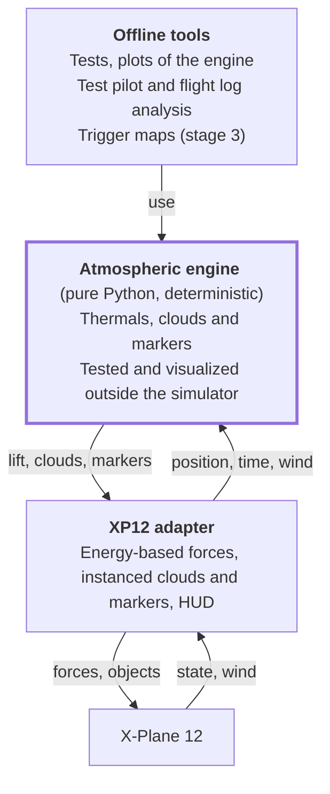

# xp-gliding — Soaring in X-Plane 12: Specification

Started 2026-11-02 · Juan Luis Gabriel

## How to use this document

This is the reference specification for xp-gliding, a thermal layer for X-Plane 12. It gathers the goal, the diagnosis of the existing plugin, what was measured, the decisions taken and the [stages](#stages).

- **Source of truth:** this file (`notes/SPEC.md`) is the single source of truth and is referenced from `CLAUDE.md`. For any design question, this document rules; if something contradicts what is observed in the simulator, the observation wins and this document is updated.
- **Keep it current:** after each step of the [stages](#stages), come back here and record what was resolved or changed, so the document never falls behind the code.
- **Certainty level:** items marked *verify* are reasonable assumptions that have not been confirmed by tests or documentation. Do not treat them as facts.
- **Scope:** good thermals (decided 2026-11-05). What was considered earlier and left out is listed in [Set aside](#set-aside), so the ideas are not lost.
- **Language:** everything in the repository is written in English. The original Spanish draft of this document is no longer maintained.
- **Notes and documentation:** this file and the rest of `notes/` are the working records. The text for readers outside the project is in [`docs/`](../docs/README.md), under its [writing guide](../docs/writing-guide.md).

## Goal and principles

**The goal is good thermals** (redefined by Juan Luis on 2026-11-05, after the first flights): thermals you find by reading the clouds and climb in by hand. The project is an independent proposal for thermals, another option for soaring in X-Plane 12 and not a competitor to it (Juan Luis, 2026-11-05), so its reason to exist does not depend on what [the native thermals](#native-soaring-in-xp12) turn out to be. XP12 keeps the weather, the ridge lift and the flight model. Condor's soaring remains the inspiration, not the target. The project started from Alex Ferrer's [xplane_thermals](https://github.com/alexferrer/xplane_thermals) plugin.

**What it promises**

- A thermal can be found by looking at the clouds, without markers.
- It can be climbed by hand, at believable rates.
- Thermals follow the wind, and each cloud stays with its thermal, from birth to death.
- Lift needs no per-aircraft calibration.
- No frame-rate cost a pilot would notice.

**What it does not promise**

- A physically correct atmosphere. The sky starts from a published model and is tuned by flying.
- Fidelity to real weather. XP12's weather will feed the thermals only as far as the flying asks for it.
- A soaring simulator in X-Plane: no tasks, no other gliders, no wave.
- Better gliders. Each aircraft's flight model is what it is; the reference is the Laminar ASK 21, which sinks ~2.1 m/s circling at 45° where the HpH 304S Shark sinks ~1.1 m/s ([phase1.md](phase1.md)). A third-party glider whose wings are not in the usual parts cannot be read yet.

**Why the goal changed.** The first version of this section aimed to turn XP12 into a Condor-style simulator, on "a single atmosphere, XP12's" (full text: `git show 7128549:docs/SPEC.md`). Three days of building and flying said otherwise:

- We cannot add air, only a force. The SDK has no way to move air at a point. The force gives the right climb (Δvs = w within 0.01 m/s) and leaves artifacts, such as overbanking in a climbing turn.
- The plugin reads nothing of XP12's atmosphere: strength and depth of the day are two fixed settings, and the clouds are our own.
- The published model was a starting point, not the result. Perfectly centred at 35°, ~10% of Allen's thermals could be climbed. What flew well was a tuned sky, at odds with the paper in several documented ways.
- The test that counts is by hand: the test pilot got up to +0.7 m/s under the clouds, and the first hand flights +2.31 m/s for 126 s, and a thermal found by looking at a cloud.

**First principle: the sky must be readable.** What you see tells you where the lift is. Clouds are a consequence of the thermal model, never independent decoration, and a thermal found by looking is the test of the whole project.

**Second principle: native first, apart from the thermals.** The thermals are the project's own proposal. Beyond them, whatever XP12 does well natively, we use as it is, and the measurements backed this up: its ridge lift works, so we leave it alone. Native effects are better physics than ours, since XP12 moves the air itself and the flight model and vario see it; ours is a force on the aircraft. No effect is ever applied twice: each lift source is native or ours, recorded in [Native soaring in XP12](#native-soaring-in-xp12). These decisions are made with measurements, not forum reports.

**Third principle: the flight decides.** Literature gives the first numbers. Offline tests and the test pilot rule things out and save flights. A number stays only if it flies well by hand, and each departure from a published model is documented as one.

**Use:** full-size gliders, starting with the Laminar ASK 21 that ships with XP12 (decided 2026-11-03).

## Starting point: xplane_thermals

The plugin works in XP12: Juan Luis tested it and it produces usable thermals. Manual per-glider calibration compensates for a good part of the physics problems described in the next section.

**General facts**

| Attribute | Value |
| --- | --- |
| Author | Alex Ferrer, real pilot with ~25 years in gliders, paragliders and ultralights (Texas and Peru) |
| License | `LICENSE` file is GPL-2.0; source headers say only "License: GPL" (no version) |
| Platform | XPPython3 v4 (embedded Python 3), X-Plane 12+ only |
| Activity | Last major update November 2024; last commit July 2025 (`082dd7d`); ~205 commits, 36 stars, 7 forks, 14 open issues |
| Essential files | `PI_ThermalSim.py`, `thermal_model.py`, `world.py` (the rest are helpers or tests) |

**What it already does well**

- Samples several points of the aircraft (left wing, right wing, center, tail) to generate roll torque: a thermal "lifts a wing". The concept is right.
- Strong core with weaker outer layers; drifts with the wind; thermals rise up to cloud base or the top of lift.
- Reduces the roll effect when the aircraft is already banked.
- Solar factor: strength depends on sun elevation, including seasons.
- Random generator with configurable count, size and strength, which avoids placing thermals over water.
- Real clouds at the top of thermals (v0.4).
- Optional visual rings for beginners, with a bindable command (`alexferrer/xplane_thermals/show_thermal_rings`).
- Loading of CSV hotspots from [thermal.kk7.ch](https://thermal.kk7.ch/).
- imgui UI: generate thermals, load KK7, configure glider, statistics window, about.
- Enable or disable the plugin (so it does not affect aircraft that are not gliders).
- Persistent configuration in an .ini file; debug levels 1 to 6 to `XPPython3Log.txt`.
- Calibration mode at 1 m/s to tune the glider.

**The author's own TODOs**

- Thermal cycles: start (small bubble that gets stronger), middle (wider and stronger), end (stops rising when it reaches the base and dies). Duration depends on temperature, humidity and altitude; pilots learn to read the cycle to know when to leave.
- Thermal streets.

**Relevant open issues**

| # | Topic | Relevance |
| --- | --- | --- |
| 34 | Error on load (May 2025) | No details in the issue. Likely cause: `world.py` crashes at import when `init_values.json` is not at `Resources/plugins/PythonPlugins/` (e.g. installed into a subfolder); *verify* in the baseline |
| 32 | Terrain and environment considerations | Terrain triggers |
| 31 | Thermal visibility ON/OFF does not work | UI bug |
| 30 | Menu to enable only the effect, not the plugin | UX |
| 28 | Thermal generation range | Generation |
| 24 | lat/lon to meters swaps x/y (since 2016) | Confirmed geometry bug |
| 16 | Control to adjust refresh rate | Performance |
| 15 | Cloud base marker | Visual |
| 14 | Change the thermal climb-rate constant | Drift |
| 13 | Multiplayer capability | Deterministic seed |
| 11 | Thermal cycles | Life cycle |
| 9 | Test ground-based origin point | Triggers |
| 8 | Thermal trigger point | Triggers |
| 7 | Information screen | Instrumentation |

## Technical diagnosis of the current plugin

The plugin is slow and depends on calibration by design, not because it is written in Python. These are the problems found when reading `PI_ThermalSim.py` and `thermal_model.py`; all of them must be fixed or redesigned in the new project.

**1. Injection physics**

- Converts m/s to force with a fixed constant `METERS_PER_SECOND_TO_NEWTON = 10`, multiplied by a `lift_factor` that has to be hand-calibrated for each glider.
- Adds the same amount as thrust (`faxil_plug_acf`) "so the aircraft does not float without moving forward". This is a symptom that the model is not physical.
- Datarefs used: `sim/flightmodel/forces/fnrml_plug_acf` (lift), `faxil_plug_acf` (thrust), `L_plug_acf` (roll), `M_plug_acf` (pitch). Each value is added to the value read from the same dataref.

**2. Framerate dependence**

- The flight loop runs every fixed 0.01 s (`CALLBACKTIME = .01`), not every frame. The author's comment says it works fine on his fast machine.
- If the `_plug_acf` datarefs are applied per flight-model cycle, the effective force changes with FPS. *Verify* whether X-Plane resets them every frame.

**3. Geometry errors**

- Wing tips are placed at `heading` and `heading + 180`, i.e. along the flight axis instead of perpendicular to it. The tail is at `heading + 90`. Everything looks rotated by 90°, consistent with issue #24 (x/y swap).
  - *Verify* (second reading, 2026-11-02): with X-Plane's local frame (x east, z **south**) and the offsets `(cos h, sin h)` applied to (x, z), the "left" point lands on the aircraft's right side and the "right" point on its left, and the tail lands behind. That would mean the wing labels are swapped (and the roll sign swaps them back), not rotated. Test F in [baseline.md](baseline.md) decides.
- `roll_factor` and `pitch_factor` are each applied twice (in `calc_thermalx` and again in the flight loop), so the moments scale with their square.
- Pitch uses `(_lift_r - _lift_l)`: the difference between wings, not between wings and tail. The tail is computed but not used for pitch.
- Total lift averages 4 samples by dividing by 3: a hidden 33% gain.
- Wing tips use `wing_size * 3`, an empirical tweak to "feel the wing bump".
- `xp.worldToLocal` returns (x, y, z) with y up and z pointing south; mixing sin/cos with those conventions is confusing and must be redone with an explicit coordinate system.

**4. Simplistic thermal model**

- Linear cone profile: `strength × (R − d) / R`. No sink ring.
- Height attenuation (`calc_thermal_band`) is disabled (`tband_factor = 1`).
- Linear solar factor: `(sun_pitch + 10) / 100`, zero below the horizon.
- Only the nearest thermal to each sample point is considered.

**5. Wind drift**

- Uses only the surface wind (`sim/weather/wind_speed_kt[0]`, `wind_direction_degt[0]`).
- Assumes a constant climb of 2.54 m/s (~500 ft/min) to compute rise time.
- Uses MSL altitude instead of AGL: over high terrain the drift error is large.
- Applies drift by shifting the aircraft position the opposite way instead of shifting the thermals.

**6. Thermal generation**

- 200 × 200 grid with random positions; offset of `0.00001°` per meter in both latitude and longitude, without the cos(lat) factor. At 33° latitude the grid is distorted by ~16%.
- Random strength weighted toward high values (30% to 100% of the configured strength) and random radius between 1/5 and the average.
- Avoids water with a terrain probe (`is_wet`).
- KK7 loading uses lat/lon but ignores each hotspot's probability.

**7. Abrupt refresh**

- Every `thermal_refresh_time` minutes the whole map is regenerated: the thermal you are circling in can vanish suddenly.
- No life cycle.

**8. Performance**

- For each of the 4 sample points, every 10 ms, it loops over all thermals calling `xp.worldToLocal` from Python. With 200 thermals that is ~80,000 SDK calls per second.
- Fix: precompute local coordinates (recompute only when the local origin changes) and use a spatial grid.

**9. Code quality**

- Global state in `world.py`.
- Prints `"P "` to the log every cycle while the simulator is paused.
- Many debug prints mixed with the logic.

## What XP12 has and what this project adds

| Piece | XP12 alone | xp-gliding |
| --- | --- | --- |
| Thermals | Documented by Laminar, tied to cumulus; not characterized by us ([below](#native-soaring-in-xp12)) | The core of the project: another option, with thermals of its own |
| A cloud over each thermal | Draws cumulus; the link to its thermals was not measured | Its own particle clouds, born and dying with their thermal |
| Wind | The wind of the day, which carries the glider | Read, and thermals follow it ([Wind](#wind), next) |
| Ridge | Native: wind × slope under the aircraft, fading with height (measured 2026-11-03) | Left alone |
| Vario | Depends on each aircraft | A soaring HUD ([hud.md](hud.md)) |
| Flight model and polars | Depends on each aircraft | Left alone; measured, not corrected |

## Native soaring in XP12

XP12 already models some soaring lift. Following the native-first principle, this section records what it does, who owns each phenomenon, and what is still unknown. The phase 0 native audit (tests H–J in [baseline.md](baseline.md), flown by the test pilot on 2026-11-03) measured it; the reports it started from are kept below for reference.

**What was measured (2026-11-03, Laminar ASK 21, details in [baseline.md](baseline.md))**

- **Ridge (test H, a Pennsylvania ridge, 12 and 25 kt).** XP12 moves the air with a *local slope model*: the vertical air speed is close to wind × slope of the ground directly under the aircraft, scaled by height above that ground (about 1 near the surface, 0.5 at 500 m AGL, roughly 0 by 1000–1100 m AGL), linear in wind speed, smooth (r ≈ 0.9 between measured lift and wind × slope). Ridge running works: at crest level 600 m out from the face, 25 kt gave +1.4 m/s on average and the ASK 21 climbed. Gaps: no lift band upwind of the foot of the slope or above and ahead of the crest; lee sink is the exact mirror of windward lift (−3.7 m/s at 25 kt behind the crest) with no rotor or turbulence; every bump of the terrain makes its own lift and sink. Flown by hand at Santiago in 15 kt (2026-11-05, [phase3.md](phase3.md#a-flight-by-the-clouds-alone)): the air rose 3.6–4.0 m/s at 117–141 m AGL on the west face, which fits this model.
- **Thermals (test I, KHOB, cumulus 40%, 500 fpm setting).** No thermal was found in ~75 km of straight flight from 400 m AGL up to just below cloud base, with custom and preset cumulus, although the clouds were drawn. The only measurable effect of the setting is a uniform sink everywhere, about 14% of the setting (−0.35 m/s at 500 fpm, constant to ±0.05 m/s; absent with the setting at 0). `sim/weather/aircraft/thermal_rate_ms` is not a sensor: it repeats the regional setting everywhere. With real weather X-Plane does set a nonzero regional rate (0.62 m/s at KHOB), so the "slider stuck at 0" report did not hold. This does not show that native thermals are absent: Laminar documents them, and straight lines blind to the clouds can miss narrow lift under them. See the [open question](#open-questions-and-verifications).
- **Wave (test J, Sierra Nevada at Bishop, wind from 250° rising from 26 kt at 11000 ft to 50 kt at 25000 ft).** Not modeled: over the Owens Valley, 5–28 km downwind of the crest, the air is still to ±0.02 m/s at crest +600 m and +2000 m; only the local slope effect appears near the crest and lee slopes.

**What was reported before measuring (checked 2026-11-02)**

- **Thermals.** Laminar's [flight model report](https://developer.x-plane.com/article/x-plane-12-flight-model-report/) says thermals are tied to cumulus clouds so gliders can find them, rise to the cloud tops, and fade out below ~100 m AGL. They are switched on in *Customize Weather*. Forum users report that not every cumulus has lift, that thermals are unreliable, and (disputed) that with real weather the thermal slider stays at 0. Nothing is reported about a sink ring, a life cycle, a daily cycle or blue thermals.
- **Ridge.** Laminar calls the ridge model good, and the [manual](https://www.x-plane.com/manuals/desktop/) describes riding a windward slope to 10,000 ft with a 25 kt wind. Juan Luis flew it and it works. Forum reports are mixed: one user measured more than 1300 ft/min in 25 kt, another found only sink on slopes, and one notes that lift depends only on the local slope angle, with no venturi or chimney effect.
- **Wave.** No source confirms that XP12 models lee waves or rotor; an older forum post says it does not.

**Who owns what**

| Phenomenon | Owner | Reason |
| --- | --- | --- |
| Wind, temperature, dew point, clouds, cloud base | XP12 | It is the atmosphere; we read it |
| Ridge lift | **XP12** | Native air motion, measured good close to the face (test H). Its gaps are [set aside](#set-aside) |
| Thermals | **Plugin** (strategy A) | The project's own proposal. The native setting stays at 0 under our thermals, since each lift source is one or the other and the setting adds a uniform sink |
| Streets | Plugin, later | Not modeled natively |
| Wave, convergence | Nobody | Not modeled natively (test J), and [set aside](#set-aside) |

**Thermal strategy (decided 2026-11-03: A)**

Thermals are where the project adds the most. There are three ways to combine ours with XP12's:

- **A. Replace.** Set native thermals to zero and apply our own, with the strength of the day and cloud base taken from XP12. Full control: bell profile, sink ring, life cycle, blue thermals, terrain triggers, and AI gliders that share the same air. Cost: the link to XP12's own cumulus is lost unless we draw our own.
- **B. Anchor to XP12's clouds.** Keep XP12's cumulus as the truth and place our thermals under them. The most coherent option, but only possible if a plugin can learn where XP12 draws each cumulus, which the SDK probably does not expose (*verify*).
- **C. Modulate native thermals.** Only drive the regional `sim/weather/region/thermal_rate_ms` (for example with a daily cycle). Minimal work, but it adds no structure (profile, sink ring, life cycle).

**Why A:** it is the only option that gives the project thermals of its own, which is the proposal, and it stands whatever native thermals turn out to be. Test I (2026-11-03) was read at first as support, since it met no native thermal and found a uniform sink of ~14% of the setting, but its method cannot show they are absent. What it does settle is that the native setting should be 0 under our thermals.

## XP12 SDK capabilities and limits

The most important technical limit: XP12 does not allow injecting vertical air motion at specific points, so local lift will still be applied as a force on the aircraft.

**Weather API (XPLMWeather)**

- Reading available since X-Plane 12.04; writing since 12.3.0. ([XPPython3](https://xppython3.readthedocs.io/en/beta/development/modules/weather.html))
- `getWeatherAtLocation` only works within the nearby region (~50 nm of good accuracy) and is not meant to be called every frame. ([Laminar](https://developer.x-plane.com/sdk/XPLMWeather))
- Returns 13 wind layers by height, temperature and dew point per layer, up to 3 cloud layers (type, coverage, base, top) and a `thermal_climb` field (climb rate due to thermals, m/s).
- What a plugin writes with `setWeatherAtLocation` is added as one more sample to the simulated weather; `setWeatherAtAirport` replaces that airport's records. `eraseWeatherAtLocation` erases what the plugin itself injected. ([Laminar](https://developer.x-plane.com/sdk/XPLMSetWeatherAtAirport))
- When writing clouds there is no way to say "keep the clouds as they are": the layers must be re-sent.
- Uses in the project: so far none of this is read, and the native thermal rate is held at 0 through its dataref. **Read** layered temperature and dew point when the day comes from XP12 (stage 2); **write** as little as possible (native first).
- Native thermal datarefs in XP 12.4.3 (`DataRefs.txt`): `sim/weather/region/thermal_rate_ms` (writable, regional climb rate) and `sim/weather/aircraft/thermal_rate_ms` (read-only, what the aircraft experiences). The old `sim/weather/thermal_rate_ms` is marked as replaced.

**Relationship with XP12's native weather**

The plugin works *on top of* the native weather, never instead of it. Whether the user flies real weather or sets it manually, XP12 stays in charge of the large scale.

| Element | Who owns it | What the plugin does |
| --- | --- | --- |
| Wind by layer, temperature, dew point, pressure, visibility | XP12 (real or manual weather) | Reads it as input: cloud base, thermal top, drift, strength of the day |
| Frontal and layered clouds, rain | XP12 | Reads coverage for cloud shadow; does not touch them |
| Native thermals | XP12 | Depends on the thermal strategy: with A, sets them to zero while active and restores them when disabled; with B or C, keeps or modulates them |
| Ridge lift | XP12 | Uses it as is |
| Thermal lift | Plugin | Applied as forces on the aircraft |
| Cumulus marking each thermal | Plugin | Drawn by the plugin (method to be decided in phase 2) |

- Everything the plugin writes must be undone when it is disabled or X-Plane closes (`eraseWeatherAtLocation`, restore the native thermal rate). Never use `endWeatherUpdate(isIncremental=0)`, which wipes everyone's injected weather.
- The weather API works per region (tens of nautical miles), so it can tint the day (cumulus coverage, temperature profile), but it cannot place one specific cloud on top of one specific thermal. That is why per-thermal cumulus will probably be drawn objects, not weather.
- Refinement (2026-11-07): a written report has a horizontal radius of effect, `radius_nm` (30 nm by default, smaller allowed), plus `max_altitude_msl_ft` and `age`, in version 2 of `XPLMWeatherInfo_t` ([Laminar](https://developer.x-plane.com/sdk/XPLMWeatherInfo_t/)). It is the reach of a weather sample, not the size of a cloud: X-Plane still decides where its cumulus go, and nothing in the SDK creates, moves or erases one cloud. For the region datarefs, changes fade in over 1-2 minutes, and clouds take about a minute even when updated at once ([Laminar](https://developer.x-plane.com/article/weather-datarefs-in-x-plane-12/)), a large share of a 5-30 minute thermal. *Verify* whether XPPython3 4.7.1 passes these fields: its installed `xp_typing.py` lists version 1 only. Untried.
- *Verify* coexistence with third-party weather injectors, which may overwrite what the plugin writes.

**Forces on the aircraft**

- `sim/flightmodel/forces/*_plug_acf` datarefs for additional forces and moments. This is the path for local lift.

**Wind (DataRefs.txt, XP 12.4.3, read-only)**

- At the aircraft: `sim/weather/aircraft/wind_now_x_msc`, `_y_msc`, `_z_msc` (OpenGL axes), `wind_now_speed_msc`, `wind_now_direction_degt`. This is the wind that moves the glider, within 0.02 m/s (measured 2026-11-05, [phase3.md](phase3.md)). The vector points where the air goes, and `wind_now_direction_degt` says where it comes from (2026-11-07).
- By layer: `sim/weather/aircraft/wind_altitude_msl_m[13]`, `wind_speed_kts[13]`, `wind_direction_degt[13]`, `shear_speed_kts[13]`, `shear_direction_degt[13]`, `turbulence[13]`. Datarefs, so no call to the weather API is needed. Between two layers set by hand, X-Plane goes in a straight line (one reading, 2026-11-07, [phase4.md](phase4.md#flights-by-hand-for-the-first-release)).

**Other**

- Instance API (XPLMInstance) to draw custom .obj models efficiently.
- Terrain probes (`XPLMProbeTerrainXYZ`), measured 2026-11-06 ([phase3.md](phase3.md#clouds-over-uneven-ground)): about 2 us each from Python, ground found out to at least 125 km from the glider, `result` 2 beyond it with a height that means nothing. They give height, slope and a water flag, not land cover.

**XPPython3 (platform facts, from its documentation, checked 2026-11-02)**

- Stable version 4.7.1 (July 2026), beta 4.8.0b2; requires X-Plane 12.00+. It is actively maintained, but there is no public source repository; the [documentation](https://xppython3.readthedocs.io/en/latest/) is the reference.
- Ships its own private **Python 3.12** (system Python is irrelevant). Bundles imgui, OpenGL and requests, and since v4.4 it auto-installs **numpy**, Pillow and freetype. Other packages install through its "Pip Package Installer" menu or `xp_pip`. ([pip](https://xppython3.readthedocs.io/en/latest/usage/pip.html), [xp_pip](https://xppython3.readthedocs.io/en/latest/development/modules/xp_pip.html))
- Plugin layout: one `PI_xp_gliding.py` in `Resources/plugins/PythonPlugins/` plus a same-named package folder `xp_gliding/`, imported relatively; avoid generic top-level module names because all Python plugins share one interpreter. ([import](https://xppython3.readthedocs.io/en/latest/development/import.html), [deployment](https://xppython3.readthedocs.io/en/latest/development/deployment.html))
- "Reload scripts" exists but the docs call it unreliable: submodules are not reloaded automatically, modules with native libraries (numpy) may crash on reload, and reloading after using imgui crashes the simulator. Fast iteration must therefore happen in the engine **outside** the simulator; in-sim reload is a convenience, not the workflow. ([runtime menus](https://xppython3.readthedocs.io/en/latest/usage/runtime_menus.html))
- Flight loops: `xp.createFlightLoop(callback, phase)` + `xp.scheduleFlightLoop`; phase `BeforeFlightModel` is the normal case; returning `-1` runs every frame. All SDK calls must happen on the main thread. ([processing](https://xppython3.readthedocs.io/en/latest/development/modules/processing.html))
- Datarefs: look them up once and cache the handle; reads and writes are cheap; a wrong type silently returns 0. ([data access](https://xppython3.readthedocs.io/en/latest/development/modules/dataaccess.html))
- Objects: `xp.loadObject` blocks the frame (measured: ~5 ms per small object), so use `xp.loadObjectAsync` from the flight loop. Instancing calls cost a few µs each. ([instance](https://xppython3.readthedocs.io/en/latest/development/modules/instance.html), [phase2.md](phase2.md))
- A Performance window shows microseconds per frame per plugin; it is the tool for the per-frame budget. ([performance](https://xppython3.readthedocs.io/en/latest/usage/performance.html))
- Weather writes must be batched inside `beginWeatherUpdate()` / `endWeatherUpdate()`; `isIncremental=0` wipes everyone's injected weather; `radius_nm` and `max_altitude_msl_ft` come back as 0 from a read and must be set explicitly. ([weather](https://xppython3.readthedocs.io/en/latest/development/modules/weather.html))
- Testing: the official `xp` stubs are type hints only, not executable. No official mock exists, which reinforces the rule that the engine never imports `xp`. ([stubs](https://xppython3.readthedocs.io/en/latest/development/stubs.html))
- Third-party projects worth a look later: [xppython3-headless-dev](https://github.com/stu-speed/xppython3-headless-dev) (sim-less runner, new and unproven) and [xppython3-atmos](https://github.com/stu-speed/xppython3-atmos) (see below).
- **xppython3-atmos (reviewed 2026-11-02):** a design-only repository, with Markdown specs and no code. It was created on 2026-07-01 and last pushed on 2026-07-02, has 0 stars, and is licensed AGPL-3.0. It plans a whole-weather engine (visibility, haze, fog, precipitation, synoptic, terrain and orographic wind, cloud dynamics, turbulence) fed by GFS/HRRR/METAR. It acts by *writing wind* into X-Plane, not forces.
  - **Overlap:** its Terrain Wind (ridge, lee, rotor), Orographic Wind (mountain wave, rotor) and Cloud Dynamics (cumulus lift, thermal modulation by sun and shading) overlap our scope only in the cumulus lift.
  - **Nothing reusable as code:** there is none. Ideas worth keeping are the fixed 10-ray terrain-sampling box (up, down, 8 compass directions, ray length ∝ TAS) and the standard wavelength λ = 2πU/N for waves.
  - **Its write path does not exist in XP 12.4.3:** it relies on `sim/weather/region/wind_vertical_mps[]` and writable `sim/weather/wind_now_*`, but `DataRefs.txt` has no vertical-wind dataref, and `wind_now_*` are read-only and marked replaced. This supports our force-based approach.
  - **Coexistence:** if it is ever implemented and a user runs both, its wind and turbulence writes would stack with our lift. Check then, not now.

## System architecture

The system is split in two, and the key decision is that the atmospheric engine does not depend on X-Plane. It has paid off: it makes the oracles and all the offline tests possible.



**1. Independent atmospheric engine**

- Pure Python, never imports `xp`. Deterministic: given a seed, a date, a place, a time, the wind's offset and what the adapter reads from the ground (where there is water, the clouds' level and each thermal's floor), it always produces the same sky. Those last inputs depend on the flight, so two flights can differ ([open question](#open-questions-and-verifications)).
- Can be tested and visualized outside the simulator: thermal maps, cross-sections, climbs against a glider model.

**2. XP12 adapter**

- Reads datarefs, calls the engine and applies the result: forces, clouds, markers, HUD. Minimizes SDK calls per frame.

**Repository decisions**

- **New repository**, not a fork: the scope changes the architecture too much. Ideas are taken from Alex Ferrer's plugin.
- **License: GPL-3.0-or-later.** The repository is public.
- **No code is copied from xplane_thermals**; it is used only as a reference for ideas and behavior (cloned locally into `reference/`, git-ignored). Its `LICENSE` file is GPL-2.0 while its source headers say only "GPL" without a version, so copying would need a licensing check first. A clean rewrite also avoids inheriting the problems listed in the diagnosis.
- **Contacting Alex Ferrer:** only once there is something that works (at least phase 1), and before the first release is announced (2026-11-07). He is a real pilot with 25 years of thermal experience; as a collaborator or tester he would be very valuable. Alternative on record: small PRs upstream for the clear bugs.

## Language and performance

Decision: **Python on XPPython3.** Python does not limit this project: most of the work is tuning (change a number, fly, compare), and the measured costs are well inside the budget.

**Per-frame budget**

At 60 FPS each frame lasts ~16.7 ms; the plugin should use less than 0.5 ms. Measured: 118–132 µs median with the field sampled at 4 points ([phase1.md](phase1.md)), and 265 µs for the HUD as built ([hud.md](hud.md)), mostly one TrueType number.

**Performance rules**

- The real cost in XPPython3 is crossing into the SDK: minimize `xp.*` calls per frame.
- Spatial grid for thermal lookup; precomputed local coordinates.
- Do not create objects in the per-frame loop, to avoid garbage-collector pauses (micro-stutters).
- Measure with the profiler before optimizing.

The price of Python is distribution: every user must install XPPython3. A native port would only pay that price and is [set aside](#set-aside).

## Injection physics

Lift is injected as the power delivered by the rising air mass, so that any glider climbs ~w m/s above its sink rate without per-aircraft calibration.

**Base formula**

An air mass rising at w m/s delivers to the glider a power P = m·g·w. Expressed as a force along the flight path:

```math
F = \frac{m \, g \, w}{V_{TAS}}
```

- m = actual total aircraft mass (`sim/flightmodel/weight/m_total`).
- V_TAS = true airspeed.
- w = model lift at that point (m/s).
- Removes the `METERS_PER_SECOND_TO_NEWTON` constant and the need for a per-glider `lift_factor`. A global multiplier may remain only as a fine-tuning of feel.
- *Verify* in the simulator whether it is better applied as a force along the flight path, as a vertical component, or split; compare against the expected climb rate.

**Per-frame execution**

- Flight loop every frame (`return -1`), ideally synchronized with the flight model, so the force does not depend on FPS.
- The `_plug_acf` datarefs are effectively reset every frame (test B, 2026-11-03): a force written before the flight model acts once and is cleared. DataRefs.txt says to *add* to them, so the adapter adds its force once per frame, from a before-flight-model flight loop, to the value read in that same frame. Because X-Plane clears them, that can never accumulate across frames, and it keeps any force another plugin wrote earlier in the frame. A plugin reading them after the flight model sees 0, so the adapter publishes the force and lift it applied in datarefs of its own, for logging and the test pilot.
- Frame-rate independence measured (phase 1, 2026-11-03, [phase1.md](phase1.md)): with 1 m/s of uniform lift the climb gain is w within 0.002 m/s at 60, 30 and 20 fps (X-Plane's `--lock_fr=N` command-line option fixes a rate below the 60 fps cap). X-Plane integrates the per-frame force over each frame's time step.
- Respect pause and replay; do not write to the log on every paused cycle.

**Sampling geometry**

- Explicit, documented coordinate system (for example east-north-up in meters relative to a local origin), with correct lat/lon conversion including cos(lat).
- Sample points: center, left and right wing tips (perpendicular to heading, at the real or configured span) and tail (behind, on the longitudinal axis).
- **Roll:** proportional to the lift difference between wing tips, attenuated by the current bank angle (shorter lever arm). *Verify* whether it should depend inversely on airspeed.
  - Resolved by analysis (2026-11-02, `xp_gliding/engine/injection.py`): a vertical air velocity that varies linearly along the span, w(y) = g·y, changes each wing station's angle of attack exactly as a roll rate p = g does. The rolling moment is therefore the aircraft's own roll damping applied to that rate, L = ¼ ρ V S b² C_lp g, with C_lp from the wing's aspect ratio (Helmbold lift slope) and a generic taper correction. It grows with airspeed, not inversely, and needs only span and wing area, which the adapter reads from the aircraft. Bank attenuation comes out of the geometry: the tips are sampled at their real 3D positions, so a banked wing spans less horizontal distance. *Verify* the feel in test F terms once the adapter exists.
  - The energy uses the span average of the three wing samples (Simpson's rule). Pitch from the tail sample and the transient load factor when entering lift ("the seat kick") are not modeled yet: the energy force gives the right climb but a softer entry. Both are to be measured in phase 1.
  - Roll sign checked in flight (2026-11-03): more lift under the right wing rolls the glider left. The adapter reads span, wing area, taper and tail arm from the aircraft's `.acf` (Plane Maker's wing parts), because the SDK does not expose the parts' positions.
  - **Climbing-turn overbanking (found in flight, 2026-11-03).** A force makes the glider climb *relative to the air*, while in real rising air it still descends relative to it. In a turn each wing station has a different airspeed V(y), so the climb lowers each station's angle of attack by a different w / V(y), equivalent to a spanwise gradient of −w·r / V (r yaw rate). That makes the outer wing lift more, and the glider overbanks: a 35° circle in 2 m/s ran away to 46°. The adapter adds +w·r / V to the roll moment's gradient (`helix_gradient`), which removes ~63% of the extra stick the artifact asks for. Revisit the size with test F (feel).
- **Pitch:** proportional to the difference between lift at the wings/center and at the tail.
- **Total lift:** correct average of the samples (without the hidden 4/3 factor).

**Neutralize double effects**

- Never stack our lift on top of a native effect of the same kind. With thermal strategy A, set X-Plane's native thermals to zero (`thermal_climb` in the weather API) while the plugin is active. Native ridge is left alone, so any ridge correction of ours must be designed as a difference from it, not a second ridge.
- Option to enable or disable only the thermal effect without disabling the plugin (issue #30).

**Known limitation**

Because lift is a force and not moving air, the aircraft's own instruments that compute netto from the polar may show wrong values. Mitigation: the plugin's own vario (see instrumentation). Measured 2026-11-03 ([hud.md](hud.md)): X-Plane's total-energy gauge reads our lift correctly, within 0.03 m/s over 20 s, so this concerns netto only.

## Thermal model

Thermals move from static cones to objects with a realistic profile, a life cycle and a height that depends on XP12's atmosphere.

**Horizontal profile**

- Bell-shaped core, not a linear cone.
- **Sink ring** around the core (Allen / Lenschow model). This is what teaches centering.
  - Finding (2026-11-02, from the paper): in Allen's model the ring exists only above z/zi = 0.5 and is weak, about −0.1 m/s on a mean day; lower down the only sink is the uniform environment sink (about −0.13 m/s). That is probably too gentle to teach centering. Whether to strengthen it is decided by flying, as a documented deviation from the paper.
- Turbulence and gusts at the edge: the physical cue a pilot uses to know they entered or left.

**Engine implementation (phase 1, started 2026-11-02)**

The engine's thermal model lives in `xp_gliding/engine/` and is tested outside the simulator (`tests/`, run with the Python 3.12 venv made from XPPython3's own interpreter) and plotted with `tools/engine_plots/plot_engine.py`. It does not depend on the thermal strategy as long as it is A or B; under C it would not be needed.

- **Profile: Allen (2006)**, "Updraft Model for Development of Autonomous Soaring Uninhabited Air Vehicles" (AIAA 2006-1510, NASA NTRS 20060004052), in `updraft.py`. It gives the outer radius r2 and mean updraft from w*, zi and z (Lenschow and Stephens 1980), a bell shape fitted to Konovalov's measured profiles, the toroidal downdraft and the environment sink from conservation of mass. The transcription reproduces the paper's check case (its Fig. 12) and Fig. 10 within reading accuracy; tests pin both.
  - The paper's Table 3 prints a k4 column that its own code does not use; the code's column is the one that makes the bell reach zero near r2, and it is the one implemented.
  - The mean updraft peaks at 0.45 w* at z/zi = 1/4.4 and turns negative above z/zi = 1/1.1, so thermals stop about 10% below zi. Mapping zi to XP12's cloud base must take that into account (phase 2).
  - With mean-day numbers the outer radius is ~80–110 m at mid heights, about an ASK 21's turn radius at 35–45° of bank. Real-world experience says that is narrow but flyable; to check by flying.
- **Two deviations from the paper,** both to avoid lift jumps the pilot would feel, each switchable to reproduce the paper exactly: the shape table is blended between rows instead of picking the nearest row (the paper's rule jumps ~0.2 m/s at about 60 m AGL on a mean day as r2 grows with height), and the stretch toward the environment sink is applied at every radius instead of only outside the core.
- **Sky profiles, offline, not flown** (2026-11-04, [phase2.md](phase2.md#a-wider-sky-under-the-clouds)): `SkyProfile` shapes the sky the draw gives, moving nothing, and `"sky"` in `config.json` chooses one by name. The default changes nothing. The candidate `wide_carriers` adds two deviations from the paper: thermals that carry a cloud are stretched x2, shape and all, rather than following Eq. 13 (which flattens the top and lowers the peak), and only 15% of the others remain, at 0.6 of the strength and 0.75 of the width, far below the density of Eq. 20. The environment sink stays what conservation of mass gives.
- **Field** (`field.py`): thermals are generated per tile of a global 0.02° lat/lon grid and per time slot, each with its own random stream keyed by (seed, day, tile, slot), using a portable splitmix64 generator (`rng.py`). The same inputs give the same sky whatever the player's path or the local origin. Births are a Poisson process with Allen's density (Eq. 20 at z/zi = 0.4: 4.5 thermals/km² for zi = 1400 m) and lifetimes of 5–30 min (Allen). That density is fixed, a deviation from Allen not noted until the audit of 2026-11-09 ([audit](audit-2026-11-09.md), C1): his falls as 1/zi² while each thermal widens with zi, so the share of sky the thermals cover, and with it the sink between them, does not change with zi. Here it grows with zi², and at the default zi of 2000 m the density is already twice his. Offline, at z/zi = 0.4 with w* = 3, the sink between thermals in the wide sky is -0.03 m/s at zi 1000, -0.14 at 2000, -0.36 at 3000 and -1.47 at 4667; and with zi 667 no cloud thermal of the wide sky gives +0.5 m/s in a centred 30° circle at 95 km/h. For 0.3.1 zi is kept in the menu's range instead ([stage 1](#stage-1-first-release)); making the density follow zi is in [stage 2](#stage-2-after-the-release). A life-cycle envelope grows each thermal from narrow and weak to full size and fades it out, so nothing appears or vanishes abruptly. Lift is the environment sink plus the sum of nearby thermals' perturbations (Allen uses only the nearest updraft, which jumps where two overlap).
- **Cost in XPPython3's Python 3.12:** 5–10 µs per sample point, so ~40 µs per frame for 4 points; first load of a 10 km radius (~9000 thermals over two slots) 42 ms; crossing into a new row of tiles ~3 ms.

**Vertical profile**

- Strength varies with height relative to the convective layer (z / zi): it weakens near the top and dies at cloud base.
- Cloud base computed from XP12 temperature and dew point (rule of thumb: ~125 m per °C of surface temperature–dew point spread).
- Top of blue thermals (no cloud) derived from the same atmosphere.
- Re-enable and redesign the height attenuation that is disabled today.

**Drift:** see [Wind](#wind).

**Life cycle of each thermal (author's original TODO)**

1. **Start:** the sun heats the ground and a large bubble of warm air starts rising; it is narrow and getting stronger.
2. **Middle:** the bubble rises, widens and delivers the strongest lift.
3. **End:** on reaching the base, the air inside and outside equalizes; it stops rising, residual lift remains and it dies.

- Duration depends on temperature, humidity and altitude. Pilots learn to read the cycle to know when to leave.
- Evaluate the **bubble** model versus continuous **columns**.
- Never remove a thermal in use abruptly: new ones are born and old ones die gradually.

**Daily cycle**

- Thermals start mid-morning, peak mid-afternoon and fade at sunset.
- Cloud base rises during the day.
- Replaces the current linear solar factor with one tied to radiation and season.

**Cloud shadow**

- Under cloudy areas (XP12 weather coverage), less thermal activity. Forces the pilot to read the sky.
- A visible shadow on the ground under our own clouds: tried in a lab and set aside (Juan Luis, 2026-11-06; [shadows.md](shadows.md)). Particles do not seem to cast one. A shape with `ATTR_draped` drew nothing through XPLMInstance in X-Plane 12.4.3. Hidden geometry in the sky does cast X-Plane's own shadow, but it reaches about 250 m from the camera unless two private, global datarefs are raised, and it comes out nearly black with a sharp edge. *Verify, if it comes back:* a mesh of quads fitted to the terrain with probes, the one way not tried.
  - A shadow belongs where the sun puts it, not under the cloud: height / tan(sun's elevation) away, towards the side opposite the sun. Seen to hold with `sim/graphics/scenery/sun_pitch_degrees` and `sun_heading_degrees`, by eye.

**Variety**

- Blue thermals (no marking cumulus) and thermals with cumulus.
- Narrow and strong versus wide and gentle.
- Thermal streets and sink streets aligned with the wind ([Wind](#wind)).

**Generation**

- Deterministic with a seed (date + area) for reproducibility.
- Distance conversion with cos(lat).
- No thermals over water: built ([phase4.md](phase4.md#no-thermals-over-water)). What counts is the ground under a thermal at its birth, and any water does, a pond as much as the sea. Born over land, a thermal can drift out over the sea.
- A cloud's height over uneven ground: built ([phase3.md](phase3.md#clouds-over-uneven-ground)). The higher of a level for the area and the highest ground under it and along its drift, plus 300 m (rule approved by Juan Luis, 2026-11-06). The numbers are first guesses, and the level will come from XP12's atmosphere (stage 2).
- The lift ends with its cloud: built ([phase4.md](phase4.md#the-lift-ends-with-its-cloud), flown by the test pilot, not by hand). A thermal's height is measured from a floor of its own, so that its cloud's base is at `cloud_base_zzi` of zi over any ground. It takes the place of "the terrain under each thermal, for the top of its lift", once set for the terrain triggers. A thermal with no cloud goes by the level. The sink between thermals stays with the height above the ground.
- Later, [terrain triggers](#terrain-triggers) (stage 3).
- Configurable generation range around the player (issue #28) and zone-by-zone regeneration as the player moves.

## Wind

In progress (decided by Juan Luis, 2026-11-05; results in [phase3.md](phase3.md)). With thermals fixed to the ground, XP12's wind would carry a circling glider out of its thermal: 20 kt is ~10 m/s, out of a thermal 200 m in radius in about half a minute. The first step below is built and flown by the test pilot, and by hand as far as staying in a thermal.

**The wind is X-Plane's** (Juan Luis, 2026-11-05). The plugin has no wind model and writes no wind: it reads the wind the simulator is flying, real or set by hand, and the thermals respond to it. Whatever the user sets in XP12's weather is what the thermals see.

**What real thermals do** (FAA *Glider Flying Handbook*)

- They drift with the wind, with or without a cloud (10-4).
- Plumes tilt in a steady wind and can distort in shear (9-8). Strong shear can break them apart and cap their height (10-3).
- Under cumulus the lift is upwind of the cloud: the lower the glider, and the stronger the wind against the thermal, the further upwind (10-4).
- Brisk winds with a nearly constant direction up to the base can line thermals up in streets, with sink between them (9-11).

**First step: the wind carries the sky** (flown by the test pilot in a uniform wind: at 15 kt a circle with no correction matches the calm one within 0.02 m/s of climb)

Thermals and clouds keep the positions they were generated with, in a frame that moves with the air. The engine gets one offset D(t), the wind integrated over time, and everything else follows: lift is sampled at the glider's position minus D, and clouds and markers are drawn at their position plus D. In a uniform wind, glider and thermal travel together and a circle needs no correction.

- **Nothing changes without wind:** D = 0 is today's sky, thermal for thermal.
- **Determinism:** seed, date, place, time and D give the same thermals, shifted by the lean if that is on. D starts at 0 when the aircraft is loaded, and a new flight with the same aircraft keeps it, at least through the web API ([phase3.md](phase3.md#the-lean-in-the-simulator)). Both are published as datarefs so the test pilot's oracles can rebuild the sky. The water filter, the clouds' level and the thermals' floors also depend on the flight, and over hills an oracle with no floors differs from the plugin ([phase4.md](phase4.md#the-lift-ends-with-its-cloud), [open question](#open-questions-and-verifications)).
- **No jumps:** the wind changing moves nothing at once, only the rate D grows at. Pause stops it.
- **Tiles:** the field looks up tiles by position in the air's frame, so it does not need to search further for thermals that have drifted.
- **Which wind:** the adapter passes a wind and the engine does not care which. In a uniform wind all candidates agree. In shear they differ: a sky moving at one layer's speed runs away from a glider at another height at the difference between the two. The default is the wind at the glider (`wind_now_*`), which keeps it with its thermal at any height, at the price of a sky that depends slightly on the glider's height. The clouds do not stretch under it, as flown by the test pilot in gentle and strong shear (2026-11-06). The wind at the clouds' base is behind a setting (`wind_at_clouds`, [phase3.md](phase3.md#which-wind-carries-the-sky-in-shear)). Juan Luis kept the wind at the glider (2026-11-06), on the test pilot's measurements; not yet flown by hand.
- **Clouds now move:** each gets a new position about once a second in wind, a quarter of them per update, and none in calm air. No cost seen so far; not measured properly.
- **Particles:** with `DRAG` 0 they stay where they were emitted, and a moving emitter left a trail of about 2 km at 25 kt. With `DRAG` 1, XP12's wind carries them, and clouds stay compact ([phase3.md](phase3.md#clouds-in-wind)). In shear they appear to move at about the wind at the glider, not at their own height ([phase3.md](phase3.md#which-wind-carries-the-sky-in-shear)): an inference from screenshots, with the camera at the aircraft and speed shear only.

**Second step: the lean.** Built, checked by the test pilot, not flown by hand, off by default ([phase3.md](phase3.md#the-lean)). A rigid column tilted by the rise time (10 m/s of wind and 3 m/s of rise give 3.3 km of offset per km of height) and carried with the air moves away from a climbing glider at U·c/w: 5 m/s with U = 10 m/s and a climb of half of w. Offline, a simulated pilot who centres well gains less than half the height in it at 15 kt, and about a quarter at 25 kt. What has to be right is what a pilot sees: the lift upwind of the cloud, more so when low, in more wind and on a weaker day.

- **Form (`engine/wind.py`, `Lean`):** the field is the sky at the clouds' base, and at a height z all its lift is shifted upwind by L(z), the integral from z to the base of f·U/w\*, from X-Plane's layers of wind, with f = 0.1 and a slope of at most 0.5. First guesses, and a documented departure from a real plume, whose slope would be U/w\*, so f = 1.
- **Offline:** a pilot who centres loses 2–6% of the height at 15–25 kt, and the lift is met upwind of a cloud when low and under it when high.
- **In the simulator** ([phase3.md](phase3.md#the-lean-in-the-simulator)): the same thermal, ten turns with no correction, gains the same height with and without it (+156 and +156 m at 15 kt, +145 and +162 m at 25 kt), and the circle falls behind by the slope × the height gained.
- **Shear does not make the climb harder yet,** because the sky still moves at the wind at the glider. Whether it should is for flying to say.

**Streets** come after that, once a uniform wind and shear fly well ([stage 3](#stage-3-potential)).

## Terrain triggers

Thermals should be born where they would be in reality, computing their probability from global data preprocessed outside the simulator (issues #32, #8 and #9). Set aside for a day on 2026-11-05, and brought back by Juan Luis the same day: where a thermal is born is part of a good thermal. With the stages of 2026-11-07, global data is [stage 3](#stage-3-potential), and a lighter version from terrain probes is a candidate for [stage 2](#stage-2-after-the-release).

- **Factors:** ground type (dry crops, rock, urban, forest, water), slope and orientation to the sun by time of day.
- **Data:** global land cover and elevation model. *Verify* concrete sources (for example, freely licensed global land-cover datasets) and their licenses.
- **Process:** offline tool that generates trigger-probability maps per area, in a lightweight format the engine loads at startup.
- **Relation to scenery work:** the flow is similar to scenery pipelines already built for other simulators.
- **Complement:** thermal.kk7.ch hotspots remain useful as real data where they exist, including their probability column.
- **With wind:** a thermal is generated in the air's frame ([Wind](#wind)) but born over the ground, so its trigger has to be looked up at its position plus the offset at its birth. Thermals born before the flight started have no offset on record; *verify* that this does not show.
- **Desired result:** ranges, valleys and plains anywhere in the world, with thermals consistent with the real terrain.

## Visual cues

What you see in the sky must be a consequence of the model, so the pilot learns to read the sky instead of looking for rings.

- **Cumulus with a life cycle:** they form, mature and dissolve in sync with their thermal. A cumulus that frays warns that the thermal died, just like in real life. Done (2026-11-04, [phase2.md](phase2.md#cumulus)): an instanced object with a particle emitter of our own, the technique of Alex's plugin v0.4, driven per instance. *Verify* next to XP12's volumetric clouds: they have not been flown together yet.
- **Cloud base marker** (issue #15).
- **Optional thermal rings** for beginners, off by default in realistic mode; fix the toggle (issue #31). Done as the training markers (2026-11-03, [phase2.md](phase2.md)): a ring at the glider's height sized to the core, a thin column up to the thermal's cloud (up to the top of the lift until [2026-11-06](phase4.md#the-lift-ends-with-its-cloud)), colour by core lift, for up to 20 thermals within 3 km. Menu, command, setting and dataref.

## Instrumentation

What a pilot needs to feel and work a thermal. It goes into the first release as it is (Juan Luis, 2026-11-04, 2026-11-05 and 2026-11-07), and is refined in stage 2.

- **Soaring HUD** (decided by Juan Luis, 2026-11-03: permanent). A small panel with TE, netto, the average climb, the height up to the clouds and a centring aid, in the plugin (`xp_gliding/adapter/hud.py`). The centring direction comes from netto against heading only, never from the engine, and is reliable from about 60 m off centre. Drawing method and measurements in [hud.md](hud.md). Netto needs each glider's polar; only the Laminar ASK 21 has one.
- **Wind** (Juan Luis, 2026-11-05): an arrow and the speed in knots, from the wind at the glider. Up is the nose and it points where the wind goes, so it turns as the glider circles.
- **Audio vario: X-Plane's own** (Juan Luis, 2026-11-07: "we keep this sound"), from `sim/cockpit2/switches/total_energy_audio`, the AUDIO switch on the ASK 21's panel. Its TE is right, so it reads our lift. A vario of our own is no longer planned, unless pilots ask for it.

## Settings menu

Worked on alongside the model (Juan Luis, 2026-11-05), and part of the first release: *Plugins → xp-gliding* should let the pilot choose the plugin's settings, so flying never needs an edit of `config.json` and a restart.

- **Switches:** plugin, thermals, thermals follow the wind, thermals lean with the wind (off by default), the sky moves with the wind at the clouds (off by default), markers, cumulus, HUD, each also a command. Each new piece of the model that needs one gets its item when it is built.
- **Submenus** (`config.MENU_CHOICES`, built 2026-11-05, first chosen in X-Plane on 2026-11-07, which found and fixed a fault): the sky by name, the strength and depth of the day, the seed.
- **Saved:** what is chosen in the menu is written to `config.json`, so the next session starts from it.
- **Method:** plain XPLM submenus with check marks and a few values to choose from, since they cost nothing per frame. A window with sliders only if the flying asks for it, and without imgui if possible: XPPython3's reload crashes after imgui.
- **Changing the sky in flight** replaces every thermal and cloud at once. That is acceptable from a menu, but it has to be clean: no cloud left behind and no jump in the forces. Flown by the test pilot (2026-11-06, [phase4.md](phase4.md#changing-the-sky-in-flight)): the clouds go and new ones fill, judged by their count with no screenshot, and no errors. In a thermal the force steps once, by up to 458 N, with normal acceleration unchanged at 1.05 g. By hand (2026-11-07, [phase4.md](phase4.md#flights-by-hand-for-the-first-release)): no jolt felt in a thermal, so it needs no fade.

## Set aside

Decided by Juan Luis on 2026-11-05: the project is good thermals, and these ideas are not planned, with no phase and no promise. Their earlier designs are in `git show 7128549:docs/SPEC.md`.

- **Wave and rotor.** XP12 does not model them (test J), and no other X-Plane add-on we know of does.
- **Ridge gaps** (lift band ahead of the face, rotor, lee turbulence), and convergence lines.
- **AI gliders,** TCAS traffic and FLARM.
- **Briefing, IGC recording and replay,** centring statistics.
- **Force feedback,** the wing's bump in the stick (Juan Luis's Moza base is disconnected for now).
- **Multiplayer.** Deterministic generation would allow it, once [two pilots get the same sky](#open-questions-and-verifications), which they do not today.
- **A native C++ plugin,** for distribution.
- **Racing and competition,** native aerotow and winch improvements, RC gliders.

**Where Juan Luis would like to end up (2026-11-06).** A candidate for [stage 3](#stage-3-potential), after everything else: to fly in XP12 the tasks already made for other soaring simulators. A task would be imported in two parts, the route to XCSoar and the weather to the plugin, which builds the task's sky from it. It rests on the XCSoar link of stage 3 and the day of stage 2, and until then the project stays as the goal above says: no tasks.

## Stages

Reorganized at Juan Luis's request on 2026-11-07, around an early release: ship what already flies, improve it with what pilots report, and let the response decide how far to go beyond that. This replaces the earlier order, in which the whole model came first and publishing waited until the end. The phases that built the project are kept with their findings [below](#phases-as-built), and their names stay in the notes. Each step ends with a criterion checked by flying.

| Stage | What it is | Commitment |
| --- | --- | --- |
| [1. First release](#stage-1-first-release) | A public alpha of what flies today, with its limits stated | The current work |
| [2. After the release](#stage-2-after-the-release) | The day from XP12's weather, a sky tuned with what pilots report, a better HUD and clouds | Planned, in an order the response can change |
| [3. Potential](#stage-3-potential) | XCSoar, other gliders, and the most sophisticated pieces | Not promised: only if the response is good, or shaped to Juan Luis's own needs |

### Stage 1: first release

A public alpha (decided by Juan Luis, 2026-11-07): a prerelease on GitHub and a post on the X-Plane.org forum. Juan Luis publishes; the zip and the texts are prepared for him. No notice to Alex Ferrer before it (Juan Luis, 2026-11-08): this is an independent project.

**What it ships, already built:** thermals with a life cycle and no per-aircraft calibration, cumulus tied to them, the wind carrying both, lift that ends with its cloud, no thermals over water, the HUD, the menu and the training markers.

**Flights by hand** (short ones, and several can share a flight):

- [x] Choose the default sky: a recorded climb as high as it goes in `wide_carriers` and in `medium_carriers` (x1.5, nearer the FAA handbook's typical size, [phase2.md](phase2.md#against-the-faas-handbook-and-a-narrower-sky)), then set it in `config.py`, which still says `default`, the narrow thermals. Juan Luis found one thermal by looking at a cloud, markers off, and climbed (2026-11-05, told, not recorded): the first sign of phase 2's criterion. A climb to the base by the test pilot (2026-11-06, [phase4.md](phase4.md#how-high-does-a-climb-go)): 14 m over it, in one of the strongest thermals; offline a typical one stops 100-175 m under it at 35° and 95 km/h, and most reach it flown tighter and slower. The test pilot did not centre `medium_carriers` ([phase4.md](phase4.md#medium_carriers-again-no-use)). By hand (2026-11-07, [phase4.md](phase4.md#flights-by-hand-for-the-first-release)): +1.14 m/s over 501 s in `wide_carriers`, and a short, fast climb in `medium_carriers`, which Juan Luis found harder and fine as such. Proposed, not objected to: `wide_carriers` by default, `medium_carriers` in the menu. **Set** for 0.1 (2026-11-08): `config.py` defaults to `wide_carriers`, the sky Juan Luis flies with, and the menu lists it first. His `config.json` differed from the defaults in the sky only.
- [x] Test F, the feel (Juan Luis, 2026-11-07, [phase4.md](phase4.md#flights-by-hand-for-the-first-release)): the wing lifts enough to notice and no more, and a climbing turn is stable and corrected without thinking. Whether the rings read at eye level was not asked.
- [ ] From the seat, with the lift that ends with its cloud ([list](phase4.md#the-lift-ends-with-its-cloud)): whether a climb ending under the cloud or just into it feels right, whether clouds at two heights look natural, whether a big cloud on a crest touches it, and whether the HUD's TOP helps when it jumps between clouds at different heights. Also a thermal with no cloud, which gives no lift over ground higher than the level plus 318 m. Cloud size against climb still has no data. First answer (Juan Luis, 2026-11-07, [phase4.md](phase4.md#a-climb-by-hand-towards-a-cloud)): a climb fading under the cloud feels right, left at 162 m under the base and still at +0.53 m/s, so where it ends by itself was not flown. Second answer (2026-11-07, [phase4.md](phase4.md#flights-by-hand-for-the-first-release)): clouds at two heights and a cloud on a summit look good. Still open: where a climb ends by itself, since the two tried were left at +0.44 and ended on a ridge's lift; TOP when it jumps; a thermal with no cloud over high ground; size against climb.
- [ ] Shear: one flight, to see that a pilot can recentre without losing the thermal, since real weather brings shear. Flown (2026-11-07, [phase4.md](phase4.md#flights-by-hand-for-the-first-release)): not lost, and harder than in an even wind, with the markers on and native ridge lift mixed in. Left: the same over the valley with the markers off. Juan Luis kept the wind at the glider (2026-11-06) on the test pilot's measurements ([phase3.md](phase3.md#which-wind-carries-the-sky-in-shear)): no stretch of the clouds seen in gentle or strong shear, against the arithmetic.
- [x] The menu by hand, including a change of sky in flight (2026-11-07, [phase4.md](phase4.md#flights-by-hand-for-the-first-release)). The submenus stopped the plugin at first, now fixed. No jolt in a thermal, so no fade. The change itself was flown by the test pilot (2026-11-06, [phase4.md](phase4.md#changing-the-sky-in-flight)): clouds go and new ones fill, no errors; in a thermal the force steps once, with no change in normal acceleration.
- [x] X-Plane's native audio switch (`sim/cockpit2/switches/total_energy_audio`), listened to (2026-11-07, [phase4.md](phase4.md#flights-by-hand-for-the-first-release)): "perfect", and the AUDIO switch on the ASK 21's panel works it. The guide says so.

**To build** (decided by Juan Luis, 2026-11-07, except where marked as proposed):

- [ ] Far clouds drawn over near ones: investigate first (Juan Luis, 2026-11-07: the clouds' biggest problem, [phase4.md](phase4.md#flights-by-hand-for-the-first-release)). Why it happens, and whether a plugin can do anything about it. Then decide whether it holds the release. It comes ahead of the rule that looks go last. **Investigated and largely fixed** (2026-11-07, [phase4.md](phase4.md#the-order-clouds-are-drawn-in)): X-Plane does not sort particles between instances and draws them in the reverse of the order they were created, so the oldest is on top; moving an instance does not change its place. The plugin now makes instances in advance for rings of distance, the nearest first, and hands a cloud over to its new ring's instance as the glider moves. Flown by the test pilot: near clouds in front where `main` drew far ones over them, no ring ran short, the clouds' update at most 1.1 ms. A cloud coming into a nearer ring fills its new instance fast (Juan Luis's choice), so a cloud just approached is in front within about 9 s, and is up to twice as dense for a few minutes ([phase4.md](phase4.md#a-cloud-just-approached)). Left: errors within a ring as the glider moves, and between clouds beyond 8 km. To do: Juan Luis's eye on it in a hand flight, and whether what is left holds the release.
- [x] No sun, no thermals. Today lift and clouds ignore the sun, so they are there at 3 in the morning. Both fade out around sunset and back in around sunrise, from the sun's elevation (`sim/graphics/scenery/sun_pitch_degrees`), with first-guess numbers. This is a cutoff, not the daily cycle of stage 2. **Built** (2026-11-08, `engine/sun.py`, after 0.1): a thermal is born only with the sun at least 5° high at its place and birth (`SUN_MIN_DEG`, a first guess), so those born before live out their lives and the sky, clouds and all, empties in about 30 min from the last birth and fills in as long after the first. The sun is worked out in the engine (NOAA's approximation, about 0.5°) from X-Plane's local date, the time and the place, not read from the dataref: the field needs it at each thermal's birth, up to 30 min before now, and the sky must stay the same for the same seed, date, place and time. The sink between thermals fades with the share of a full day's flux alive (`ThermalShare`), so the night is still air, not a slow sink. Setting `sun_enabled` (on; off is 0.1's behaviour), datarefs `xp_gliding/sun/elevation_deg` and `sun/share`. Checked in X-Plane 12.4.3 by the test pilot (2026-11-08, Hobbs, 2 November): our elevation against `sun_pitch_degrees` over a whole day (`tools/testpilot/check_sun.py --sweep`) differs by 0.40° at most, near local midnight, and by 0.16° at most within 20° of the horizon. Air starts in the ASK 21, read 10 s after each: at 12:00 local 529 thermals alive and share 1; at 16:15 (sun 8.3°) 523 and 1; at 16:30 (5.3°, the last births) 498 and 1; at 16:39 (3.6°) 324 and 0.68; at 16:48 (1.8°) 125 and 0.18; at 17:00 (-0.6°) 5 and 0.00; at 03:00 none, no clouds, lift 0. Air starts through the web API can leave X-Plane's main menu open over the flight, which keeps it paused; `sim/operation/toggle_main_menu` closes it. Flown by Juan Luis at SCTB on 8 November (2026-11-08), the clock moved through the web API: at 19:30 a full sky, at 20:06 only the last particles of the clouds and NET -0.1 at 155 km/h, at 07:20 small clouds forming and growing. His verdict: good to start with, to be tuned with time. Seen in passing, for the looks at the end: at dusk the last clouds read as flat bluish shapes, not lit from the side of the sun.
- [x] A menu for a first-time pilot (proposed): the experiments that are off by default (the lean, the wind at the clouds) leave it or are marked as such. Marked "(experiment)" in the menu for 0.1 (2026-11-08).
- [x] Checks by the test pilot (proposed): a second glider (the HpH 304S Shark), for lift, no errors and `NET --`, and the centring aid, which there works from total energy, not checked; an aircraft with engines, for no force and the native thermal rate restored; a new flight, pause, replay and quitting, with a clean log; an origin shift in wind; the whole plugin's cost per frame with clouds moving in wind, which was never measured properly. **Done** (2026-11-08, X-Plane 12.4.3, Hobbs, short flights; the weather set a native rate of 100 fpm, 0.508 m/s):
  - HpH 304S (STMA): eligible, wings read from its .acf (span 17.6 m, area 11.5 m²). With 1 m/s of uniform lift the force was 162 N against m·g·w/V = 162 N. The HUD shows `NET --`, and in a 35° circle the centring aid became valid from total energy within 30 s. The native rate went to 0 a few seconds after the flight loaded, with 0.508 saved.
  - Pause and replay: no force in either (`active` 0, force 0). X-Plane leaves replay paused; unpaused, the plugin is active again.
  - Cessna 172 loaded as a new flight: inactive, force 0, and the native rate back at 0.508.
  - An origin shift in 15 kt of wind (`fly_origin.py --wind-kt 15`, ASK 21 flying east): the shift came 69 s in, and the marker column and the clouds stayed in place in the screenshots before and 10 s after it.
  - Cost per frame in that flight, with clouds filling and moving in the wind: the flight loop 140-195 µs (572 µs in the first second, while 500 clouds were created), plus the HUD 304-333 µs, so about 0.45-0.5 ms in all, at the edge of the 0.5 ms budget. The HUD is the larger part, mostly its one TrueType number ([hud.md](hud.md)). The clouds' update peaked at 1.2 ms, in one frame every few seconds.
  - Quitting: X-Plane closed in about 6 s, and `XPPython3Log.txt` has no traceback and no line repeated per frame; xp-gliding wrote one line per aircraft loaded.

**Hardening for 0.3.1** (Juan Luis, 2026-11-09, after an outside audit by another model, [audit-2026-11-09.md](audit-2026-11-09.md), in Spanish for now; he chose this first, before the model's density):

- [x] Built (2026-11-09), 396 tests pass:
  - `config.json` is checked when read (`config.Settings.update`): a value not of its setting's kind or not a finite number is left out, a number outside `config.LIMITS` is taken to the nearest end (w* 0–6 m/s, zi 1000–3000 m, range 2–30 km, recentre 5–50 km), and the log says which. Before, a NaN w* reached the forces, the string `"false"` turned a switch on, and an unknown sky fell to the narrow one. Offline, w* 8 gave a 30 m/s core in the narrow sky, so 6 is the top.
  - A last guard in `core.Injector.step`: lift over 50 m/s or not a number, or a roll moment not a number, gives no force that frame.
  - An error in the flight loop now shows: the menu's first item reads "Enabled: stopped by an error, see XPPython3Log.txt", and a new flight, a new aircraft, or unticking and ticking Enabled starts the loop again from a clean state, three times at most; then only re-enabling the plugin does. Before, it stayed stopped until X-Plane restarted and the menu still read Enabled.
  - The weather's cloud base is kept within 1000–2250 m above the ground (was 500–3500 m), so zi stays within 1333–3000 m in the wide sky, the range the sky was tuned and flown in ([Field](#thermal-model)). Juan Luis's two hand flights of 0.3 (1174 and 2005 m) are inside it.
  - README and the pilot guide no longer promise the same sky for the same place, date and seed alone: in calm air, and at the same time; with wind it drifts from where it stood when the flight began.
  - Stale comments and docstrings brought up to date, and `tests/test_architecture.py` fails if an engine module imports `xp`, or an adapter module other than `xpio`, `plugin` and `hud`.
- [x] In X-Plane 12.4.3 by the test pilot (2026-11-09): an air start in the ASK 21 at Hobbs, calm and clear, with the weather's base on. The plugin loaded with no traceback, active, 529 thermals alive, flight loop 194 µs; 1 m/s of uniform lift gave 98.8 N against m·g·w/V = 98.4 N. The calm default's base, 2733 m before, was kept at 2250 m, so zi 3000 m. The new menu text and the restarts are covered offline only.
- [ ] Publish 0.3.1, or keep it for the next release (Juan Luis).

**To package and publish:**

- [x] A version and a zip with `PI_xp_gliding.py` and `xp_gliding/` only, without the tools or the flight logger. Juan Luis chose plain `0.1` (2026-11-08). `tools/make_release.py` writes `dist/xp-gliding-0.1.zip`: one folder holding the two items, a `README.txt` for pilots (`tools/release/README.txt`) and the `LICENSE`. **0.2** (2026-11-08, at Juan Luis's word): the sun cutoff and motor gliders, after the test pilot's checks; the public text and the zip's `README.txt` say so. **0.3** (2026-11-09, at Juan Luis's word): the cloud base from X-Plane's weather, a switch off by default, after his hand flights under a low and a high base.
- [x] An install from that zip, with XPPython3 as its only requirement. 0.1 by Juan Luis in his X-Plane (2026-11-08): loaded, defaults written, active on the ASK 21. 0.2 the same day by the test pilot, the old `xp_gliding` folder deleted and the zip's two items copied by hand: `0.2 starting` in the log, active on the ASK 21 with 529 thermals alive at noon, no traceback.
- [ ] The pilot guide in `docs/`, under the [writing guide](../docs/writing-guide.md): installing, a first flight, reading the sky, the menu, the HUD, how to report a problem (what to send from `XPPython3Log.txt`), and the known limits below. Drafted 2026-11-07 ([pilot-guide.md](../docs/pilot-guide.md)), rewritten for pilots for 0.1 (2026-11-08), with the sun not read stated as a known limit; since the cutoff, the limit is that the sun only switches thermals on and off.
- [x] README and documentation index brought up to date, and all the public text read once more for neutrality. Brought up to date for 0.1 (2026-11-08). Read for neutrality the same day, after 0.2: README, the documentation index, the pilot guide, both findings and the zip's `README.txt`. They describe X-Plane by measurement, without judging it, and present the plugin as another option. Changed: the README's list of what the plugin does now names the sun and motor gliders, and the guide no longer says that X-Plane has no way to move air at a point, since it moves its own for the ridge: a plugin has no way to move X-Plane's air. The README's line that Condor's soaring is the inspiration, not the target, was left at first, as naming the inspiration without ranking, and then taken out at Juan Luis's word the same day: the public text names no other soaring simulator.
- [x] Publish (Juan Luis): the prerelease, the forum post. [v0.1](https://github.com/jlgabriel/xp-gliding/releases/tag/v0.1) is out (2026-11-08), from `6ac4119`, first as a prerelease and the same day, at Juan Luis's word, as a full release: not a draft and not called an alpha, so the public text no longer says alpha. [v0.2](https://github.com/jlgabriel/xp-gliding/releases/tag/v0.2) followed the same day (2026-11-08), from `8ee81ee`, a full release and the latest, with the sun cutoff and motor gliders. The forum post was published by Juan Luis for 0.1 (2026-11-08, [XP12 Gliding](https://forums.x-plane.org/forums/topic/353728-xp-gliding-xppython3-plugin-for-x-plane-12/)), and stays the one thread: each version edits its first post and adds a short reply.

**Known limits, stated in the guide:**

- The day is chosen in the menu. It is not read from XP12's weather yet, so strength and cloud base do not follow the day flown. Since 2026-11-09, after 0.2, the cloud base can follow it with a switch that is off by default (stage 2, below).
- XP12's own cumulus mark none of our thermals, so the guide says to leave them off to read the sky ([phase4.md](phase4.md#next-to-xp12s-clouds-and-at-dusk)).
- The Laminar ASK 21 is the reference. Other gliders get the lift and no netto, and a glider with wings outside the usual parts is treated as an ASK 21. An aircraft with engines gets nothing unless the pilot treats it as a glider from the menu, which is how a motor glider gets in.
- A far cloud can still appear in front of a near one at times, mostly between clouds far away, and a cloud just approached looks denser for a few minutes ([phase4.md](phase4.md#the-order-clouds-are-drawn-in)).
- Lift is a force, not moving air: a climbing turn overbanks a little even with the correction, and a glider's own netto instrument may read wrong.
- Two pilots at one instant do not see the same sky ([open question](#open-questions-and-verifications)).

*Done when:* someone else installs it and climbs under a cloud.

### Stage 2: after the release

The order is a starting point, and what pilots report can change it. Advanced but important: this improves the thermals that exist, and adds nothing the first release cannot do without.

**The day**

- [ ] Cloud base and strength from XP12's weather instead of two fixed settings. Started 2026-11-07 ([phase5.md](phase5.md)), read and offline only: the layers of temperature and dew point are datarefs, and 125 m per degree of spread gave 2530 m for a cumulus layer set at 2500 m MSL, since XP12 fits its dew point to it. Real weather comes late, with -100 for no data. No strength found. Six questions for Juan Luis before wiring it. **Answered and wired for the cloud base** (2026-11-09, [phase5.md](phase5.md#wired)): *Cloud base from X-Plane's weather (experiment)* in the menu, off by default, sets zi from the rule's base over the sky's `cloud_base_zzi`, between 500 m and 3500 m above the ground, read when a sky begins and once more 90 s later, then kept. Strength stays a setting. Flown by hand by Juan Luis the same day under a low base (1174 m above the ground, +1.72 m/s) and a high one (2005 m, +1.88 m/s): both climb, the deeper sky a little stronger to him ([phase5.md](phase5.md#by-hand-under-a-low-base)). The rule misses X-Plane's own cumulus layer by +220 m at 1600 m MSL and -380 m at 3500 m. Left: strength from the weather. The limits narrowed to 1000–2250 m for 0.3.1 (2026-11-09, [stage 1](#stage-1-first-release)), until the thermals' density follows zi.
- [ ] Thermal density that follows zi as Allen's does, anchored to 4.5/km² at zi 2000 m so the default sky stays as flown ([Field](#thermal-model), [audit](audit-2026-11-09.md) C1). The positions of the thermals would then depend on zi, which Juan Luis decides. Then the weather's base limits can open again, and a hand flight under a high base judges it. A test should pin the sink between thermals at several zi.
- [ ] Daily cycle, in place of stage 1's cutoff.
- [ ] Cloud shadow: less lift under cloudy areas. The visible shadow on the ground is set aside ([shadows.md](shadows.md)).
- *Done when:* two different days in XP12 give two different skies, and a pilot can tell from the air.

**The sky, from what pilots report and the [open questions](#open-questions-and-verifications)**

- [ ] How much sink belongs between clouds, whether a cloud should have several thermals and sink beside them, and whether a wide, flat core gives enough cues for centring.
- [ ] The lean by hand: does it read from the seat, is f = 0.1 right? Then on by default, tuned, or removed.
- [ ] Shear beyond stage 1's flight: whether the pilot should have to recentre more than in a uniform wind.
- [ ] Where thermals are born, light (proposed, 2026-11-07): slope and orientation to the sun from terrain probes at a thermal's birth, the way the water filter works, with no data to download. Land cover waits for stage 3.

**Instruments and looks**

- [ ] Refine the HUD ([hud.md](hud.md#still-open)).
- [ ] Units on the HUD, chosen in the menu (Juan Luis, 2026-11-07): metric or aviation, so feet for `TOP` and, to decide when it is built, knots or feet per minute for the vario. Metric is what it shows today.
- [ ] Reset the 30 s average when the glider jumps (seen 2026-11-07): after a placement with the map, `AVG` showed an impossible -7.7 m/s, the jump counted as a descent.
- [ ] Cloud looks, once the thermals and all that goes with them are done (Juan Luis, 2026-11-06): same-light captures, one change at a time, his eye decides. The model to follow is X-Plane's own cumulus (Juan Luis, 2026-11-07, flying with a layer of them behind ours): "ese sería el mejor patrón a seguir". Side by side, by eye: X-Plane's have soft, uneven edges, density that varies through the cloud, flatter and greyer bases, and wisps; ours are made of small round puffs of one size, evenly bright, with a firm outline.

**Documentation**

- [ ] Findings for the community (asked for by Juan Luis, 2026-11-04): a section that shares the analyses and tests done (`notes/baseline.md`, `phase1.md`, `phase2.md`, `hud.md`: X-Plane's native soaring, plugin forces, particle emitters, drawing costs), readable by people outside the project, with each method and its limits. He rates this work almost as interesting as the plugin itself. Its form was agreed on 2026-11-05: Markdown pages in [`docs/findings/`](../docs/findings/native-soaring.md), written alongside the model since a finding about X-Plane does not age with it. Native soaring and particle emitters are written; plugin forces, drawing costs and the rest are to come, along with the [open question](#open-questions-and-verifications) of how XP12's native thermals behave.
- [ ] "How it works": the thermal model, how lift is applied, the clouds and the wind ([docs](../docs/README.md)).

### Stage 3: potential

Not promised, with no date. It is decided after the response to the first two stages: if the response is good, these become plans, and if not, they are built only as far as Juan Luis wants them for his own flying. [Set aside](#set-aside) stays apart: those are not candidates unless he brings them back.

- [ ] XCSoar through NMEA. The polar of the Laminar ASK 21 is ready for it, not yet loaded: [`ask21-laminar-541kg.plr`](../tools/xcsoar/ask21-laminar-541kg.plr), see [baseline.md](baseline.md#a-still-air-polar).
- [ ] Other gliders: a measured polar for netto, and wings outside the usual parts. The HpH 304S Shark and the NHAdrian ASK 21 are at hand.
- [ ] Motor gliders (asked for by Juan Luis, 2026-11-08, for the VSKYLABS SF-25C Falke). Built: an aircraft is a glider if its .acf is filed as one (`sim/aircraft2/metadata/is_glider`, the "Glider" category in Plane Maker) or has no engines. The lift acts with the engine running too, Juan Luis's choice: rising air lifts a motor glider either way, and our thermals replace the native ones, so cutting them with the engine on would leave air with no thermals under clouds that lift nothing. The Falke 5.1.1 is filed as an ultralight only, so it waits for its author to add the category; the ASK 21s and the HpH 304S are filed as gliders. Tried 2026-11-08 on a local copy of the Falke with the category ticked: the dataref reads it ("filed as a glider, eligible" in the log), but X-Plane then treats the aircraft as a glider to launch, and put a tow plane on the runway in front of it. So asking a motor glider's author to tick the category is the wrong way in; the file was put back as it was. Built instead (Juan Luis, 2026-11-08): *Treat this aircraft as a glider* in the menu (`xp_gliding/aircraft/glider/toggle`), saved by the .acf's file name, in any case, in `also_gliders` in `config.json`; ticked and greyed out for an aircraft that is a glider already. Left: the Falke flown by hand; a polar from its author would give it netto.
- [ ] [Terrain triggers](#terrain-triggers) with global data: sources of land cover and elevation and their licenses, an offline tool for probability maps, and loading them in the engine. *Done when:* thermals appear preferentially over dry ground and sunlit slopes.
- [ ] [Streets](#wind), aligned with the wind, with sink between them.
- [ ] Tasks from other soaring simulators, on the XCSoar link above and the day of stage 2 ([where Juan Luis would like to end up](#set-aside)).
- [ ] One sky for two pilots at the same place and instant ([open question](#open-questions-and-verifications)), which multiplayer would need.

## Phases as built

The record of how the project got here, from 2026-11-02 to 2026-11-07, kept for its findings; [phase1.md](phase1.md) and the others hold the detail. Open flying from phases 1, 3 and 4 moved to the stages above. What is still open in phase 0 measures the starting point and is not needed for the release.

0. **Baseline**
   - Install XPPython3 and Alex's plugin, and fly a known glider. (Juan Luis already flew the plugin informally.)
     - [x] XPPython3 4.7.1 installed and verified (2026-11-02).
     - [x] Alex's plugin (`082dd7d`) installed flat in `PythonPlugins/` (2026-11-02).
     - [x] Per-frame flight logger and offline analyzer in `tools/flightlog/`, recording by itself since 2026-11-05 (a glider in the air starts a log, ~150 MB per hour; both hand flights of that day left logs with it installed, and it missed the main climb of 2026-11-06 because a test pilot's mission had turned it off, which [no longer stays off](phase4.md#a-flight-by-hand-through-a-cloud)); protocol and code-reading predictions in [baseline.md](baseline.md).
     - [ ] Fly the protocol and fill in the results. Test A (still-air polar) done at KHOB on 2026-11-02, by hand and then by the automatic test pilot (`tools/testpilot/`, flies through X-Plane's local web API), which agree within ~0.02 m/s: Laminar's ASK 21 sinks ~0.86 m/s at sea level from 77 to 90 km/h and has a best glide of ~31 at 100 km/h, worse than the real glider at low speed (details in [baseline.md](baseline.md)).
     - [x] Native audit (tests H–J), flown by the test pilot on 2026-11-03: native ridge is a local slope model (wind × slope under the aircraft, fading with height), soarable close to the face; native thermals were not found and the setting only adds a uniform sink; no wave. See [Native soaring in XP12](#native-soaring-in-xp12).
     - [x] Tests B and C (Alex's calibration mode), 2026-11-03: exact at 90 km/h, 1.35× at 120 km/h; all the energy comes from the forward force (predictions 1 and 2 held).
     - [ ] Still open: D (frame rate; X-Plane's `--lock_fr=N` command-line option now makes it possible, and our plugin already passed it in phase 1), E (Alex's thermals: his random map was generated far from the glider), F (feel, by hand), G (performance), and one hand-flown look for native thermals under cloud centers.
   - Measure climb rates, roll feel and FPS; review issue #34.
   - *Done when:* there are written measurements to compare against later ([baseline.md](baseline.md)), including what XP12 does natively.
1. **Thermal engine and correct physics**
   - [x] Decide the thermal strategy: **A, replace** (2026-11-03, from test I and the AI-glider consequence).
   - New repository with the engine / adapter split.
   - Energy-based physics, per-frame flight loop, correct wing/tail geometry, spatial grid.
   - Profile with sink ring, variation with height, life cycle without abrupt disappearances, deterministic generation with cos(lat).
     - [x] Engine, offline only (2026-11-02): ENU frame with WGS84 radii, Allen profile reproducing the paper's check case, deterministic tiled field with life cycle and spatial grid, energy-force and gust-roll math. 41 tests. Valid for thermal strategies A and B. See [Engine implementation](#thermal-model).
     - [x] XP12 adapter (`PI_xp_gliding.py` + `xp_gliding/adapter/`, 2026-11-03): datarefs looked up once, before-flight-model loop every frame, energy force and gust roll moment with the climbing-turn correction, pause and replay respected, native thermals held at 0 and restored, menu and commands for the plugin and for the thermals alone (issue #30), its own datarefs for logging and the test pilot, settings in `Output/xp-gliding/config.json`. Installed with `tools/install_plugin.py`. See [phase1.md](phase1.md).
     - [x] Uniform lift with the test pilot (test B with our physics, 2026-11-03): Δvs = w within 0.01 m/s at 90 and 120 km/h, from 1 to 3 m/s, straight and in a 35° circle, and at 60, 30 and 20 fps (Alex's plugin: 1.35 w at 120 km/h).
     - [x] Climb in the engine's thermals against the engine's lift at the glider (2026-11-03): the test pilot's rule-of-thumb hunt found no climbable core (see below), so an oracle mission (`fly_phase1.py orbit`) rebuilds the plugin's deterministic field, flies to the best thermal and orbits its centre. Over 23 thermals in four flights, the measured netto matched the engine's lift within 0.02 m/s where the orbit was flown at the reference circle's bank and speed, and read up to 0.38 m/s high where it was not (the sink then comes from the turn model; the test pilot's pitch-attitude cap let the speed run 10–12 km/h fast in strong cores, and the ASK 21 cannot hold 80 km/h at 45° at all). See [phase1.md](phase1.md#thermals-of-the-engine).
     - [x] Cost per frame with the field sampled (2026-11-03): median 118–132 µs, p99 150–190 µs at 60 fps (42 µs without sampling); about twice the offline estimate, well inside the 500 µs budget.
     - Test F (feel), by hand: see [stage 1](#stage-1-first-release).
     - [ ] ~~A second glider, with no changes.~~ **Deferred** (Juan Luis, 2026-11-03): everything is made complete with the Laminar ASK 21 first; other gliders much later (stage 3, since 2026-11-07). The physics has no per-aircraft constant, so nothing is expected to depend on the aircraft.
   - *Done when:* the Laminar ASK 21 climbs ~w m/s above its sink rate without calibration, at different FPS, and climbs in the engine's thermals as the engine says it should. (A second glider with no changes: deferred, see above.)
2. **Cumulus and a sky that can be read**
   - Cumulus with a life cycle synchronized with their thermal.
   - Priority (Juan Luis, 2026-11-03): being able to *place* a cloud where each thermal is, coherent with it over its life, matters more than how the cloud looks; looks can improve later.
   - [x] Step zero, training markers (2026-11-03, [phase2.md](phase2.md)): instanced objects at thermal positions, created and destroyed with each thermal's life. Within 0.2 m of X-Plane's own coordinates, and no cost that can be told from the noise at 20 markers (40 instances). Feel from the seat still to judge in test F.
   - [x] Cumulus with a life cycle (2026-11-04, [phase2.md](phase2.md#cumulus)): our own particle object over about 3% of the thermals, chosen from the thermal's own numbers, ~200 clouds within 20 km. Forms and fades with its thermal. No cost that can be told from the noise. Flown by the test pilot: the lift is within ~150 m of a cloud's centre. Climbing under them with the test pilot is still unproven: three clouds of six, up to +0.7 m/s, with an orbit that swings 12–145 m from the centre.
   - [x] Juan Luis under a full sky (2026-11-04, Santiago): he enjoyed it, and saw that the thermals did not seem to be right under the clouds. Offline he was right ([why](phase2.md#why)), so he decided to tune the sky before publishing on the forum.
   - [x] A candidate sky, offline (2026-11-04, [phase2.md](phase2.md#a-wider-sky-under-the-clouds)): thermals with a cloud twice as wide, few blue ones. Nearly all the air at +2 m/s or more is then under a cloud, and an ASK 21 climbs under every cloud offline, with the clouds' base lowered to where a typical climb runs out. Its numbers are a first guess. `wide_carriers` in `SKIES`; the default sky has not changed. First climb by hand (2026-11-05): +2.31 m/s for 126 s under a cloud, 422 to 712 m AGL, sink within 0.04 m/s of the offline model.
   - *Done when:* a thermal can be found just by looking at the clouds.
3. **Wind** ([design](#wind); shear by hand is in [stage 1](#stage-1-first-release), the lean by hand in [stage 2](#stage-2-after-the-release))
   - [x] The wind carries thermals, clouds and markers: an offset in the engine, tested offline, with no change at zero wind.
   - [x] Particle clouds that move without a trail: `DRAG` 1, so XP12's wind carries the particles ([phase3.md](phase3.md#clouds-in-wind)).
   - [x] Checked by the test pilot in a uniform wind (2026-11-05, [phase3.md](phase3.md)): `wind_now_*` is the wind that moves the glider, and at 15 and 25 kt a circle with no correction stays on the thermal with the same sink as in calm air.
   - [x] By hand in a uniform wind: stay in a thermal (Juan Luis, 2026-11-05, 15 kt, [phase3.md](phase3.md#first-flight-by-hand): about 1 km over the ground in 90 s, still in the thermal; felt the roll on entry; the centring aid is right in wind).
   - [x] What a cloud's size says about its thermal: a bigger cloud meant a weaker thermal (correlation −0.75), and now usually means a stronger one (+0.80), offline, not yet seen in flight ([phase3.md](phase3.md#first-flight-by-hand)).
   - [x] By hand in a uniform wind: find a thermal by its cloud, with the markers off (Juan Luis, 2026-11-05, 15 kt, Santiago, [phase3.md](phase3.md#a-flight-by-the-clouds-alone): two found; the first worked at +2.35 m/s for 149 s, about a fifth of it native lift from the slope under it).
   - [x] The lean, offline (2026-11-05, [phase3.md](phase3.md#the-lean)): lift upwind of the cloud, more when low, off by default.
   - [x] The lean in the simulator, by the test pilot (2026-11-05, [phase3.md](phase3.md#the-lean-in-the-simulator)): the layers of wind, the column's direction, the same thermal with it off and on. A climb with corrections and a circle in shear were not flown.
   - *Done when:* in a steady 15–20 kt wind a thermal can be found by its cloud and worked by hand as in calm air, and in shear the pilot has to recentre without losing it.
4. **A sound sky** (built; what is left is flying, in [stage 1](#stage-1-first-release))
   - [x] A tool that reads a flight afterwards (2026-11-06, [phase4.md](phase4.md#reading-a-flight-afterwards)): `tools/flightlog/read_flight.py` finds the circlings and which thermal each belonged to, and gives the clouds raised, size against climb, each climb's top against the base and the distance from the emitter.
   - [x] The height of clouds over the ground, by the test pilot (2026-11-06, [phase3.md](phase3.md#clouds-over-uneven-ground)). Not yet seen near a hill by hand.
   - [x] No thermals over water, by the test pilot (2026-11-06, [phase4.md](phase4.md#no-thermals-over-water)): about 30% of thermals go at a coast, 0.2% inland. Not looked at by hand.
   - [x] A flight by hand through a cloud (Juan Luis, 2026-11-06, Santiago, [phase4.md](phase4.md#a-flight-by-hand-through-a-cloud)): the climb went into the cloud and out of its top with netto still +2.8 m/s, so the lift did not end with its cloud. The main climb was not logged, and its numbers are read from the HUD in screenshots.
   - [x] The lift ends with its cloud, by the test pilot (2026-11-06, [phase4.md](phase4.md#the-lift-ends-with-its-cloud)): the fix from that flight, approved by Juan Luis. Lift rebuilt offline matches the logged one to 0.01 m/s, flat ground is unchanged as far as one flight can say, and the Andes climb stops 118 m under a raised cloud. The lift reaching zero 318 m above the base is the model's, not a measurement.
   - [x] Next to XP12's own cumulus, and at dusk, by the test pilot (2026-11-07, [phase4.md](phase4.md#next-to-xp12s-clouds-and-at-dusk)): drawn together with no fault of order seen, and pink at sunset. An XP12 cloud marks none of our thermals, so a first install should say to leave them off to read the sky.
   - [x] A shift of the local origin, by the test pilot (2026-11-07, [phase4.md](phase4.md#a-shift-of-x-planes-local-origin)): one shift, flying east in calm air. The clouds stay in place by eye, a column stands under its cloud after it, and lift, force and the plugin's frame run on. Not flown: in wind or in a climb.
   - *Done when:* there is a default sky chosen by flying, test F is judged, and nothing in the sky contradicts the terrain or XP12's clouds.
5. **The day, terrain triggers, integration and release.** Planned as phases 5, 6 and 7 until 2026-11-07, and now spread over the [stages](#stages). What was started of the day is in [phase5.md](phase5.md).

**Alongside the model: the [settings menu](#settings-menu)**
   - [x] On/off items for the plugin, thermals, markers, cumulus and HUD.
   - [x] A switch for the wind.
   - [x] Sky, strength and depth of the day, seed, saved to `config.json`. Tested offline, and loads in X-Plane.
   - Used by hand: see [stage 1](#stage-1-first-release).
   - *Done when:* a flight never needs an edit of `config.json`.

## Open questions and verifications

These questions do not have an answer yet; they are resolved in the phase indicated.

**Decisions for Juan Luis**

- [x] What is the project? **Good thermals; wind first, then the rest** (2026-11-05). See [Goal and principles](#goal-and-principles) and [Set aside](#set-aside). Terrain triggers stay in the project, after the day (phase 6). The model comes first: integration (XCSoar, HUD, audio vario) and publishing wait until the end, if the result is good. That order was replaced on 2026-11-07, next.
- [x] When to release? **Early, in three stages** (Juan Luis, 2026-11-07, after trying other splits the same day): a first functional release, a second stage with what is advanced but important, starting with the day, and a third of potential pieces that depends on the response or on his own needs. See [Stages](#stages).
- [x] What is missed most from Condor when flying gliders in XP12? **Finding thermals by looking at the clouds** (2026-11-03). That made coherent cumulus (phase 2) the priority right after the phase 1 physics. **The same day** he also asked for an own HUD, permanently, with netto, a centring aid, the thermal average, the height to the top and audio ([hud.md](hud.md)).
- [x] Main use: **full-size gliders only, and only the Laminar ASK 21 that ships with XP12 for now** (2026-11-03). RC is out of scope until further notice.
- [x] Thermal strategy: **A, replace** (2026-11-03; its reason restated on 2026-11-05, see [Thermal strategy](#native-soaring-in-xp12)). The plugin owns thermals as its own proposal and keeps the native setting at 0 while it is active. Until phase 2 draws its own cumulus, XP12's clouds will not match our thermals (fly it as a blue day).
- [x] Relationship with XP12's weather: **native first, complement instead of compete** (2026-11-02). See the second principle in the vision.
- [x] Reference glider: **the Laminar Schleicher ASK 21 that ships with XP12**. All tuning and measurements are done with it. A second aircraft (for example the NHAdrian ASK 21) was planned as a check that nothing depends on per-aircraft calibration; **deferred** on 2026-11-03 until the project is complete with the ASK 21.
- [x] Repository and project name: **xp-gliding**.
- [x] License and visibility: **GPL-3.0-or-later, public repository**.
- [x] When to contact Alex Ferrer: **once something works**, not before. Now: **before the first release is announced** (2026-11-07).
- [x] Does a change of sky inside a thermal need a fade? **No** (Juan Luis, 2026-11-07, [phase4.md](phase4.md#flights-by-hand-for-the-first-release)): no jolt felt. The force steps once, by up to 458 N, with normal acceleration unchanged ([phase4.md](phase4.md#changing-the-sky-in-flight)).

**Technical verifications**

- [ ] Global land-cover and elevation data sources, and their licenses. (stage 3)
- [x] Is `sim/weather/aircraft/wind_now_*` the wind that moves the glider? **Yes,** within 0.02 m/s at 15 and 25 kt, and it points where the air goes (2026-11-05, [phase3.md](phase3.md)).
- [x] Which wind should carry the sky in shear: the one at the glider, or a layer's? **The wind at the glider** (Juan Luis, 2026-11-06), until a flight by hand says otherwise. Measured offline and by the test pilot on 2026-11-06 ([phase3.md](phase3.md#which-wind-carries-the-sky-in-shear)), with the wind at the clouds' base behind a setting, off by default. In 3 m/s of shear the same circle with no correction gains +156 m with the wind at the glider, as in a uniform wind, and −270 m with the wind at the base, falling off the thermal at 70 m per turn. In strong shear, +154 and −349 m, at 191 m per turn. Offline, only a pilot who rolls out on every turn climbs under the base's wind in gentle shear, nobody in strong shear, and the lean does not make up for it. The arithmetic gave the wind at the glider a price at the clouds (556 m of stretch with the glider 1000 m under them in gentle shear, 1415 m in strong), and the test pilot's flights contradict it: no stretch was seen under it, and about 300 m of displacement under the wind at the base in gentle shear.
- [ ] What form should tilt take, so the lift is upwind of the cloud without running away from a climbing glider? (phase 3, by flying) Candidate, offline: the whole sky shifted upwind with height, a tenth of a plume's slope ([phase3.md](phase3.md#the-lean)).
- [x] Do the layers `sim/weather/aircraft/wind_*` agree with `wind_now_*` at the glider's height? **Yes,** exactly in a wind set by hand, within 1.3–1.6 m/s in real weather. A layer not in use reads −1 kt, at an altitude that means nothing (2026-11-05, [phase3.md](phase3.md#the-lean-in-the-simulator)).
- [x] Does a moving emitter leave a trail, and does a drag above 0 let XP12's wind carry the particles? **Yes to both** (2026-11-05, [phase3.md](phase3.md#clouds-in-wind)): `DRAG` 1 keeps clouds whole at 25 kt.
- [x] How to draw an on-screen instrument from XPPython3 under Vulkan, and at what cost? **A plain XPLM window, raw OpenGL, a display list, X-Plane's font for small text:** 75 µs per frame for the test scene, against ~500 µs with xpgl or imgui; the HUD as built costs 265 µs, mostly one TrueType number. Avionics popups draw every frame even on demand. Measured 2026-11-03/04 ([hud.md](hud.md)).
- [x] Does X-Plane reset the `_plug_acf` datarefs every flight-model cycle? **Effectively yes** (test B, 2026-11-03): Alex's add-to-current-value force gives exactly one application per frame; it would run away otherwise. A plugin reading them after the flight model sees 0, so they cannot be used to observe another plugin's force.
- [x] Best way to apply the energy-based force: along the flight path, vertical, or split? **Along the air-relative velocity, split into body axes with α and β** (2026-11-03): it gives Δvs = w at every speed and bank tried ([phase1.md](phase1.md)). Signs, from DataRefs.txt and checked in flight: `faxil_plug_acf` positive pushes backward, `fside_plug_acf` right, `fnrml_plug_acf` up, `L_plug_acf` positive rolls right; X-Plane's β is positive with the nose right of the flight path.
- [ ] Do results change with X-Plane's number of flight-model runs per frame? (raised by Juan Luis, 2026-11-02) Partly answered (2026-11-03): with `--lock_fr` the frame rate itself does not matter (20–60 fps give the same still-air sink and the same lift gain). `--fm_per_frame=4`, another command-line option found in `X-Plane.exe`, changed nothing at 20 fps, but no dataref confirms that it took effect.
- [ ] Is Allen's sink ring (about −0.1 m/s, only above 0.5 zi) enough to teach centering, or does it need strengthening? (phase 1, by flying)
- [ ] How does zi relate to XP12's cloud base, given that Allen's thermals stop about 10% below zi? (phase 2) A base there cannot be reached, since the lift fades long before: first tried, offline, a base at 0.75 zi ([phase2.md](phase2.md#the-numbers)), `cloud_base_zzi` in the sky. So when phase 2 reads the base from XP12, zi would be about 1.3 times that base, not 1.1. Not flown yet.
- [ ] How should lift behave near the cloud's base? Allen's fades toward it, so with the base at his top a glider tops out about 400 m below the clouds, with narrow thermals or wide ones. Juan Luis met this flying (2026-11-04): clouds above, and no lift at 1540 m AGL. The candidate lowers the base ([phase2.md](phase2.md#the-numbers)), which brings the clouds within reach but leaves the lift weak just under them, about +1.3 m/s, where the FAA's handbook says it often grows a lot. Next: a recorded climb as high as it goes, in flight, before changing the lift's shape. Recorded (2026-11-06, [phase4.md](phase4.md#how-high-does-a-climb-go)): the ASK 21 stops about 100 m under its cloud, sinking 1.5-2 m/s in the turn up there, over flat ground and [over hills](phase4.md#the-lift-ends-with-its-cloud), and offline only a tighter circle reaches it. The lift's shape has not been changed. What decides is a hand flight.
- [ ] Should two pilots at the same place and instant see the same sky? (raised by Juan Luis, 2026-11-06: in MSFS 2024, people racing together saw different skies at the same moment, one of its biggest problems.) Multiplayer stays set aside, and nothing is decided, but the design should not close this off. Today they would differ even with the same seed, date, settings and wind: the wind's offset counts from when each flight began (D, [Determinism](#wind)), the clouds' level comes from the ground under each glider when its sky begins, a raised cloud's base and so its thermal's floor depend on that level and on when it is first asked, and the water filter reads the wind of the moment. Resetting the offset when a new flight is detected would make one pilot's flights repeatable, but would not bring two pilots together. Doing that would take an offset that depends only on the time and the wind, and a level from the area, as the day in stage 2 already asks.
- [ ] Should a cloud have several thermals, and should there be sink beside a thermal? The FAA's handbook describes both ([phase2.md](phase2.md#against-the-faas-handbook-and-a-narrower-sky)); neither is in the model.
- [ ] How much sink should there be between clouds? Conservation of mass gives about −0.12 m/s in the candidate sky, half of today's, so glides get easier. A stronger sink would take more flux in the clouds' thermals: about four times as much for −0.6 m/s. (by flying)
- [ ] Are the cues for centring enough in a wide, flat core? In the candidate sky the lift's swing around a circle 60 m off centre is about a quarter of today's, and the roll on entry about half. (test F, and the HUD's centring aid) First evidence (2026-11-05, [phase3.md](phase3.md#first-flight-by-hand)): the roll on entry was felt without being told to look for it, and the aid was right whenever it showed, but both on a narrow thermal for this sky (core radius 76 m), and at 110–210 m from its centre, on its steep flank.
- [x] Is a thermal's decay too fast to fly? **No, as far as one flight goes** (2026-11-07, [phase4.md](phase4.md#flights-by-hand-for-the-first-release)): "it felt good, and makes it more entertaining", though one case, and it may have been shear. Earlier: one with a life of 18 minutes went from 5.3 to 2 m/s in about 190 s, which came as a surprise in the air. (by flying, [phase3.md](phase3.md#first-flight-by-hand))
- [x] Are Allen's mean-day thermal radii wide enough to circle an ASK 21 in? **Barely, and only circling tight** (2026-11-03, [phase1.md](phase1.md#thermals-of-the-engine)). With w* 3 m/s and zi 2000 m, r2 is ~135 m at mid height but the strong core only ~40 m. Perfectly centred, at 35° and 90 km/h only ~10% of the thermals can be climbed; at 45° and 80 km/h ~40% (best 10% ~+1.3 m/s), and almost none above 0.7 zi. Laminar's ASK 21 adds to it: it sinks ~2.1 m/s circling at 45° and cannot hold 80 km/h there. Tuning the sky (widths, strengths, density, the environment sink of −0.26 m/s) is a decision still to make, against real climb rates rather than to make up for this glider's flight model. **Candidate, offline** (2026-11-04, [phase2.md](phase2.md#a-wider-sky-under-the-clouds)): a cloud carrier stretched x2 gives, in this glider, +2.3 to +2.7 m/s at 31° and 83 km/h, perfectly centred. Flown once by hand (2026-11-05): +2.31 m/s at 35° and 95 km/h.
- [x] Which Python version does XPPython3 use, and can numpy be installed in it? **Python 3.12; numpy is auto-installed since v4.4.** Confirmed on 2026-11-02: XPPython3 4.7.1 bundles Python 3.12.2 and installed numpy 2.5.4 on first launch.
- [x] Does stu-speed/xppython3-atmos overlap with this project or offer something reusable? **Partly overlaps in scope (ridge, wave, cumulus lift), but it is design docs only, AGPL-3.0, and plans to write vertical wind datarefs that XP 12.4.3 does not have.** Nothing to reuse beyond ideas; details in the XPPython3 section.
- [x] How can XP12's native thermals be neutralized reliably? **The setting adds a uniform sink of ~14% of its value, and setting it to 0 removes it** (sink back to the test A polar within 0.01 m/s). Test I, 2026-11-03.
- [ ] How do XP12's native thermals behave? **Not known yet** (reopened on 2026-11-05, Juan Luis: not finding them does not show they are absent). Laminar documents them, tied to cumulus. Test I flew straight lines blind to the clouds and met none. Its leads are the uniform sink, which might balance lift elsewhere, and the variation on the *convective* run (−0.56 to +0.41 m/s, above the cloud base). This is to make what we publish correct, not a condition of the project. To do: Laminar's documentation and pilots' reports, a hand flight aiming at cloud centers, a dense scripted sweep of a small area, and real weather in light wind.
- [x] How good is XP12's native ridge lift: strength against wind and slope, lee-side sink, rotor? **Wind × local slope, fading to ~0 by ~1100 m AGL, mirror-image lee sink, no rotor.** Test H, 2026-11-03.
- [x] Does XP12 model mountain waves at all? **No.** Test J, 2026-11-03.
- [ ] Can a plugin learn where XP12 draws each cumulus (needed for thermal strategy B)? (phase 1) Two leads, untried and not needed for strategy A: Laminar's [RADR UDP data](https://developer.x-plane.com/article/weather-radar-data/) gives cloud ratio, base and top at scanned points, on a page that does not mention XP12; and `thermal_climb` from `getWeatherAtLocation` has not been compared between places. Both belong with the question about native thermals. A third lead the other way round, also untried (2026-11-07): inject one report of cumulus with a small `radius_nm` (see "Relationship with XP12's native weather") and look, with a fixed camera and a marker at that point, whether a single cloud forms there, how fast it comes and goes after `eraseWeatherAtLocation`, and whether two reports a few km apart stay apart. Cheapest test first: one report, then smaller radii. Not for the first release.
- [ ] Which method suits per-thermal cumulus? Alex's plugin draws an instanced 3D object at cloud base; the weather API is regional. (phase 2) What matters first is placing one where each thermal is (decided 2026-11-03), so instancing is enough to start with. Alex's cloud (read 2026-11-03) is an almost empty `.obj` holding one XP12 particle-system emitter (`.pss`, a few hundred blended billboards with a cloud texture), instanced at cloud base over each thermal; Juan Luis remembers it looking good. That is the candidate method: same technique with our own `.obj`, `.pss` and texture (his assets' license and origin are unclear), limited to mature thermals near the glider, and its GPU cost measured. The training markers (2026-11-03, [phase2.md](phase2.md#what-x-plane-taught-for-the-cumulus)) settled the placing: instancing from Python is cheap and exact, objects must load with `loadObjectAsync`, textures must not be tiny, and `instanceSetAutoShift` should spare clouds their position updates. **Settled 2026-11-04** ([phase2.md](phase2.md#what-x-plane-does-with-an-emitter)): an object with an emitter works, each can be driven on its own through datarefs of the instance, and 200 of them show no measurable cost.
- [ ] Do training-marker rings read well from the cockpit, at eye level and stepping once a second, or do they need an offset, a second ring or smoother motion? (test F, by Juan Luis)

## References

- [alexferrer/xplane_thermals — repository and README](https://github.com/alexferrer/xplane_thermals)
- [PI_ThermalSim.py](https://github.com/alexferrer/xplane_thermals/blob/master/PI_ThermalSim.py)
- [thermal_model.py](https://github.com/alexferrer/xplane_thermals/blob/master/thermal_model.py)
- [Plugin open issues](https://github.com/alexferrer/xplane_thermals/issues)
- [thermal.kk7.ch — thermal hotspots](https://thermal.kk7.ch/)
- [Allen, M. J., "Updraft Model for Development of Autonomous Soaring Uninhabited Air Vehicles", AIAA 2006-1510 (NASA NTRS 20060004052)](https://ntrs.nasa.gov/citations/20060004052)
- Federal Aviation Administration, *Glider Flying Handbook*, FAA-H-8083-13B, chapters 9 (Soaring Weather) and 10 (Soaring Techniques)
- Lenschow, D. H. and Stephens, P. L., "The Role of Thermals in the Convective Boundary Layer", Boundary-Layer Meteorology 19, 1980, pp. 509–532 (source of Allen's radius, strength and spacing laws)
- [XPPython3 — XPLMWeather](https://xppython3.readthedocs.io/en/beta/development/modules/weather.html)
- [XPPython3 — weather data structure](https://xppython3.readthedocs.io/en/latest/development/modules/weather.html)
- [Laminar — XPLMWeather API](https://developer.x-plane.com/sdk/XPLMWeather)
- [Laminar — XPLMSetWeatherAtAirport](https://developer.x-plane.com/sdk/XPLMSetWeatherAtAirport)
- [Laminar — X-Plane 12 flight model report](https://developer.x-plane.com/article/x-plane-12-flight-model-report/)
- [X-Plane 12 desktop manual](https://www.x-plane.com/manuals/desktop/)
- [XPPython3 — XPLMPanelGraphics (X-Plane 12.4.4+)](https://xppython3.readthedocs.io/en/beta/development/modules/panelgraphics.html)
- [XPPython3 — Avionics API](https://xppython3.readthedocs.io/en/beta/development/modules/display_avionics.html)
- [Laminar — Plugin compatibility guide, Vulkan and Metal](https://developer.x-plane.com/article/plugin-compatibility-guide-for-x-plane-11-50/)
- X-Plane.org forum, XP12 Gliding: [Gliding in X-Plane 12](https://forums.x-plane.org/forums/topic/271830-gliding-in-x-plane-12/), [Automatic thermals?](https://forums.x-plane.org/forums/topic/276240-automatic-thermals/), [Personal thoughts and FAQ suggestions for gliding in XP12](https://forums.x-plane.org/forums/topic/306594-personal-thoughts-and-faq-suggestions-for-gliding-in-xp12/), [Gliding is broken in 12.0.9](https://forums.x-plane.org/forums/topic/302753-gliding-is-broken-doesnt-work-in-1209/)
